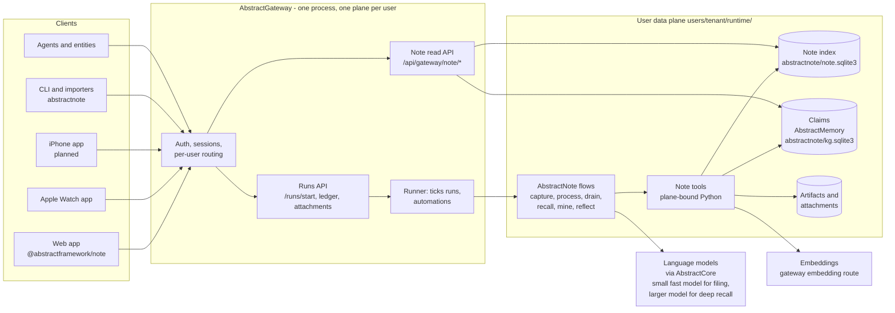
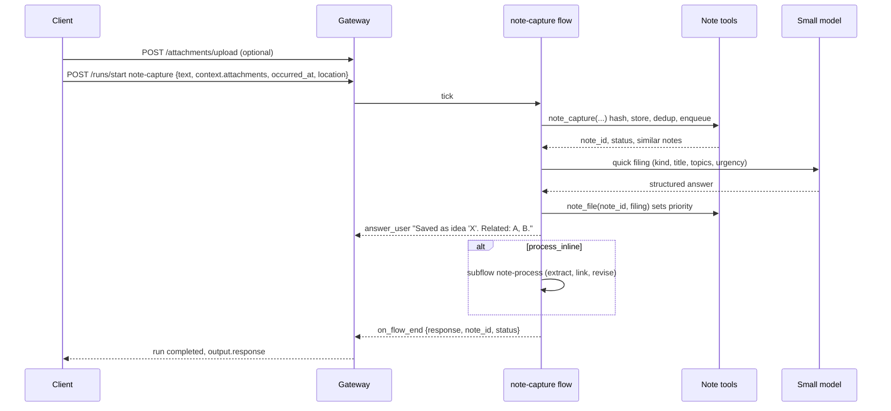

# Architecture

AbstractNote is one endpoint for everything you want to remember. You (or an agent) send a
note, a file, a photo, a recording or a log. AbstractNote files it with its time, place and
provenance, links it to what you already know, and keeps a **temporal semantic knowledge
graph** that you can search by effort level (quick, standard, deep) and revisit through time.

This page describes the system as it is designed and built. The data model is in
[data-model.md](data-model.md), the cognitive process (flows) in [cognition.md](cognition.md),
the HTTP, Python and tool surfaces in [api.md](api.md), the clients in [clients.md](clients.md),
and the recall design in [remembering.md](remembering.md).

## Principles

1. **Gateway-first, thin clients.** Every client (web, Apple Watch, iPhone, CLI, agents) talks to
   AbstractGateway. The gateway authenticates the caller and routes the request to that user's
   own runtime and data plane. AbstractNote never runs a server of its own.
2. **One user, one runtime, one notebook.** All AbstractNote state for a user lives inside that
   user's gateway data plane. Clients never send user, tenant or runtime identifiers.
3. **Flows are the cognitive process.** How a note is received, classified, linked, and how a
   question is answered is written as AbstractFlow workflows that run on AbstractRuntime. You
   can open them in the Flow editor. Python tools do the deterministic bookkeeping (hashing,
   storage, candidate lookup, graph writes); language models do the judgement (classify,
   extract, link, decide what changed).
4. **Eventual consistency.** Capture is immediate and durable. Understanding is queued and
   processed in the background, in priority order, by small fast models. The graph converges;
   nothing is ever lost while it converges.
5. **Models link, not regular expressions.** Entity and relationship normalisation and
   de-duplication are decided by a language model from candidates that deterministic lookups
   produce (aliases, full-text, vectors). Exact hashes de-duplicate bytes; everything else is
   judged.
6. **Append-only history.** Every change to the graph is a revision caused by a note. The graph at
   any past moment is the replay of revisions up to that moment. Facts are superseded, never
   overwritten.
7. **Claims live in AbstractMemory's format.** Every claim is a temporal triple assertion in an
   AbstractMemory store owned by the notebook, so memory tooling reads it with the framework's
   contracts (`TripleQuery`, `active_at`, provenance). Agents and entities reach note knowledge
   through the note tools and flows, which carry the effort level and the citations.
8. **Humans can act on the graph.** Tasks can be closed, claims retracted, merges undone, by the
   user; each such action is a revision with its own provenance, so the history stays honest.

## Components

### Clients

- **Web app** (`web/`): a browser app served by the gateway at `/apps/note/`, like the other
  framework apps. Four views: **Capture** (a chat where you send notes and attachments and get
  a filing answer), **Remember** (what changed, cue cards by category, ask by effort,
  then-versus-now), **Explore** (the graph: entities, relationships and themes, scrub through
  time, see what happened on a day) and **Processing** (what the notebook is doing with your
  notes, live: the queue and its pace, the notes being understood step by step, failures to
  retry, the helpers' health, and the consolidation with its progress, ETA and schedule).
- **Apple Watch app** (`watch/apple/`): dictate or type a note and send it, ask a quick question,
  see what resurfaced today. Shares the gateway client conventions of the AbstractAssistant
  watch app.
- **iPhone app** (`phone/iphone/`): planned; the folder holds the plan and the shared contract.
- **CLI** (`abstractnote`): capture from a terminal, import corpora (Claude Code sessions, an
  agora hub database, folders of Markdown, files), run the processor headlessly, search. It works
  on a notebook directory; gateway client mode is not available in this version.
- **Agents and entities**: use the same recall tools and flows, with the effort level as a
  parameter, so digital users search the same memory as humans.

### Gateway

AbstractNote adds three things to a gateway that has `abstractnote` installed:

1. **Flows**: the `abstractnote` bundle (capture, process, drain, recall, mine, reflect).
   Clients start them with the ordinary runs API. See [cognition.md](cognition.md).
2. **Plane-bound tools**: when the gateway builds a user's runtime it binds the note tools to that
   user's data plane, exactly as it binds `read_skill`. The tools are auto-approved because they
   only touch the caller's own notebook.
3. **A read API** under `/api/gateway/note/*` for the interactive views (graph, timeline, quick
   search, queue status). It resolves the caller's plane through the gateway's own service lookup.
   Writes that change knowledge go through flows; the read API only performs small bookkeeping
   actions that are themselves recorded as revisions (close a task, retract a claim, undo a merge,
   acknowledge an insight, retry a failed note, archive). Attachments uploaded through the gateway
   are capped by the gateway's attachment limit (25 MB by default); larger files enter through the
   `abstractnote import files` command on the machine that holds them.

The gateway side of this integration is a small, explicit change in AbstractGateway (an app
catalog row, the tool binding, the router include). It is listed in the backlog as the
`abstractgateway` seam.

### Data plane

Everything for one user lives under `<plane>/abstractnote/`:

| Path | Content |
|---|---|
| `note.sqlite3` | The note index: notes, attachments, queue, entities, aliases, claims index, relations, revisions, topics, tasks, insights, settings, full-text and vector indexes. Rebuildable from notes plus revisions. |
| `kg.sqlite3` | The AbstractMemory `SQLiteTripleStore` holding every claim as a temporal `TripleAssertion` (plus a journal). Readable with AbstractMemory's own contracts; private to the notebook. |
| `blobs/<sha256[:2]>/<sha256>` | De-duplicated attachment bytes (original files, images, audio). |
| `extracted/<sha256>.txt` | Text extracted from attachments (documents, transcripts, image descriptions). |

Why two stores: AbstractMemory models facts (subject, predicate, object, time, provenance) and is
shared with the rest of the framework. The note index models what AbstractMemory does not
(raw notes and bytes, the queue, entity records with aliases, relation statistics, revisions,
tasks, insights) and serves interactive queries in milliseconds. The revision log is the
authoritative history; both stores can be rebuilt from notes and revisions.

## Request lifecycle

### Capturing a note

### Understanding a note (background)

The **processor** is an automation per user that runs the `note-drain` flow on a schedule and on
demand. Each run leases the highest-priority queued notes and runs `note-process` for each:
look at existing knowledge (context packet), extract mentions and claims with a structured
schema, resolve each mention against candidates, let the model adjudicate (same entity, new
entity, merge, and whether a claim restates, refines or contradicts an earlier one), then apply
the revision to the index and the triple store. Failures are recorded on the note and retried
with backoff; after three failures the note is marked for the user to see.

### Remembering

- **Since you last looked** (read API): the default screen for humans and agents: what changed
  in the notebook since a cursor (new entities, superseded claims, closed loops, failed notes).
- **Quick** (read API, under a second): full-text plus vector search over notes, entities and
  claims, grouped by entity and time.
- **Standard** (`note-recall` flow, seconds): quick retrieval, graph expansion around the hits at
  the requested moment, one synthesis by a model with citations and a then-versus-now note.
- **Deep** (`note-mine` flow, minutes, background): the model plans sub-questions, searches across
  time slices, compares stances, and writes a dossier that is stored as an insight note with
  provenance, so the result itself becomes searchable.

The `note-reflect` flow runs on a schedule and surfaces open loops, contradictions, stale but
related material, and connections you may have missed, as insights.

## Dependencies and boundaries

| Package | Used for | Boundary |
|---|---|---|
| AbstractGateway | auth, per-user planes, runs, attachments, automations, app hosting | AbstractNote adds flows, tools, a router; it never bypasses gateway auth |
| AbstractRuntime | durable runs, VisualFlow compiler and executor, effect handlers, tool executor | flows use only catalog node types |
| AbstractFlow | authoring format, node catalog, editor | flows are importable and editable |
| AbstractMemory | `SQLiteTripleStore`, `TripleAssertion`, `TripleQuery`, `SQLiteJournal`, embedders | library use, plus one additive store method (`close_assertion`) that closes a superseded assertion in place |
| AbstractSemantics | predicate and entity-type registry for claims | predicates outside the registry are written in the `ex:` namespace |
| AbstractCore | model calls with structured output, embeddings, media text extraction | per-node provider and model pins |
| AbstractUIC | ui-kit, panel-chat, app-server for the web app | registry packages, semver ranges |

## Related documents

- [data-model.md](data-model.md): notes, entities, claims, revisions, time and de-duplication.
- [cognition.md](cognition.md): the flows, the queue, the prompts and schemas.
- [api.md](api.md): HTTP read API, Python API, tools, CLI.
- [clients.md](clients.md): web app, Apple Watch, iPhone plan, sign-in and isolation.
- [remembering.md](remembering.md): how recall is designed for humans and agents.
- [importers.md](importers.md): turning existing corpora into notes.
- ADRs in [adr/](adr/README.md); work items in [backlog/overview.md](backlog/overview.md).
