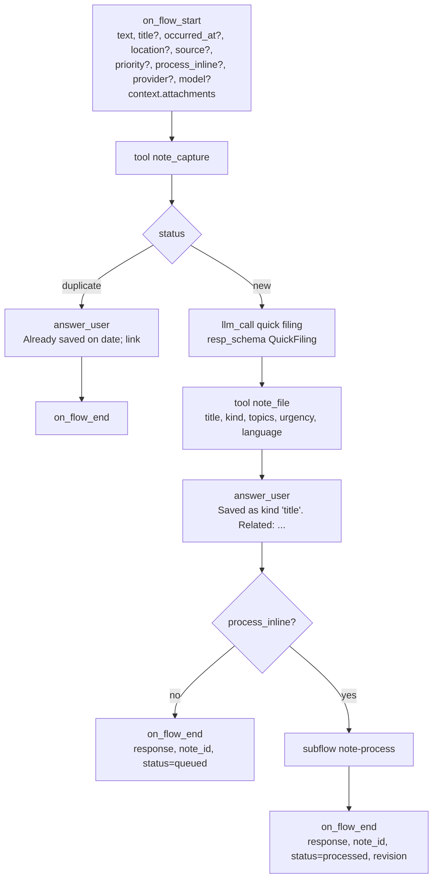
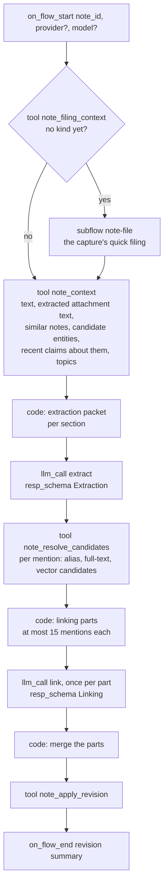
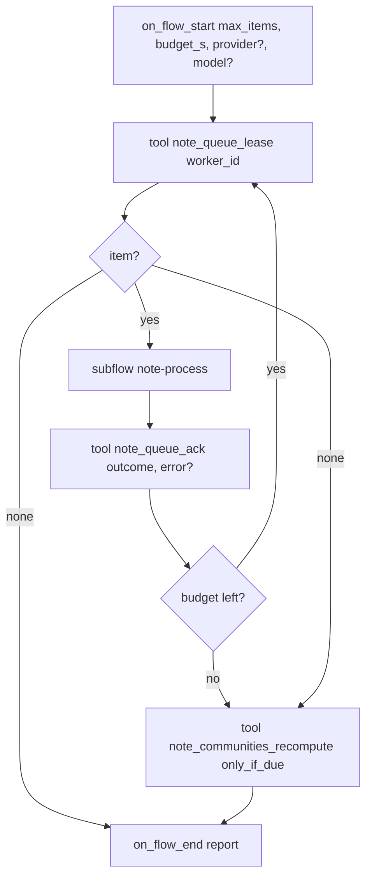
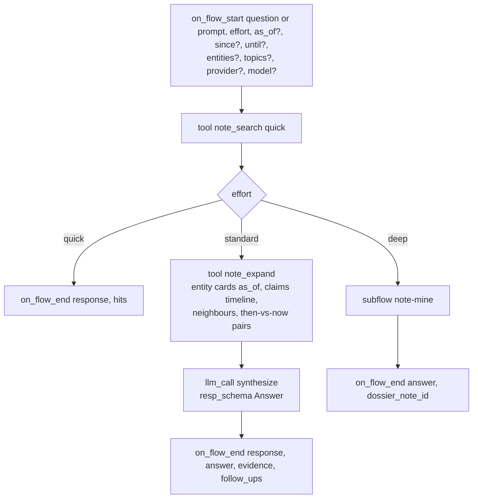

# Cognition: the flows, the queue, the schemas

AbstractNote's thinking is written as AbstractFlow workflows (VisualFlow JSON) packaged in the
`abstractnote` bundle. They run on AbstractRuntime inside the gateway, one durable run per
invocation, and you can open every one of them in the Flow editor. Deterministic work happens in
plane-bound **note tools**; judgement happens in `llm_call` nodes with structured output.

Flow sources are generated by `abstractnote.flows.build` (a Python generator in the style of
AbstractFlow's `wf_common`) into `src/abstractnote/flows/json/*.json`; the bundle is packed by
`abstractnote bundle`. Only catalog node types are used.

## The flows

| Flow id | Interface | Started by | Purpose |
|---|---|---|---|
| `note-capture` | `abstractnote.capture.v1` | clients, per note | store, de-duplicate, file quickly, answer, enqueue; optionally process inline |
| `note-process` | internal subflow | `note-capture` (inline) and `note-drain` | understand one note and revise the graph |
| `note-drain` | `abstractnote.drain.v1` | the processor automation, "Process now", the CLI | lease queued notes by priority and process them one at a time |
| `note-recall` | `abstractnote.recall.v1` and `abstractcode.agent.v1` | clients, agents, per question | answer a question at the requested effort |
| `note-mine` | internal subflow | `note-recall` (deep) | multi-step mining across time; writes a dossier insight |
| `note-reflect` | `abstractnote.reflect.v1` | a scheduled automation | surface open loops, contradictions, resurfaced material, connections |
| `note-consolidate` | `abstractnote.consolidate.v1` | the consolidation automation, "Consolidate now" | merge duplicates, understand again the notes an earlier note changed, refresh the groups and their names, stale summaries and then-and-now, then reflect |

Every flow exposes `provider` and `model` start pins. Blank means the gateway's default text
model. The processor automation carries the user's "filing model" (a small fast model is
recommended, for example `mlx-community/Qwen3.6-35B-A3B-4bit` on Apple silicon); the reflect and
consolidation automations and recall at standard and deep effort use the user's "answering model". The
automations take the models from the notebook settings when they are created.

### note-capture



- `note_capture` reads attachments from the run's artifacts (inside the gateway, only
  `{"$artifact": id}` references resolved through the host's artifact store; local paths exist only
  in headless use with an allowed root), hashes bytes and text, stores the note and blobs, extracts
  text from documents and transcripts, returns `status` (`new` or `duplicate` for a retried
  idempotency key), the revisited notes (same words earlier) and similar notes (vector neighbours),
  the existing topics, and enqueues the note with the requested or default priority. The bound tool
  stamps `source.account` with the plane's account at bind time; `session_id` comes from a start
  pin; clients send an `idempotency_key`.
- Quick filing is one small-model call with the `QuickFiling` schema (below). It sees the note,
  the similar notes' titles and the existing topic list, and returns a title, a kind, topics, an
  urgency and the language. `note_file` stores them and maps urgency to queue priority.
- The answer is delivered twice: as an `answer_user` message as soon as it exists (clients that
  stream the ledger show it immediately) and as `output.response` when the run ends (clients
  that poll the run read it there). `process_inline` is the client's choice: the web app sends
  its "Instant linking" setting (`process_inline_default`, off by default); the watch always
  sends `false` and shows the filing answer. The answer says where a date from a file came from
  ("Dated 2 July 2019 from the document."); the processed answer says it when the note's own text
  dated it, with what lost, in place of the capture's sentence ("Dated 5 March 2025 from the document; the file
  itself is from 20 March 2026.", data-model.md "Document dates"), and for a document of dated entries "A document
  of 4 dated parts, from ... to ...; each is read as a note of its own.". A note with nothing to read is refused by
  `note_capture`.
- **Nothing is understood twice** (ADR 0008 §8). `note_capture` with `process_inline` claims the
  queue row (`inline_run_id`, the capture run's id) in the same transaction as the enqueue, before
  the quick filing, so no drain leases the note while note-capture files and understands it; the
  outcome ends the claim either way: `note_queue_ack ok`, or, when note-process failed,
  `note_queue_ack error` with the child's sentence (a failed attempt in `queue_errors`, retried by
  the processor) and then the capture run ends with that sentence. See "Claims" under the queue.

### note-process



0. **Filing, when the note has none** (W27). Imports store notes without the quick filing a live capture gets
   (eval2: 985 of 988 understood imported notes had no kind and no filing topics). `note_filing_context` answers
   `needed` (no kind, not an insight, not archived, something to read) with what the capture's filing sees (the
   note's own text, whole, or its files' extracted text when it has none; the nearest notes by its stored vector;
   its recorded revisits; the topic names); `needed` runs the `note-file` subflow: the capture's own filing
   packet, prompt, `QuickFiling` schema and settings (one call, thinking off, 400 output tokens), then
   `note_file` with the kind, up to 4 topics, the title when the note has none, the language and the one line,
   never the urgency (the note keeps its place in the queue). A filing that fails fails the note (its sentence
   in `queue_errors`), never a silent skip. A note filed at capture goes straight on. The notes understood
   before this step existed are filed by `abstractnote refile --missing` (api.md "CLI") or `POST /note/refile`
   (the same repair on the gateway, each note one run on your runtime): the same `note-file`
   flow per note, oldest first, within `--max-items` and `--budget-s`, one `refile_runs` row per repair updated
   after every note (`done`, `filed`, `skipped` with each reason, `kinds`, `not_reached`) and closed
   `completed`, `completed_with_gaps` or `interrupted`, with one sentence of what is left (ADR 0007).
1. **Context** (`note_context`): what the notebook already knows that is relevant, **as of the note's
   date** (ADR 0008 §2; `as_of` = the note's `occurred_at`): the nearest notes, entities whose names or
   aliases appear in the text or whose embeddings are close, each as it was known then (its latest summary
   dated on or before that day, its statements believed then: observed by that day, or said by a later note
   to hold already then) and, apart, what was recorded LATER (statements and summaries of a later day), the
   open tasks that mention them, and the topic vocabulary. A note written after everything sees no LATER part
   at all. It also returns `context`, the digest of what the note is understood against
   (`{as_of, entities, claims, summaries, later_claims, omitted}`: the entity ids and claim ids shown, the
   revision of the summary shown for each entity, the later claims offered, and per entity what the linking
   cards' budget left out); `note_resolve_candidates` adds its candidates to the same digest, which the packet
   row keeps and the built revision carries (`context`, ADR 0008 §3, next to `used`: the entities, statements
   and tasks the revision's ops resolved to, `revise.used_of`). This is the "look at the existing knowledge"
   step.
2. **Extract** (`Extraction` schema), once per section: summary, mentions (name, kind, aliases
   seen, role in the note), claims (subject, predicate, object, literal flag, certainty, stance,
   evidence excerpt, optional validity dates), tasks (opened, completed), time references, and
   topics. The model sees the section's whole text and a bounded orientation packet (see
   "Prompts and bounds"); the predicate vocabulary from the AbstractSemantics registry is in the
   static system prompt and `ex:` is allowed for the rest. **Moments** (W30): when the header says the note's
   date is approximate or from the file's metadata and the text is a sequence of separately dated entries (a
   diary, a journal, a log of dated moments), the section's answer also lists them (`moments: [{heading, date,
   basis: "stated in the text", text_span}]`, `text_span` the exact words the entry begins with); the model
   decides, no rule reads the text for dates. The merge step concatenates the moments of every section in order.
   When the note may be split (data-model.md "Dated parts": a document, not a part, not `no_split`) and at least
   two entries are found in its words (`process/split.py` `split_plan`, the same source in the flow's "Dated
   parts?" node and in the apply step), note-process skips steps 3 and 4 and the apply step splits the document
   into a container (kind `archive`) and one note per entry, each queued and understood as a note of its own in
   history order (a part's header says "(one dated part of the document “...”)"). Otherwise the moments are
   ignored with a warning saying why (asked to keep one note, a part already, not a document's date, only one,
   not found in the words, a date that is not one), and the note is read as one note.
3. **Resolve candidates** (`note_resolve_candidates`): for every mention, up to three existing
   entities with their kind, aliases, summary and statements as known on the note's date, their LATER
   block, last seen date and how they matched (`matched_by`, and `match`: `alias` when the mention's name or
   an alias has the canonical name key of the entity's name or one of its aliases). An alias match is always a
   candidate, past the three if need be (ADR 0008 §6), and the packet records it (`alias_matches`). Each
   mention carries the predicates of the note's statements about it (`predicates`, from the merge step): every
   statement of a candidate on those predicates, believed then or LATER, is in the packet (indexed, so the
   linking can name it), whatever the per-card count; the others fill the card up to its bound, those whose
   predicate shares a word with the note's first (a ranking only, never a decision).
4. **Link** (`Linking` schema), once per part of at most 15 mentions: the model decides, per
   mention, `reuse` (a candidate index), `create`, or `merge` (two candidate indexes); per
   claim, whether it `restates` an existing claim (reinforce; for a LATER one, its start moves back to the
   note's date), `refines` it (new claim, old stays active), `supersedes` it (close the old one),
   `contradicts` it (both stay, marked disputed) or is `earlier_state_of` a LATER one (the same kind of
   fact with the value it had before: placed before it, never closing it), naming the existing claim by its
   `#` index in the packet (the index decides, whatever the predicate is called: a statement linked this way
   to a statement of the same subject under another spelling adopts the existing predicate); per task, open or close by index, quoting
   the note's words that say it is done (`evidence`).
   Each part carries the claims whose subject is one of its mentions (the first part also the
   tasks and the open tasks they may close); claim, task and packet indexes stay those of the
   whole note, so the parts merge back into one Linking without renumbering. The schema uses
   indexes and enumerations rather than free-form ids so that small models cannot invent
   identifiers; `note_apply_revision` rejects any reference outside the packet and downgrades it
   to `create` or `new` with a warning. The model also writes the revision summary and a
   summary for each entity it creates and for each reused entity whose description the note
   changes: what the entity is on the note's date (see "Prompts and bounds"), never an event. A missing summary is never a failed note: a created entity gets one
   built from its role in the note (or where it was seen) and a reused entity keeps its current
   summary, each with a warning in the revision.
5. **Apply** (`note_apply_revision`): checks the decisions structurally, then writes the revision ops to the
   index and the triple store in one transaction per store, updates relations, topics, tasks, embeddings, and
   marks the note `processed`. The checks (data-model.md "Identity and de-duplication" and "Time"): a merge applies
   only with the same kind, a shared name or alias key, fewer than 5 notes on the merged entry and one merge per
   entry per note (else a close match for review); values (numbers, versions, ids, links, tokens, the generic
   words list) are literals, never entities; `supersedes`/`contradicts`/`earlier_state_of` only on the same resolved subject (the named
   statement's predicate is adopted when the spelling differs, `predicate_adopted`); time-aware placement: a
   note older than the statement it supersedes, and a statement `earlier_state_of` a later one, is inserted
   before it as the earlier belief (`claim.insert_before`), never closing it; an older note restating a belief
   moves its start back (`claim.start_earlier`); a task closes only with the note's own words and never
   from an older note; a stated `document_date` redates a note when it beats the note's date evidence (`note.redate`
   with `from_basis`; W30 `dates.PRECEDENCE`: the file's metadata or a stand-in, never a person's date nor the
   moment the words were written); a document of dated moments is split instead (step 2); no window
   ends before it starts. A note older than what is known about an entity marks it (stale summary, then-versus-now
   dropped, `graph_version`) for the consolidation. The response lists created and merged entities, claims added and superseded, and
   any warnings (unknown predicates mapped to `ex:`, unresolved references, missing summaries).

Large notes: `note_context` splits texts beyond the model's budget into sections; `note-process`
loops over sections for extraction and merges mentions and claims before linking, so no text is
ever truncated.

**Validity of model answers** (ADR 0008 §8, `process/validate.py`). A structured answer can parse and still be
corrupt: the structured-output lane of a remote model spills the rest of the answer into a string field
(`...approved by the board.","reason":"same organization","aliases":["Zorn Labs"]},{`), loses decisions, or
answers `reuse` with no candidate. An answer is invalid when:

- a prose field (`summary`, `reason`, `revision_summary`, `name`, `aliases`; in an extraction also `role` and
  `topics`) holds a fragment of the answer's own structure: one of the schema's field names closed by `":`
  (`reason":`, `"aliases":`), or a closing quote followed by a closing brace or bracket and then a comma, another
  closer or the end (`"},{`, `"]}`); a fragment that appears verbatim in the note's words (or, for a linking, in the
  extraction it links) is the note's, not a corruption. Fields that quote the note (`evidence`, `quote`, a literal
  object, a task's text, a time reference) are never read, so a note about a JSON API is never refused;
- a decision names no candidate from its list (`reuse` or `unsure` without a candidate index of that mention,
  `merge` without two of them) or decides a mention the note does not have. Until 2026-10-20 such a decision was
  applied in part (the mention was created as new with a warning); it is now invalid;
- an index is answered twice in contradiction: a mention with two decisions, a statement with two relations or
  once naming an existing statement and once none, a task once closing an open task and once none (null, an
  empty string and an empty list are the same absent value). One statement linked to several existing ones with
  the same relation (or one task closing several) is valid; the first link is applied and the others are named in
  a `multi_link` revision warning ("multi_link: statement 0 was linked to 2 existing statements; only the link to
  #3 (supersedes) was applied, the link to #5 was not."), never dropped silently (ADR 0007).

note-process checks every extraction (per section) and every linking (per part) in a code node that runs the very
source of `validate.py`: an invalid answer is asked once more with a fresh call (a linking: the same message
followed by what was wrong, "Your previous answer to this message could not be used: ...", since the bare message
again gave the same answer in 5 of 7 live retries; an extraction shares the re-read of a section that names
nothing); a second invalid answer ends note-process with its sentence ("The model's
linking answer was malformed twice (the summary of “Zorn Labs” holds a piece of the answer's structure
(reason":)); nothing from it was applied."), which the drain acknowledges as a failed attempt (`queue_errors`,
the usual backoff and three-failure rule). `note_apply_revision` checks the merged answers again and refuses an
invalid one with the same sentence, so nothing of a corrupt answer is ever applied in part, whoever calls it.
The known source (2026-10-20, OVH `gpt-oss-120b` with AbstractCore's native `response_format: json_schema`): the
server's constrained decoding writes an object's properties in alphabetical order and lets the model skip the
optional ones, so a `reuse` written before its `candidate` loses the candidate, and a `reason` the model wants after
`summary` (the last key) can only go inside the summary string. With every property listed as required (optional
ones nullable) the same calls came back sound (6 of 6 notes, no retry). Measured on the 2026-10-20 ledgers
(gw18080, read-only): retro-B 14 of 27 link answers invalid (3 fragments, 11
candidate-less reuses, 2 contradicting duplicates), retro-A 17 of 23, the watch 0 of 10, the 1,000-note import 12
of 1,446 (0.8 %); no extraction answer invalid (0 of 1,495); no fragment found in a quoted field.

### note-drain and the queue

The queue lives in the note index (`queue` table): `note_id, priority, enqueued_at, leased_by,
lease_until, attempts, last_error`. Ordering is `priority desc, occurred_at asc, size asc`.



- **Themes at the end of the batch** (ADR 0008 §5). Any ingest can change the groups, so every drain ends
  with `note_communities_recompute {only_if_due: true}` (`recall.communities.refresh_if_due`): the
  communities are found again (no model) when the batch made them due (`communities.due`): never computed
  yet (and at least 3 live entities), at least one note dated earlier than what was known applied since the
  last computation (`DUE_RETRO_NOTES = 1`, the retrospective marks of data-model.md "Retrospective
  insertion"), a note understood again (`note.reinterpret`) since then, or `DUE_REVISIONS = 20` revisions
  applied since then (or `DUE_REVISIONS_SHARE` = 10 % of the revisions at the last computation, when that
  is more). "Since" is counted on the revision log's sequence (`seq_at_compute` in `meta.communities`).
  Imports only queue their notes, so the drain that understands an import batch is where it ends. Naming
  stays with the consolidation: a recompute keeps the label of every group that changed little and marks
  stale the ones whose membership moved, and the drain's answer says what naming will cost:
  `communities: {recomputed, due, reasons, revisions_since, retro_notes_since, reinterpreted_since,
  labels_waiting, label_calls, ...the recompute counts}` (`revisions_since` = what made it due, counted
  before the computation; `label_calls` = groups waiting for a name / 5). The response adds "The themes
  were updated (4 groups, 2 to name next time)." A failure is said in the response ("The themes could not
  be updated: ...") and does not fail the drain or undo its notes.

- **Claims.** A note being understood outside a drain carries a claim on its queue row: `inline_run_id`
  (note-capture with `process_inline`) or `reinterpret_run_id` (the re-understanding stage), each with its
  `*_until` time. `note_queue_lease` never leases a claimed note; a note leased by a drain, or claimed one way,
  cannot be claimed the other way (`Queue.claim` answers false). A claim ends with the outcome (`ack`) or
  `Queue.release`; `Queue.heartbeat` (called by `note_file`) moves its end on. The reinterpret stage claims each
  note BEFORE anything reads it again (`note_reinterpret_next`; the no-call check writes the note's context
  packet, so it runs only under the claim). A note a drain or an inline understanding holds is held alone with
  "Being understood at this moment by another reading; read again next time." (code `held_by_inline`,
  `held_by_drain` or `held_by_reinterpret`) and its mark waits for the next pass; the stage goes on with the next
  note. The apply of the re-reading releases the claim (a failure the next round reports releases it too). A claim
  whose run died is leasable once `CLAIM_S` (15 minutes, as a drain's lease) has passed since its last heartbeat:
  the next lease clears it and logs "Understanding it right away stopped before it finished; it is understood from
  the queue instead." in `queue_errors`, not counted as a failure.
- A lease lasts 15 minutes. Acknowledging a failure increments `attempts` and schedules a retry
  (after 1 minute, then after 10 minutes); the third failure sets the note to `failed`, visible in
  the web app's queue panel with the error, and offers a manual retry. A note with no text to read (no words,
  no title, no extracted file text: `process.context.note_sections` finds no section; note-process stops with
  "The note has no text to read.") fails at its first failure: `note_queue_ack` checks the stored note, records
  the reason in `queue_errors` and `last_error` and sets it `failed` at once, since no retry can give it text.
- **The notebook changed while a note was read** (review 4.1, ADR 0008 §5). A reading that would replace a
  statement closed by a revision recorded after the note's context packet was stored (a person retracted it, a
  re-understanding closed it) is not applied when a drain holds the note: `note_apply_revision` answers
  `{revision_id: null, requeue: true, reason, stale_context}`, the drain acknowledges `requeue`, and the note goes
  back to the queue once, at its priority, available at once, no failure counted, "The notebook changed while
  this note was being read (a statement it builds on was closed meanwhile); it is read again." in `queue_errors`
  and `last_error`. The next reading builds a fresh packet; if it is stale again it is applied (its statement kept
  as new, with the warning): a note is put back at most once (`Queue.requeued_stale`). The drain's answer lists it
  under `requeued` and says "1 note is read again: the notebook changed while it was being read." An inline
  understanding (not leased) applies with the warning.
- An expired lease (the drain stopped, for example on a gateway restart) is not taken over at once:
  the next drain that leases counts it as a failure ("Processing stopped before it finished.") with
  the same backoff, and a drain retakes the note once that backoff has passed. It counts toward the
  same three failures, so a note whose processing is cut off three times (three restarts during
  the same long note) becomes `failed` and waits for a manual retry.
- **The processor automation.** `POST /api/gateway/note/processor/ensure` (the web app calls it
  when it opens and an automation is missing or unhealthy) creates two automations per user, idempotently: the processor
  (trigger `schedule@2` every `2m`, flow `note-drain`, `max_items = 20`, `budget_s = 90`) and the
  reflect automation (every `7d` by default, flow `note-reflect`), each with
  `_runtime.allowed_tools` listing the note tools. The processor's first drain runs at creation
  (an empty queue completes without a model call); the reflect automation's schedule starts one
  interval after creation (`start_at = now + every`), so opening an empty notebook never starts an
  answering-model call. "Reflect now" is the same `run_now` command sent to the reflect automation
  (`POST /api/gateway/automations/{reflect_id}/commands` with `{"command_id": "<uuid>", "type":
  "automation.run_now"}`).
  Automations run occurrences serially and coalesce missed ticks, which gives the queue exactly
  the eventual, ordered consistency it needs without a gateway worker. "Process now" sends the
  automation's `run_now` command; a `409 automation_busy` answer means a drain is already running
  and the queue panel says so. Steady-state throughput is at most `max_items` per interval.
- **Surviving an upgrade.** An automation runs one concrete workflow version: the gateway resolves
  `bundle_ref: "abstractnote"` to the latest loaded version when the automation is created and
  stores `abstractnote@<version>:note-drain` in its definition, and the runtime starts exactly that
  id at every occurrence. There is no "latest" target (AbstractGateway 0.15.11,
  `routes/automations.py` `_resolve_target`), and the gateway serves only the installed version of
  the note workflows, so after an upgrade and a restart the old automation's next occurrence fails
  ("Workflow 'abstractnote@0.1.0:note-drain' not found in registry") and the queue stops draining. A
  revision of the target cannot fix it either: a failed automation accepts only `archive`.
  The same holds for the tool list: the automation's run input freezes `_runtime.allowed_tools`
  at creation, so a tool added later (`note_communities_recompute` in reflect) is refused at its
  step ("Tool ... is not allowed for this node or run").
  So `processor/ensure` repairs: it keeps an automation that is active or paused on the served
  version with exactly the current tools (`abstractnote.tools.TOOL_NAMES`); any other one (another
  version or tool list, failed, completed, archived, gone) is archived (its
  history stays) and replaced by a new automation built from the current settings
  (`processor_schedule`, `reflect_schedule`, the models), under the next request generation
  (`abstractnote-processor-<n>`) so the replacement is a new automation, never the failed one. A
  paused automation's replacement is paused again (its first tick one interval out, so no drain
  runs before the pause lands). `GET /note/status` and `GET /note/queue` report each automation's
  health (`automations.processor` and `.reflect`: `{id, state, target, healthy, reason, paused}`);
  the web app repairs on load when one is unhealthy, and its queue panel shows "Processor needs
  repair." with a Repair button. Without the note workflows loaded, `ensure` answers 503 and
  archives nothing.
- **No approval waits.** Inside the gateway the note tools are added to the tool approval
  auto-approve set when the runtime is built, so a capture never parks on a tool-approval wait.
- **Priority**: `3` urgent and `2` high come from the quick filing step (tasks with deadlines,
  warnings, anything the user marks urgent); `1` normal is the default for interactive capture;
  `0` bulk is used by importers so that live notes always go first.
- **Concurrency**: one occurrence at a time per user; the gateway's own runner limits concurrent
  ticks across users. Local models serve requests one at a time, so serial processing is also
  the fastest total throughput on a single machine.

### note-recall

`note-recall` also serves the `abstractcode.agent.v1` chat contract: it accepts `prompt` as an
alias of `question` and always returns the answer text on the `response` output pin next to the
structured pins, so a chat client that polls `output.response` shows the answer.



The `Answer` schema returns the answer text with inline citations `[nt_...]`, the evidence list,
what changed over time about the subject (earliest stance, latest stance, turning points with
note ids), open loops related to the question, and suggested follow-up questions. Clients render
citations as links to notes.

### note-mine (deep)

1. `llm_call plan` (`MiningPlan` schema): sub-questions, time slices, entities to trace,
   contradictions to test, a budget of search rounds.
2. Loop over the plan: `note_search` and `note_entity` for each item, `llm_call findings` per
   slice (`SliceFindings` schema: facts with citations, changes, gaps).
3. `llm_call dossier` (`Dossier` schema): narrative, timeline of the subject, how the view evolved,
   contradictions, forgotten items worth revisiting, suggestions, and a confidence statement.
4. `note_insight_write` stores the dossier as a `synthesis` note with provenance (the run id,
   the evidence notes, the entities), so the result is itself searchable and revisitable.

### note-reflect

Runs from a scheduled automation (default weekly, configurable); its first occurrence is one
interval after the automation is created, and "Reflect now" (`automation.run_now`) runs it at once.
A failed occurrence is retried by the automation (up to 3 attempts). Deterministic tools produce
candidates; the model judges and writes:

| Tool | Candidates |
|---|---|
| `note_open_loops` | open tasks last mentioned more than 14 days ago (or revisited at least twice), questions never answered |
| `note_contradictions` | disputed claim pairs only (a note's `contradicts` decision); a subject with several current objects of one predicate is never a candidate, since processing records no single-valued predicates |
| `note_resurface` | entities and topics active before but silent for N days that relate to recent notes |
| `note_anniversaries` | notes from the same day in previous months or years |

`llm_call reflect` (`Reflections` schema) selects what deserves attention and writes each item
as an `insight` note (`warning`, `reminder`, `connection`, `contradiction`, `evolution`). The
web app's Remember view and the watch's Today screen show unacknowledged insights.

A cue is said once until you acknowledge it (`abstractnote.recall.reflect`, data check D5). A
candidate whose provenance (the notes and entities an insight written from it would cite) already backs
an unacknowledged insight is not offered again; `note_insight_write` returns that insight as a
`duplicate` when another of the same kind about the same notes and entities is written, however it is
worded. An age counts from the LAST mention of the subject: a task from its note or the latest note that
revisits it. A date that is only an approximation (`date_basis` `git_added`, `bulk_commit`,
`file_mtime`, `store_updated`, `last_record`, `front_matter_modified`; importers.md "Dates") never ages
anything: such a task or question is not offered as old and is never `stale` (the tasks view too), an
entity or topic whose last mention is so dated is not offered as gone quiet, and such a note has no
anniversary. A run writes at most 3 insights of one kind (`REFLECT_PER_KIND`) and one per candidate.

Then the flow refreshes the communities of the graph and names them (backlog 0030):
`note_communities_recompute` runs Louvain over the entity graph without a model (data-model.md
"Community"); `note_communities_pending` lists up to 5 communities with a stale label or without one
(stale labels first, so every reflect names them again however many new groups wait; then the largest),
each with its top entities, its strongest statements and 3 representative notes; when the list
is empty the run ends there (no model call); otherwise ONE `llm_call` (`CommunityLabels` schema,
thinking off, at most 2048 output tokens) names them all by index, a code node maps each index back to
its community (an index the list does not have is dropped), and `note_communities_label` stores the
names. The run's output adds `communities_labelled` (the number of communities named). The step's
static system prompt and template live in `abstractnote.recall.communities` (`LABEL_SYSTEM_PROMPT`,
`LABEL_TEMPLATE`), next to the schema. `POST /note/communities/recompute` runs detection alone.

The edges detection weighs are the statements between two entities plus their co-mentions: a note
that mentions `k >= 2` live entities adds `1 / ((k - 1) · log2 k)` to every pair among them
(`communities.co_mention_share`). A two-entity note adds 1 to its pair, like one statement; a note's
total co-mention weight is `k / (2 · log2 k)`, so a 200-entity note counts about 13 times a
two-entity note, not 100 times as the flat `1 / (k - 1)` share made it. A single long note therefore
no longer forms a community on its own unless its own statements hold its entities together. On the
operator's notebook at revision 373 (networkx 3.6.1) the change took the communities from 21 to 35,
the loose ends from 2 to 4 and the modularity from 0.606 to 0.667; the two largest communities made
mostly of one note (237 and 232 entities, 87 % and 88 % from it) became one (170 entities, 84 %, the
note whose statements link its 137 own entities) and smaller groups.

### note-consolidate (memory consolidation)

Runs from a third scheduled automation, `consolidate` (backlog 0032; interface
`abstractnote.consolidate.v1`): the `consolidate_schedule` setting gives its interval (`{"every": "1d"}` by
default; `12h`, `7d` and any number of hours or days are accepted; `off` keeps it paused), its first
occurrence is one interval after creation, and "Consolidate now" (`automation.run_now`) runs it at once. It
keeps the notebook's derived memory fresh, in stages, each reporting its progress:

| Stage | What runs | Model |
|---|---|---|
| `normalize` | `note_entities_normalize`: the entries that share a canonical name are merged (`Notebook.normalize_entities`, one reversible revision per merge) | none |
| `reinterpret` | loop (ADR 0008): `note_reinterpret_next` (1) -> the `note-process` flow as a subflow for that note -> the next, until no marked note is left for this pass or the budget is spent (below). Two tiers, each in history order: the notes marked directly (they used what changed) and those marked because an idea they rely on changed deeply with an impact of at least 0.25 first, then the weaker ones (§4a, data-model.md "Deep changes reach the ideas that relied on them"); a re-reading that changes an idea deeply marks, one hop further, the later notes of the ideas that rely on it, and they are read in the same pass | as note-process, per note read again (0 for a note settled unchanged) |
| `communities` | `note_communities_recompute` (as in note-reflect) | none |
| `labels` | loop: `note_communities_pending` (5, `exclude` = the groups skipped this run) -> the reflect naming step (`CommunityLabels`, by index; asked once more when a group is left out) -> `note_communities_label`, until none waits that was not skipped, or the budget is spent | 1 call per 5 groups (2 when the first answer leaves one out) |
| `summaries` | loop: `note_entities_stale_summaries` (8) -> `llm_call summaries` (`EntitySummaries`: `[{index, summary}]`; `summaries_again` when an entry is left out or empty) -> `note_entities_set_summaries`, until none is stale that was not offered this run, or the budget is spent | 1 call per 8 entries (2 when the first answer leaves one out) |
| `then_now` | `note_then_now_refresh`: the then-versus-now cache of every entry this run merged into or summarised | none |
| `reflect` | the note-reflect flow as a subflow (open loops, tensions, resurfacing, anniversaries -> insights; its naming finds nothing left) | as note-reflect |

Summaries are dated knowledge (ADR 0008 §2). Each summary describes the entry as of a date (`at`: the
date of the note that wrote it), the summary history is ordered by that date and then by the revision log
(`store.notes.SUMMARY_ORDER`), and the CURRENT summary (`entities.summary`, the card) is the last one in that
order, never the one written last: a 2022 archive processed after the 2026 notes keeps its 2022 summary in
the history and leaves the card to 2026. A summary written by an interpretation of a note that a later
re-interpretation of the same note superseded (`note.reinterpret`, ADR 0008 §1) is out of the history and
is never current (`store.notes.summary_superseded_sql`); applying the re-interpretation selects the current
summary of the entries it described again (`refresh_superseded_summaries`). As received before the
re-interpretation, the old summary is still what the archive held.

A summary is stale when it is empty, when it is still the placeholder an entry was created with (the
revision builder recorded "No summary was written for <name>; it was described from this note." and no
summary was written since), when a note dated earlier than what the notebook knew of the entry was applied
after its current summary (`retrospective`: `Notebook.retro_state()["stale_summaries"]`), or when a note
mention or a statement about the entry (or an entry merged into it) was recorded by a revision after its
CURRENT summary's revision (`changed`; a statement its own note's re-interpretation closed is not counted).
They are refreshed in that order (empty and placeholders, retrospective, then the most changed). Nothing
reads the summary's wording (ADR 0004). Each entry handed to the model carries its name, kind, other names,
current summary, `as_of` (the date of its latest note), its strongest statements that hold now in words
with the date each started (at most 8; among equals the most recent first), its dated history earliest first
(`history`: the summaries of earlier dates, the earliest and the 5 latest; `earlier`: statements that held
from one date until another and ended, the earliest and the 7 latest) and 5 note excerpts, newest first: up
to 3 the current summary does not account for yet (mentioned by a revision recorded after it, marked `new`,
even when dated earlier: an older project's notes are what the entry must absorb), then the newest note, the
earliest one and the newest of the rest, with `omitted: {claims, notes, history, earlier}` counting
what the selection left out (shown to the model when not zero); the prompt
(`process/prompts/entity_summaries`) asks for at most two sentences, third person, present tense, what the
entry is now having been what its history shows, nothing the message does not say. The answers are mapped
back by index. Nothing stops or is left out
silently (ADR 0007, the incident of 2026-10-20 where one empty answer ended the stage as "completed" with 536
summaries stale): a round whose answer leaves out an offered entry or group (or answers it empty) asks once
more with the same prompt; what is still unanswered is skipped for this run (reported with the round's
`note_consolidation_progress(..., skipped, reason)`, logged on `abstractnote.consolidation`, recorded on the
stage) and never offered again in the run, and the loop goes on. A summary over 600 characters or a label over
4 words is kept whole with an `over_length` warning. At the close, `note_consolidation_end` reports `left_out =
{summaries, labels, reasons}` (the skipped items still pending, plus what the budget did not reach:
`budget_spent`, `not_reached`) and closes the run as `completed_with_gaps` when anything was left out; the
run's answer then reads "Consolidated with gaps: …" followed by the end-user notice ("12 summaries could not be
refreshed this time; they will be tried again next time."). Each round's summaries are one
revision (`action: entity.summary`, `run_id` = the consolidation id, source client `consolidation`), each op
dated `as_of` = the entry's latest dated knowledge (its last mention, or its current summary's date when
later): the new summary is current until a note dated later writes one, and a note dated between that
knowledge and the consolidation is never hidden behind it. The summary history keeps every version and a
rebuild replays it.

**Re-understanding** (stage `reinterpret`, ADR 0008; the records and marks are in data-model.md
"Re-understanding"). A note understood without its foundation is understood again when the foundation
arrives: when a note is applied, the later notes whose current interpretation USED what it touched are candidates,
and the activation gate (below) marks those on which what it measurably changed weighs enough (with the reason and
the note that caused it); this stage reads them again. `note_reinterpret_next` takes
the pending marks of the open consolidation in history order (date, then received time, then id), each note at
most once per pass (a mark that arrives for a note the pass already read waits for the next pass). Before any
model call it runs the no-call check: the note's context is looked up again (the same `note_context` and
`note_resolve_candidates` lookups, with the mention names its last reading asked) and compared with the
dependency record of its current interpretation, on what was known at the note's date (the entities, the
statements and similar notes recorded on or before it, the summaries written for a date on or before it), leaving
out what that reading itself wrote; equal: the note is `unchanged`, its mark is consumed and no model is called.
Otherwise the note goes through `note-process` (filing is not repeated; a note without a kind is filed first): its context leaves out its own previous
reading (its statements and tasks) from the known-then and LATER cards and shows again what that reading had closed.
The previous reading is shown on its own instead, FIRST (W29, retro-C §2): `note_context` gives `note.previous_reading`
`{claims: [{index, claim_id, subject, predicate, object, certainty, valid_from, valid_until, ...}], entities: [{entity_id,
name, kind}]}` and keeps the claim ids in the packet (`previous_claims`); the extraction packet's `known` starts with
"This note was previously understood as (its own earlier reading; a statement this text makes again keeps the same
subject and the same predicate as written here):" and the extraction prompt says to keep the predicate written there;
the linking message carries the block `{{batch.previous}}` before the mentions and their cards, its statements
numbered `P0`, `P1`, ... (`P0 Zorn Labs ex:annual_budget “40k” · stated (since 2025-02-05)`), empty (no bytes) on a
first reading. The linking names a statement read again with `same_statement_as_previous` (`existing` = its P
number): it stays that statement, the same claim id and predicate, revised in place when its value, certainty or window
changed (a statement the model now spells `ex:budget_cap` stays `ex:annual_budget`, warning `predicate_kept: a -> b`);
a number outside the list, another subject or another kind of value (an entity against a text) is refused with a
warning and the statement is new. A statement that now relates to another note's statement in a way the previous
reading did not takes that relation instead (its predicate follows the statement it names, R1's adoption). The
previous statements the new reading does not make close as `reinterpreted`, as before. The apply sees that the pass took
the note's mark and builds a `note.reinterpret` revision (or records `unchanged` when the new reading's statements,
mentions, tasks and topics equal the old ones; summaries alone do not count; what this re-reading saw, `related`
included, is appended to `reading_confirmations` for the current reading, never written into the revision, so the
next wave from the same unchanged idea needs no call). A re-understanding marks only
notes after it in history order, so a pass is one forward sweep and ends; a second pass with no new earlier note
has no mark to read and calls no model. A note read again three times in one UTC day waits for the next day
(`REINTERPRET_PER_DAY`, held with "Already understood again three times today; read again tomorrow.", code
`held_today`). A note that cannot be read again (the model fails), or whose preparation raises (code `error`, its
claim released), is skipped for this run with its reason (the W26 shape: `stages_json.reinterpret.skipped_ids`,
each with its `code`, a warning on the `abstractnote.consolidation` logger), its mark waits (with the sentence as
its `error`, readable as GET note `reinterpret_error` and `reinterpret.errors`) and its previous interpretation
stays current; the stage goes on with the next note: one note never fails the batch. The time budget stops the
stage before it takes the next note: what is left is `results.not_reached.reinterpret`. The close reports
`reinterpreted`, `unchanged` and `reinterpret_failed` (read from the marks), and `left_out.reinterpret` = the notes
this pass took and left (held, failed: read from the marks, the truth, besides the stage's skip list) still marked
plus what the budget did not reach, with `left_out.reinterpret_reasons` (`[{reason, notes}]`); a run that left notes
is `completed_with_gaps`, its row keeps the causes (`last.why`) and its notice says why: "35 notes could not be
understood again this time; they will be read again next time. Why: Already understood again three times today;
read again tomorrow (35 notes)." (F6, W31: before, the per-day holds never reached the skip list and such a run
closed `completed` with `reinterpret_failed 35` and no notice.) The progress line reads "Re-understanding 12
notes" (web: "Re-understanding 3 of 12 notes"); `GET /note/consolidation` `pending.reinterpret` gives the count
before the run, and `consolidation.state(nb)["reinterpret"]` the count by entity, the reasons, and the gate's
record (`candidates`, `marked`, `top_sources`, `would_mark_at`); the pending line reads "12 notes to understand again
(3 sources: Zorn changed its kind, Mira is described differently and 1 more; at most 4 more may follow)" and the
progress line "Re-understanding 12 notes (3 sources: ...)".

The activation gate (AbstractMemory ADR 0001 rules 7-8; data-model.md "The activation gate"). A candidate is not a
mark. Right after a reading is applied, `recall/activation.py` measures what it changed about each entity a
candidate used (retired or joined, its summary against the previous one, the share of its statements and of its
relations it changed; for a first reading as of the reading itself), divides that by the entity's mass (`(1 +
supporting notes) ** 0.5`: a hub needs much more than a thin idea, except a kind change, which weighs 8), weights it
by how much the candidate relies on the entity (the share of its own statements about it; a bare mention weighs a
tenth of a statement) and by how many notes used the entity in between, and adds it to what earlier readings left
open on that candidate. The sum goes through a logistic gate (`k = 6`, `θ = 0.5`); the candidate is marked when the
gate reaches 0.1 (a potential of 0.134). Every decision is recorded (`gate_decisions`) with its potential, gate and
sources, and `GET /note/consolidation` shows the candidates, the notes marked, the sources and how many `θ x 0.8` or
`θ x 1.2` would mark, so the dials are tuned from the record. When a marked note is read again, the edge that marked
it conducts a quarter less if nothing changed and a quarter more if something did (never under 0.25). A new entry
created apart from an existing one whose exact name or alias it carries (a close match kept for review) puts the
existing one's identity in question: a kind-class change on it, divided by its mass, so the notes that say anything
about a thin idea are read again with both entries shown side by side ("another entry with this exact name exists:
..."), a hub's only when they rest on it; confirming the two the same in review merges them, keeping them apart
clears it. On the
operator's 1,000-note notebook the two Mnemosyne archive notes that marked 790 notes directly mark 17 through the gate,
5 of them the notes of the project Mnemosyne (untracked/reports/R7.md).

A statement the PERSON retracted (`Notebook.retract_claim`) is no previous statement to keep (W31, INT3): it is
listed apart under "withdrawn by you — do not restate (you said these are wrong):", with no P number (so
`same_statement_as_previous` cannot name it), the prompts say never to give it again, and a re-reading that leaves
it out keeps the person's retraction (it is never closed `reinterpreted`). In the linking message of a note read
again every known-then and LATER statement also says when it was written (`#1 lut ex:budget_status
“placeholder…” (stated 2026-03-05; since 2026-03-05)`), and both prompts
carry the time rule (W31, F1; lead's ruling: a statement cannot be resolved by an event dated after it): a statement
of this note is never the resolution of a condition a statement known on its date sets for a later date (the
day-5 "placeholder until the board meets on 2026-04-02" against the day-20 "40k as decided"): no `supersedes`,
both kept, and the extraction gives the statement the certainty the note's date allows; the other way round, the
earlier note that sets the condition is told that a LATER statement stated before that date is not its outcome
(no `earlier_state_of` naming it, which placed the placeholder before "decided" and closed it). LATER statements
say when they were stated in every packet (a first reading's known-then lines are unchanged). The model decides the
certainty; nothing reads the text.

Deep changes spread (ADR 0008 §4a). Each applied re-understanding is measured against the reading it replaced (per
entity: retired or joined, the summary's embedding distance, the share of its statements and of its relations
replaced) and the change goes through the same gate twice: the later notes that used the entity are its direct
candidates (with the decay 0.5 and never more than the re-reading was given), and the later notes of the ideas that
rely on it through statements receive `0.5 x min(strength, carried) x reliance(idea) x their own reliance` and are
marked `propagated` when the gate reaches the floor; each hop hands on the gate's value and the gate's slope keeps the
loop gain at 0.75, so a wave dies out and cycles end. Those notes are read in the same pass, after
the direct ones when their impact is low, with the "Understood differently since this note was read" block in
their linking packet (what changed about the idea, as known on their date; never a number). The model decides: a
re-reading that comes out the same writes nothing and the spread stops there. Before the run,
`reinterpret.propagated` gives the notes waiting for that reason by source idea and `may_follow`, an upper bound of
how many more may follow; during it the progress line says "Re-understanding 12 notes (5 because Zorn changed)"
(`run.propagated`); a budget stop reports `left_out.propagated` and its sources, and the notice adds "of which 5
follow from ideas understood differently".

The start pins are `budget_s` (default 3600: the loops stop starting rounds after it), `limit` (the reflect
stage's insight limit, default 10), `thinking` (`on` or `off`, default `off`, wired to both model steps) and
the model pins. Progress: the flow calls `note_consolidation_begin` (an earlier row still open is closed as
`interrupted`), then `note_consolidation_progress(stage, done, total, skipped?, reason?)` at the start and
after each step of every stage, then `note_consolidation_end(status, results)`. The rows live in the notebook's
`consolidation_runs` table (kept by a rebuild); a stage's seconds per item are measured from its first
report, and its ETA is the items it has left times that measure (the last completed run's measure for the
stage until one item is done). After `begin` no tool step raises: a failed step's sentence is remembered and
one failure path closes the consolidation as `failed` and ends the run with that sentence (inside a loop a
raising node would only end the round); a node that breaks inside a round leaves the round's in-flight flag
set and the check after the loop fails the run the same way. A model call that fails ends the run at once;
its row stays open and reads as `interrupted` (`GET /note/consolidation` once the automation's run has
ended, and the next `begin`).

## Structured output schemas

All schemas are JSON Schema objects attached as `resp_schema`; the runtime builds pydantic
models from them and repairs invalid output. Python mirrors live in `abstractnote.process.schemas`.

**QuickFiling**

```json
{"title": "string (<= 80 chars)", "kind": "idea|task|decision|fact|event|question|reflection|reference|log|conversation|personal",
 "topics": ["string, prefer existing topics, at most 4"], "urgency": "bulk|normal|high|urgent",
 "language": "BCP-47", "one_line": "string"}
```

**Extraction**

```json
{"summary": "1-3 sentences",
 "mentions": [{"ref": "m1", "name": "string", "kind": "person|org|project|concept|place|event|artifact|software|thing",
               "aliases": ["as written in the note"], "role": "what the note says about it, one phrase"}],
 "claims": [{"subject": "m1", "predicate": "CURIE from the vocabulary or ex:snake_case", "object": "m2 or literal",
             "object_is_literal": false, "certainty": "stated|probable|possible|reported|disputed",
             "stance": "assert|revise|retract", "evidence": "verbatim excerpt", "valid_from": "ISO or null", "valid_until": "ISO or null"}],
 "tasks": [{"text": "string", "status": "open|done", "due": "ISO or null"}],
 "time_refs": [{"text": "string", "iso": "ISO or null"}],
 "topics": ["string"],
 "document_date": {"iso": "ISO date", "basis": "stated in the text", "quote": "the exact words"} or null,
 "moments": [{"heading": "as written", "date": "YYYY-MM-DD, YYYY-MM or YYYY", "basis": "stated in the text",
              "text_span": "the exact words the entry begins with"}] or null}
```

**Every schema a model is handed is strict** (`process.schemas.strict`, applied once in `flows.build.load_schemas`,
the source of every `llm_call` node's `resp_schema`): every property of every object, nested objects and array
items included, is listed in `required`; a property that has a default in the definitions below becomes nullable
(`"type": ["<t>", "null"]`, and `null` joins an enumeration), its description says "null when not applicable" (or
"null when empty", `null means "stated"`), and its `default` is dropped. The model writes every field, null when it
has nothing to say, and the parsing reads null as the default (the pydantic mirrors' `_null_means_default`;
`validate.py` reads null as absent). Why: a remote structured-output decoder (OVH) writes an object's properties in
alphabetical order and skips the optional ones (see "Validity" above). `tests/test_strict_schemas.py` fails on any
sent schema with a property outside `required`, checks the schema AbstractCore's openai-compatible provider sends
(the runtime's pydantic model, `model_json_schema()`), and compiles each schema with Outlines, the local MLX
provider's constrained decoding. The nullable fields: in Extraction `aliases` (null = []), `object_is_literal`
(false), `certainty` (stated), `stance` (assert), `valid_from`, `valid_until`, `due`, `iso`, `document_date`
(null; given only when the header says the note's date is approximate or from the file's metadata and the text
states its own date) and `moments` (null; only for a text of separately dated entries, W30); in
Linking `candidate`, `merge_candidates` ([]), `name` (""), `kind`, `aliases` ([]), `reason` (""), `existing`,
`closes_open_task` and `evidence` ("": a close without it is not applied); in EntitySummaries `ties` ([]). `claims`
lists only the statements that relate to an existing one (a statement left out is `new`) and `tasks` only those
that close an open task.

**Linking** (indexes refer to the candidate lists in the context packet; enumerations are JSON
Schema enums)

```json
{"mentions": [{"ref": "m1", "decision": "reuse|create|merge|unsure", "candidate": 0,
               "merge_candidates": [0, 1], "name": "preferred name", "kind": "person|org|project|concept|place|event|artifact|software|thing",
               "aliases": ["..."], "summary": "what the entity is on the note's date, one or two sentences: for create and unsure, and for a reused entity whose description this note changes; otherwise null (a missing one is a warning, never a failed note)", "reason": "short"}],
 "claims": [{"index": 0, "relation_to_existing": "new|restates|refines|supersedes|contradicts|earlier_state_of|same_statement_as_previous",
             "existing": 0, "reason": "short"}],
 "tasks": [{"index": 0, "closes_open_task": 0, "evidence": "the note's words that say it is done"}],
 "revision_summary": "one sentence"}
```

**Answer**, **MiningPlan**, **SliceFindings**, **Dossier**, **Reflections**: see
`abstractnote.process.schemas`; each is documented inline with the fields listed above.

**CommunityLabels** (the reflect flow's naming step; defined in `abstractnote.recall.communities`
and merged into the flow schemas by `flows.build.load_schemas`)

```json
{"communities": [{"index": 0, "label": "at most 4 words", "summary": "one sentence",
                  "kind": "project|theme|people|tooling|process|other"}]}
```

**EntitySummaries** (the consolidation's summary step; `process.schemas.ENTITY_SUMMARIES`, merged into the
flow schemas by `flows.build.flow_schemas`)

```json
{"summaries": [{"index": 0, "ties": ["each project, organisation or person a note marked new ties the entry to, with its role and date"],
                "summary": "at most two sentences, third person, present tense, naming every tie listed in ties"}]}
```

`ties` (default `[]`) is written before the summary: the prompt asks the model to read every note the packet marks
`new` (one the current summary does not account for yet, which may be dated earlier) and list what it ties the entry
to, then to name every listed tie in the summary while keeping it a dated description of what the entry is (the
current role and the new ties first; older detail stays in the history). It is a scaffold for the answer: nothing
stores it or compares it with the summary's words (ADR 0004).

## Prompts and bounds

Every model step has two Markdown files under `src/abstractnote/process/prompts/`:

- `<step>.system.md`, the **static system prompt**: the instructions, the output shape with one
  illustrative answer, and the rules; the extraction one also lists the predicate vocabulary
  from the AbstractSemantics registry with one-line glosses, filled in when the flows are
  generated. These bytes are the same for every note, so a local model's prompt cache reuses
  them (below).
- `<step>.md`, the **dynamic user message**: rendered inside the flow by a `string_template`
  node from a packet that a code node builds with `abstractnote.process.packets` (the flows'
  code nodes carry that module's own source, so Python and the flows cannot drift).

The note steps' user message starts with one constant envelope,
`<runtime_metadata>{"time": "the note's own date is on the last line of this message"}</runtime_metadata>`,
and ends with a line that identifies the note: `About this note (not part of its text): nt_…
“title”, written 2026-07-10 08:47 (now, for this note) (kind …; from …) [part 2 of 3]`. The
runtime keeps an envelope already at the head of a message byte for byte (it stamps a fresh
per-second one on a message without one), so no per-call value sits in the shared prefix; the
note's date is "now" for the model (relative dates resolve from it) and the system prompt says
the last line is not content. The user templates end without trailing whitespace, which the
runtime needs to recognise the envelope as the message's own.

A prompt note from the Claude sessions importer keeps the assistant's answer in
`source.origin.outcome` by `source.origin.outcome_author` (and appended to the text):
`note_context` then returns the author's text and the answer as separate sections (`source`
`note` or `answer`, with their `author`), and the packet labels them "Text written by …" and
"Answer by … (what they said; not written by the note's author)"; the extraction prompt
writes statements from an answer as `reported`.

Rules that every prompt states:

- Use only the note and the provided context; never invent entities or dates.
- Prefer reusing an existing entity when the candidate list contains it; create sparingly.
- Keep names as written by the author; put variants in aliases.
- Quote evidence verbatim; one claim per statement; no inferred hierarchy.
- When unsure whether two things are the same, say `unsure` (treated as `create` plus a
  `skos:closeMatch` claim for later consolidation) rather than guessing.
- Output JSON only, matching the schema.

Predicates outside the vocabulary are accepted as `ex:snake_case` and reported in the revision
warnings so the vocabulary can grow deliberately.

**Kinds: seats are not packages (eval2 D7).** The eval2 corpus folded agora seats (`gateway`, `core`,
the agents that write the messages) into the packages they own (`abstractgateway`, `abstractcore`). The
extraction and linking prompts carry one glossary line for the nine kinds (a person is a human, or an
AI agent or seat that writes, decides or acts; software is a program, package, library, service or
tool; ...); extraction gives two mentions with two kinds when one name means both in the text; the
linking packet shows every mention and candidate as `name — kind`, and the prompt says to compare kinds
as well as names (a person is never the software, project or artifact it owns or works on) and, when
a candidate has the very same name but is a different thing, to create the new entity under a name
that tells them apart as the text would say it (`gateway seat`) with the shared name as an alias (an
entity of the same canonical name would otherwise be the same entity, data-model.md "Entity").

**Choosing a predicate (eval2 D6).** The eval2 notebook's claims collapsed onto a few generic
predicates (`schema:mentions` 32 %, `schema:participant` 10 %, `schema:name` 8 %, `schema:nextItem` 5 %),
so a later value rarely met the earlier one on the same predicate. The extraction prompt therefore
says how to choose one, with examples and no closed list (the model decides): the relation the text
states, read from the subject to the object (`X ex:depends_on Y`), never backwards; a CURIE only when
its meaning is exactly that relation (`schema:participant` is taking part in an event or a project,
`schema:nextItem` the next item of a sequence, names go in aliases); otherwise a specific `ex:` verb
or attribute (`ex:maintains`, `ex:runs_on`, `ex:fixed_in`, `ex:status`, `ex:version`, ...); never a
vague one when the text says how two things relate; a fact with one value at a time (status, version,
owner, deadline, place) always takes the same predicate, while a relation that adds up is one statement
per value. The extraction packet lists the predicates the notebook already uses about the names it
shows (`packets.KNOWN_PREDICATES`), and the prompt asks to reuse them for the same relation, so a new
status supersedes the old one on the same subject and predicate (the apply check).

**Bounds.** Only the packet is bounded; the note's text is never cut (long notes are split into
sections, each read whole).

| Packet | Bound (`abstractnote.process.packets`) |
|---|---|
| Extraction orientation | names and kinds of at most 15 known entities, the predicates of their statements (at most 15, the most used first; `schema:mentions` never), their statement slots as `- subject predicate value (date)` with the predicate spelled as stored, the latest value per subject and predicate, believed then and recorded later apart (at most 30, `KNOWN_SLOTS`; the rest counted on a line), at most 50 topics (the note's own first, then the most used), 5 similar notes by title and date, 8 open tasks, one line each |
| Candidates per mention | 3 (`note_resolve_candidates`), plus every alias match past them |
| Candidate card | name, kind, up to 5 aliases, the summary as known on the note's date (at most 240 characters; "nothing was recorded about it by this note's date" when none), last seen when not later than the note; the statements believed then (`#index subject predicate value (since date)`, or `(from date to date)`, or `(stated later, said to hold since date)`): every one on a predicate the note uses, then the others up to 3 in all, the rest counted (`(+n more not shown)`); then, when the notebook recorded more after the note's date, the block `LATER (recorded after this note's date — do not restate; say if a statement is an earlier state of one of these):` with every later statement on the note's predicates and the others up to 12 (`LATER_CLAIMS_PER_CANDIDATE`), in date order, and the latest 2 later summaries (`summary as of date: ...`), the rest counted on a line |
| Omissions | what a linking card leaves out is counted per entity in the packet digest (`omitted`) and said in the revision (`packet_omitted: ...`), never only in the prompt (root ADR-0026) |
| Mentions per linking call | 15; the rest go to further calls for the same note, merged back |
| Statement lines | subject, predicate, object, certainty, stance, evidence (at most 200 characters) |
| Open tasks in linking | only when the note has tasks, at most 8 |
| Section | 6000 characters per extraction call (`note_context` `max_chars`), so each answer fits the extract output cap |

**Checks on the answers.** A section of at least 200 characters whose extraction names nothing is
read once more; a second empty answer is kept and the revision says so ("A part of this note
names nothing although it has text, even when read a second time."). `note_apply_revision`
leaves out, with a warning, a mention whose name and aliases never occur as whole words in the
note's own text (its title and header do not count: names copied from the context packet are
refused); a statement about it is skipped, one pointing at it keeps the name as text. A reused
entity gains only the aliases the linking lists for it (the prompt asks to list every name the note uses for
it that the candidate does not have yet, such as an older name or an abbreviation), and `unsure` without a
candidate is created as new with a warning. A mention created apart from (or reused as another entity than) a
candidate that matched it by name or alias key is kept apart with a `skos:closeMatch` review item to that
candidate, and so is a created entity one of whose aliases is a live entity's canonical name (ADR 0008 §6). In
time (data-model.md "Retrospective insertion"): `earlier_state_of` must name a statement first seen after the
note's date and not said to hold already on it, about the same subject (else a warning and `new`); a `new`
statement beside LATER statements on its subject and predicate is kept and said (`parallel_belief: ...`); a
`supersedes` of a statement no longer believed on the note's date is kept as new with a warning; one that
empties the replaced statement's window (the same time) says so. The prompts also state: reuse an entity only when the mention
names that very thing (a part, version, file or tool of X is a new entity related to X); one to
three topics; no statement whose only content is that the text mentions something (`schema:mentions`, `ex:mentions` or any other word for it), and
`dcterms:hasPart` only when stated; proposals and plans are `possible`; a superseded statement
is written with `stance: retract` and its end date, the replacing one with `stance: revise`.

**Entity summaries (eval2 D4).** A summary says what the entity IS on the note's date: its kind,
its role or what it is for, and who or what it belongs to, works with or is part of; the summary is
stored at the note's date, so it carries a date only when the text gives one for a fact, and never a
date after the note's (a gpt-oss-120b run that was asked to date changing facts dated 61 % of its
summaries, a third of those dates after the note); one or two sentences, at most about 240 characters
(the card's clip, so a summary is always shown whole; the consolidation leaves out one over 600). It
is never a sentence about the note or one event ("Dana confirmed the schedule"): the linking
rewrites a reused entity's summary only when the note changes what it is, folding the new fact into
the current description, and answers null when the entity only did something (that is a statement).
The candidate card shows the summary as known on the note's date and puts later summaries and statements
in the LATER block (`context.entity_view` with `as_of`); the linking message ends with "Write every summary as
of <the note's date>, this note's date: what the entity was then, from this note and what was known then; never
use what was recorded later.", and the prompt says to use the LATER block only to recognise the entity and to
place a statement, never in a summary. So an earlier note describes the entity as of its date (its summary is
stored at its own date in the summary history; the latest dated one stays current), and when a reused candidate
had no summary by then, the prompt asks for one. A create that the canonical name rewrites into a reuse
(data-model.md "Entity") keeps its summary as dated history when the entity's current summary describes a later
day. The consolidation's summary prompt asks for the same description in the present tense.

## Prompt cache, thinking and output caps

**Prompt cache.** It applies only on AbstractCore's prompted structured-output lane; on the
Outlines lane (below), which the gateway and the headless runner use for MLX today, no call
uses or reports a prompt cache. On the prompted lane AbstractRuntime derives one prompt-cache
key per (session, provider, model, flow, node) for every run that has a session, so all notes
processed in one session share one key per step (the processor automation has a session). Hybrid models
such as Qwen3.6-35B-A3B (Gated-DeltaNet plus attention) restore only an exactly stored prefix:
after each call the provider snapshots the part of the prompt that the last two calls on the
key shared, and the next call reuses it when its prompt extends that snapshot. Every note
step's prompt is the same system prompt followed by the same envelope, with the note's id and
date on the last line, so consecutive notes share at least the whole system prompt. When two
consecutive notes also share the first words of their text, the snapshot moves past the system
prompt and a following note that starts differently cannot extend it: that call is a full
prefill ("rebuilt"), and the next one hits again (backlog 0024 measures how often). (A fresh key would fork
the runtime's prepared system prefix instead, but for chat templates that render tool
definitions before the system text, as Qwen3.5 and 3.6 do, that prefix is 3 tokens long; the
flows therefore do not give each note its own cache scope.) The provider reports each call's
`prompt_cache` record (`outcome`, `cached_tokens`, `fed_tokens`); AbstractRuntime does not copy
it into the ledger for structured calls today (a structured result carries no metadata), so
backlog 0024's measurements read it at the provider.

**Structured output lane.** With Outlines installed, AbstractCore's MLX and HuggingFace providers
decode structured output through Outlines unless `structured_output_method="prompted"`. That lane
bypasses the prompt cache, cannot think, and applies the chat template a second time around the
already rendered prompt; the system prompts therefore carry the output shape, so the model
writes the right fields on either lane (on the old prompts, with thinking off, this lane
answered empty lists). A provider created with `structured_output_method="prompted"` (for
example `NoteRunner.local(..., llm_kwargs={"structured_output_method": "prompted"})`) generates
normally and uses the prompt cache, but with thinking on it reasons for minutes per call
(backlog 0024 measured 160-181 s per extraction), so the flows do not ask for it.

**Thinking and output caps** are pinned on each `llm_call` node (a node value wins over the run's
`_runtime.thinking`):

| Step | Thinking | Output cap (tokens) |
|---|---|---|
| quick filing | off | 400 |
| extract (and its second reading) | on (`thinking` start pin; `off` from note-drain) | 4000 |
| link | on (`thinking` start pin; `off` from note-drain) | 6000 |
| synthesize, dossier, reflect | the runtime default | 8192 |
| mining plan, slice findings | the runtime default | 4096 |
| naming communities (reflect) | off | 2048 |
| naming communities, entity summaries (note-consolidate) | `thinking` start pin, default off | 2048, 3000 |

Thinking for extraction and linking is a per-run choice: `note-process` takes a `thinking`
start pin (`on` or `off`, default `on`, anything else is refused) wired to the extract, second
reading and link nodes; `note-drain` takes its own `thinking` pin, default `off` (the bulk-import
setting: a thinking call can run to its output budget and AbstractCore then retries with a
larger one, measured 114-352 s for one section on the live drain), and passes it to every
`note-process` it starts; inline processing at capture keeps `on`. The table above gives the
defaults.

On MLX, Qwen3.6 has only an on/off switch (`enable_thinking`): any level ("low", "medium") is
treated as on and there is no thinking budget, so a thinking step can run until the output cap.
On the Outlines lane "on" changes only how the prompt ends (JSON-constrained decoding leaves no
room to reason); a failed Outlines decode falls back to normal generation, which then does think.
A truncated structured answer is retried by AbstractCore's structured-output handler with a
doubled budget, at most three attempts; a flow cannot turn that off today, so the caps are set
well above what a bounded section or linking part needs.

## Headless execution

`abstractnote process --local --notebook DIR --provider mlx --model <id>` runs `note-drain` without a gateway:
the same compiled flows on a local `Runtime` with real effect handlers (AbstractCore model calls,
the note tools bound to a local notebook directory). This is how the importers are processed in
bulk, how the test suite exercises the flows with a scripted model, and how you can run the
processor on a machine that is not the gateway host. The recipe follows AbstractRuntime's
`test_kg_learn_and_recall_contract` harness (`compile_visualflow_tree`, `WorkflowRegistry`,
`build_effect_handlers`, drive subflow waits).
