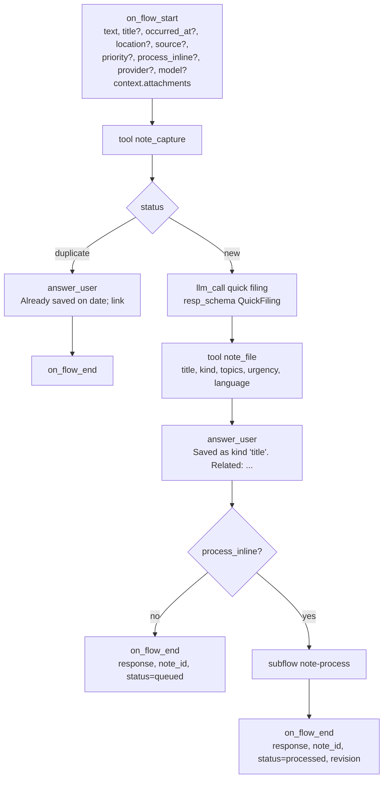
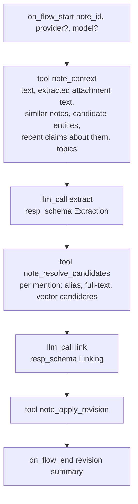
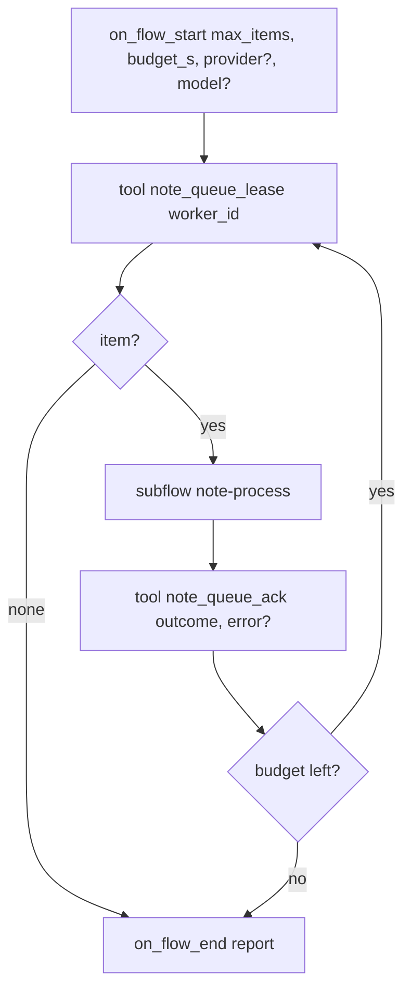
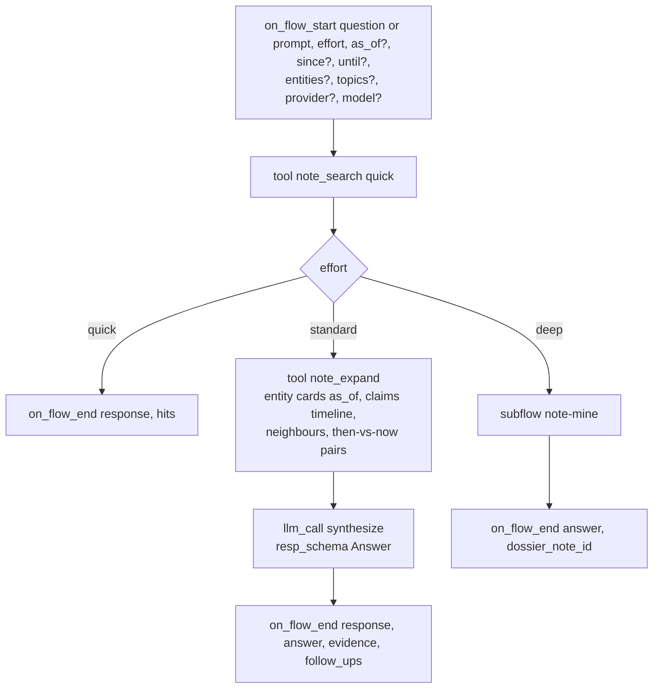

# Cognition: the flows, the queue, the schemas

AbstractNote's thinking is written as AbstractFlow workflows (VisualFlow JSON) packaged in the
`abstractnote` bundle. They run on AbstractRuntime inside the gateway, one durable run per
invocation, and you can open every one of them in the Flow editor. Deterministic work happens in
plane-bound **note tools**; judgement happens in `llm_call` nodes with structured output.

Flow sources are generated by `abstractnote.flows.build` (a Python generator in the style of
AbstractFlow's `wf_common`) into `src/abstractnote/flows/json/*.json`; the bundle is packed by
`abstractnote bundle`. Only catalog node types are used.

## The flows

| Flow id | Interface | Started by | Purpose |
|---|---|---|---|
| `note-capture` | `abstractnote.capture.v1` | clients, per note | store, de-duplicate, file quickly, answer, enqueue; optionally process inline |
| `note-process` | internal subflow | `note-capture` (inline) and `note-drain` | understand one note and revise the graph |
| `note-drain` | `abstractnote.drain.v1` | the processor automation, "Process now", the CLI | lease queued notes by priority and process them one at a time |
| `note-recall` | `abstractnote.recall.v1` and `abstractcode.agent.v1` | clients, agents, per question | answer a question at the requested effort |
| `note-mine` | internal subflow | `note-recall` (deep) | multi-step mining across time; writes a dossier insight |
| `note-reflect` | `abstractnote.reflect.v1` | a scheduled automation | surface open loops, contradictions, resurfaced material, connections |

Every flow exposes `provider` and `model` start pins. Blank means the gateway's default text
model. The processor automation carries the user's "filing model" (a small fast model is
recommended, for example `mlx-community/Qwen3.6-35B-A3B-4bit` on Apple silicon); the reflect
automation and recall at standard and deep effort use the user's "answering model". The
automations take the models from the notebook settings when they are created.

### note-capture



- `note_capture` reads attachments from the run's artifacts (inside the gateway, only
  `{"$artifact": id}` references resolved through the host's artifact store; local paths exist only
  in headless use with an allowed root), hashes bytes and text, stores the note and blobs, extracts
  text from documents and transcripts, returns `status` (`new` or `duplicate` for a retried
  idempotency key), the revisited notes (same words earlier) and similar notes (vector neighbours),
  the existing topics, and enqueues the note with the requested or default priority. The bound tool
  stamps `source.account` with the plane's account at bind time; `session_id` comes from a start
  pin; clients send an `idempotency_key`.
- Quick filing is one small-model call with the `QuickFiling` schema (below). It sees the note,
  the similar notes' titles and the existing topic list, and returns a title, a kind, topics, an
  urgency and the language. `note_file` stores them and maps urgency to queue priority.
- The answer is delivered twice: as an `answer_user` message as soon as it exists (clients that
  stream the ledger show it immediately) and as `output.response` when the run ends (clients
  that poll the run read it there). `process_inline` is the client's choice: the web app sends
  its "Instant linking" setting (`process_inline_default`, off by default); the watch always
  sends `false` and shows the filing answer.

### note-process



1. **Context** (`note_context`): what the notebook already knows that is relevant: the nearest
   notes, entities whose names or aliases appear in the text or whose embeddings are close,
   their current summaries and the active claims about them, the open tasks that mention them,
   and the topic vocabulary. This is the "look at the existing knowledge" step.
2. **Extract** (`Extraction` schema): summary, mentions (name, kind, aliases seen, role in the
   note), claims (subject, predicate, object, literal flag, certainty, stance, evidence excerpt,
   optional validity dates), tasks (opened, completed), time references, and topics. The prompt
   carries the predicate vocabulary from the AbstractSemantics registry and allows `ex:` for the
   rest.
3. **Resolve candidates** (`note_resolve_candidates`): for every mention, up to five existing
   entities with their kind, aliases, summary, last seen date and how they matched.
4. **Link** (`Linking` schema): the model decides, per mention, `reuse` (a candidate index),
   `create`, or `merge` (two candidate indexes); per claim, whether it `restates` an existing claim
   (reinforce), `refines` it (new claim, old stays active), `supersedes` it (close the old one) or
   `contradicts` it (both stay, marked disputed), naming the existing claim by its index in the
   packet; per task, open or close by index. The schema uses indexes and enumerations rather than
   free-form ids so that small models cannot invent identifiers; `note_apply_revision` rejects any
   reference outside the packet and downgrades it to `create` or `new` with a warning. The model
   also writes the revision summary and a one-sentence summary for each entity it creates and for
   each reused entity the note tells something new about.
5. **Apply** (`note_apply_revision`): writes the revision ops to the index and the triple store in
   one transaction per store, updates relations, topics, tasks, embeddings, and marks the note
   `processed`. The response lists created and merged entities, claims added and superseded, and
   any warnings (unknown predicates mapped to `ex:`, unresolved references).

Large notes: `note_context` splits texts beyond the model's budget into sections; `note-process`
loops over sections for extraction and merges mentions and claims before linking, so no text is
ever truncated.

### note-drain and the queue

The queue lives in the note index (`queue` table): `note_id, priority, enqueued_at, leased_by,
lease_until, attempts, last_error`. Ordering is `priority desc, occurred_at asc, size asc`.



- A lease lasts 15 minutes; an expired lease is taken over by the next drain. Acknowledging a
  failure increments `attempts` and schedules a retry (after 1 minute, then after 10 minutes); the
  third failure sets the note to `failed`, visible in the web app's queue panel with the error,
  and offers a manual retry.
- **The processor automation.** `POST /api/gateway/note/processor/ensure` (the web app calls it
  when it opens and the automations are missing) creates two automations per user, idempotently: the processor
  (trigger `schedule@2` every `2m`, flow `note-drain`, `max_items = 20`, `budget_s = 90`) and the
  reflect automation (every `7d` by default, flow `note-reflect`), each with
  `_runtime.allowed_tools` listing the note tools. The processor's first drain runs at creation
  (an empty queue completes without a model call); the reflect automation's schedule starts one
  interval after creation (`start_at = now + every`), so opening an empty notebook never starts an
  answering-model call. "Reflect now" is the same `run_now` command sent to the reflect automation
  (`POST /api/gateway/automations/{reflect_id}/commands` with `{"command_id": "<uuid>", "type":
  "automation.run_now"}`).
  Automations run occurrences serially and coalesce missed ticks, which gives the queue exactly
  the eventual, ordered consistency it needs without a gateway worker. "Process now" sends the
  automation's `run_now` command; a `409 automation_busy` answer means a drain is already running
  and the queue panel says so. Steady-state throughput is at most `max_items` per interval.
- **No approval waits.** Inside the gateway the note tools are added to the tool approval
  auto-approve set when the runtime is built, so a capture never parks on a tool-approval wait.
- **Priority**: `3` urgent and `2` high come from the quick filing step (tasks with deadlines,
  warnings, anything the user marks urgent); `1` normal is the default for interactive capture;
  `0` bulk is used by importers so that live notes always go first.
- **Concurrency**: one occurrence at a time per user; the gateway's own runner limits concurrent
  ticks across users. Local models serve requests one at a time, so serial processing is also
  the fastest total throughput on a single machine.

### note-recall

`note-recall` also serves the `abstractcode.agent.v1` chat contract: it accepts `prompt` as an
alias of `question` and always returns the answer text on the `response` output pin next to the
structured pins, so a chat client that polls `output.response` shows the answer.



The `Answer` schema returns the answer text with inline citations `[nt_...]`, the evidence list,
what changed over time about the subject (earliest stance, latest stance, turning points with
note ids), open loops related to the question, and suggested follow-up questions. Clients render
citations as links to notes.

### note-mine (deep)

1. `llm_call plan` (`MiningPlan` schema): sub-questions, time slices, entities to trace,
   contradictions to test, a budget of search rounds.
2. Loop over the plan: `note_search` and `note_entity` for each item, `llm_call findings` per
   slice (`SliceFindings` schema: facts with citations, changes, gaps).
3. `llm_call dossier` (`Dossier` schema): narrative, timeline of the subject, how the view evolved,
   contradictions, forgotten items worth revisiting, suggestions, and a confidence statement.
4. `note_insight_write` stores the dossier as a `synthesis` note with provenance (the run id,
   the evidence notes, the entities), so the result is itself searchable and revisitable.

### note-reflect

Runs from a scheduled automation (default weekly, configurable); its first occurrence is one
interval after the automation is created, and "Reflect now" (`automation.run_now`) runs it at once.
A failed occurrence is retried by the automation (up to 3 attempts). Deterministic tools produce
candidates; the model judges and writes:

| Tool | Candidates |
|---|---|
| `note_open_loops` | open tasks older than N days, questions never answered |
| `note_contradictions` | disputed claim pairs only (a note's `contradicts` decision); a subject with several current objects of one predicate is never a candidate, since processing records no single-valued predicates |
| `note_resurface` | entities and topics active before but silent for N days that relate to recent notes |
| `note_anniversaries` | notes from the same day in previous months or years |

`llm_call reflect` (`Reflections` schema) selects what deserves attention and writes each item
as an `insight` note (`warning`, `reminder`, `connection`, `contradiction`, `evolution`). The
web app's Remember view and the watch's Today screen show unacknowledged insights.

## Structured output schemas

All schemas are JSON Schema objects attached as `resp_schema`; the runtime builds pydantic
models from them and repairs invalid output. Python mirrors live in `abstractnote.process.schemas`.

**QuickFiling**

```json
{"title": "string (<= 80 chars)", "kind": "idea|task|decision|fact|event|question|reflection|reference|log|conversation|personal",
 "topics": ["string, prefer existing topics, at most 4"], "urgency": "bulk|normal|high|urgent",
 "language": "BCP-47", "one_line": "string"}
```

**Extraction**

```json
{"summary": "1-3 sentences",
 "mentions": [{"ref": "m1", "name": "string", "kind": "person|org|project|concept|place|event|artifact|software|thing",
               "aliases": ["as written in the note"], "role": "what the note says about it, one phrase"}],
 "claims": [{"subject": "m1", "predicate": "CURIE from the vocabulary or ex:snake_case", "object": "m2 or literal",
             "object_is_literal": false, "certainty": "stated|probable|possible|reported|disputed",
             "stance": "assert|revise|retract", "evidence": "verbatim excerpt", "valid_from": "ISO or null", "valid_until": "ISO or null"}],
 "tasks": [{"text": "string", "status": "open|done", "due": "ISO or null"}],
 "time_refs": [{"text": "string", "iso": "ISO or null"}],
 "topics": ["string"]}
```

**Linking** (indexes refer to the candidate lists in the context packet; enumerations are JSON
Schema enums)

```json
{"mentions": [{"ref": "m1", "decision": "reuse|create|merge|unsure", "candidate": 0,
               "merge_candidates": [0, 1], "name": "preferred name", "kind": "person|org|project|concept|place|event|artifact|software|thing",
               "aliases": ["..."], "summary": "one sentence; required for create and unsure, and for a reused entity this note tells something new about; otherwise null", "reason": "short"}],
 "claims": [{"index": 0, "relation_to_existing": "new|restates|refines|supersedes|contradicts",
             "existing": 0, "reason": "short"}],
 "tasks": [{"index": 0, "closes_open_task": 0}],
 "revision_summary": "one sentence"}
```

**Answer**, **MiningPlan**, **SliceFindings**, **Dossier**, **Reflections**: see
`abstractnote.process.schemas`; each is documented inline with the fields listed above.

## Prompts

Prompts are Markdown files under `src/abstractnote/process/prompts/` rendered with the context
packet. Rules that every prompt states:

- Use only the note and the provided context; never invent entities or dates.
- Prefer reusing an existing entity when the candidate list contains it; create sparingly.
- Keep names as written by the author; put variants in aliases.
- Quote evidence verbatim; one claim per statement; no inferred hierarchy.
- When unsure whether two things are the same, say `unsure` (treated as `create` plus a
  `skos:closeMatch` claim for later consolidation) rather than guessing.
- Output JSON only, matching the schema.

The predicate vocabulary is loaded from the AbstractSemantics registry at build time and listed
in the extraction prompt with one-line glosses. Predicates outside it are accepted as
`ex:snake_case` and reported in the revision warnings so the vocabulary can grow deliberately.

## Headless execution

`abstractnote process --local --notebook DIR --provider mlx --model <id>` runs `note-drain` without a gateway:
the same compiled flows on a local `Runtime` with real effect handlers (AbstractCore model calls,
the note tools bound to a local notebook directory). This is how the importers are processed in
bulk, how the test suite exercises the flows with a scripted model, and how you can run the
processor on a machine that is not the gateway host. The recipe follows AbstractRuntime's
`test_kg_learn_and_recall_contract` harness (`compile_visualflow_tree`, `WorkflowRegistry`,
`build_effect_handlers`, drive subflow waits).
