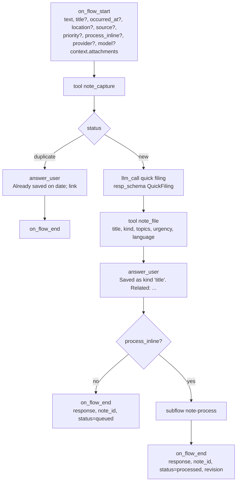
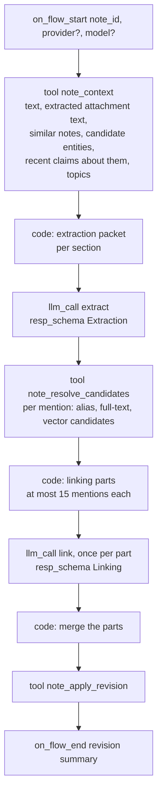
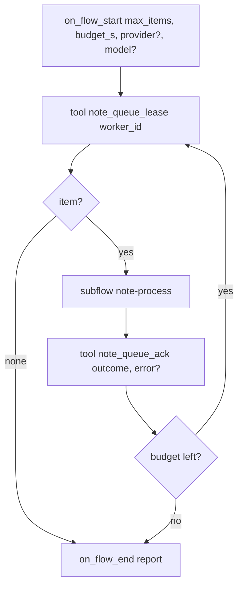
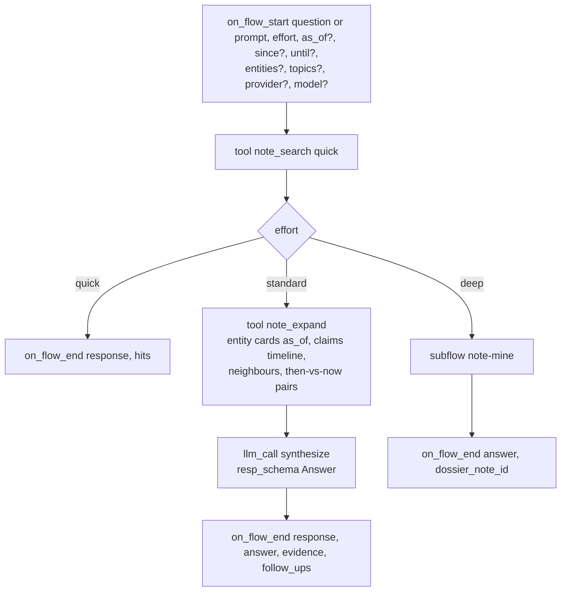

# Cognition: the flows, the queue, the schemas

AbstractNote's thinking is written as AbstractFlow workflows (VisualFlow JSON) packaged in the
`abstractnote` bundle. They run on AbstractRuntime inside the gateway, one durable run per
invocation, and you can open every one of them in the Flow editor. Deterministic work happens in
plane-bound **note tools**; judgement happens in `llm_call` nodes with structured output.

Flow sources are generated by `abstractnote.flows.build` (a Python generator in the style of
AbstractFlow's `wf_common`) into `src/abstractnote/flows/json/*.json`; the bundle is packed by
`abstractnote bundle`. Only catalog node types are used.

## The flows

| Flow id | Interface | Started by | Purpose |
|---|---|---|---|
| `note-capture` | `abstractnote.capture.v1` | clients, per note | store, de-duplicate, file quickly, answer, enqueue; optionally process inline |
| `note-process` | internal subflow | `note-capture` (inline) and `note-drain` | understand one note and revise the graph |
| `note-drain` | `abstractnote.drain.v1` | the processor automation, "Process now", the CLI | lease queued notes by priority and process them one at a time |
| `note-recall` | `abstractnote.recall.v1` and `abstractcode.agent.v1` | clients, agents, per question | answer a question at the requested effort |
| `note-mine` | internal subflow | `note-recall` (deep) | multi-step mining across time; writes a dossier insight |
| `note-reflect` | `abstractnote.reflect.v1` | a scheduled automation | surface open loops, contradictions, resurfaced material, connections |

Every flow exposes `provider` and `model` start pins. Blank means the gateway's default text
model. The processor automation carries the user's "filing model" (a small fast model is
recommended, for example `mlx-community/Qwen3.6-35B-A3B-4bit` on Apple silicon); the reflect
automation and recall at standard and deep effort use the user's "answering model". The
automations take the models from the notebook settings when they are created.

### note-capture



- `note_capture` reads attachments from the run's artifacts (inside the gateway, only
  `{"$artifact": id}` references resolved through the host's artifact store; local paths exist only
  in headless use with an allowed root), hashes bytes and text, stores the note and blobs, extracts
  text from documents and transcripts, returns `status` (`new` or `duplicate` for a retried
  idempotency key), the revisited notes (same words earlier) and similar notes (vector neighbours),
  the existing topics, and enqueues the note with the requested or default priority. The bound tool
  stamps `source.account` with the plane's account at bind time; `session_id` comes from a start
  pin; clients send an `idempotency_key`.
- Quick filing is one small-model call with the `QuickFiling` schema (below). It sees the note,
  the similar notes' titles and the existing topic list, and returns a title, a kind, topics, an
  urgency and the language. `note_file` stores them and maps urgency to queue priority.
- The answer is delivered twice: as an `answer_user` message as soon as it exists (clients that
  stream the ledger show it immediately) and as `output.response` when the run ends (clients
  that poll the run read it there). `process_inline` is the client's choice: the web app sends
  its "Instant linking" setting (`process_inline_default`, off by default); the watch always
  sends `false` and shows the filing answer.

### note-process



1. **Context** (`note_context`): what the notebook already knows that is relevant: the nearest
   notes, entities whose names or aliases appear in the text or whose embeddings are close,
   their current summaries and their most recent active claims, the open tasks that mention
   them, and the topic vocabulary. This is the "look at the existing knowledge" step.
2. **Extract** (`Extraction` schema), once per section: summary, mentions (name, kind, aliases
   seen, role in the note), claims (subject, predicate, object, literal flag, certainty, stance,
   evidence excerpt, optional validity dates), tasks (opened, completed), time references, and
   topics. The model sees the section's whole text and a bounded orientation packet (see
   "Prompts and bounds"); the predicate vocabulary from the AbstractSemantics registry is in the
   static system prompt and `ex:` is allowed for the rest.
3. **Resolve candidates** (`note_resolve_candidates`): for every mention, up to three existing
   entities with their kind, aliases, summary, last seen date, how they matched, and their most
   recent active claims.
4. **Link** (`Linking` schema), once per part of at most 15 mentions: the model decides, per
   mention, `reuse` (a candidate index), `create`, or `merge` (two candidate indexes); per
   claim, whether it `restates` an existing claim (reinforce), `refines` it (new claim, old stays
   active), `supersedes` it (close the old one) or `contradicts` it (both stay, marked disputed),
   naming the existing claim by its `#` index in the packet; per task, open or close by index.
   Each part carries the claims whose subject is one of its mentions (the first part also the
   tasks and the open tasks they may close); claim, task and packet indexes stay those of the
   whole note, so the parts merge back into one Linking without renumbering. The schema uses
   indexes and enumerations rather than free-form ids so that small models cannot invent
   identifiers; `note_apply_revision` rejects any reference outside the packet and downgrades it
   to `create` or `new` with a warning. The model also writes the revision summary and a
   one-sentence summary for each entity it creates and for each reused entity the note tells
   something new about. A missing summary is never a failed note: a created entity gets one
   built from its role in the note (or where it was seen) and a reused entity keeps its current
   summary, each with a warning in the revision.
5. **Apply** (`note_apply_revision`): writes the revision ops to the index and the triple store in
   one transaction per store, updates relations, topics, tasks, embeddings, and marks the note
   `processed`. The response lists created and merged entities, claims added and superseded, and
   any warnings (unknown predicates mapped to `ex:`, unresolved references, missing summaries).

Large notes: `note_context` splits texts beyond the model's budget into sections; `note-process`
loops over sections for extraction and merges mentions and claims before linking, so no text is
ever truncated.

### note-drain and the queue

The queue lives in the note index (`queue` table): `note_id, priority, enqueued_at, leased_by,
lease_until, attempts, last_error`. Ordering is `priority desc, occurred_at asc, size asc`.



- A lease lasts 15 minutes. Acknowledging a failure increments `attempts` and schedules a retry
  (after 1 minute, then after 10 minutes); the third failure sets the note to `failed`, visible in
  the web app's queue panel with the error, and offers a manual retry.
- An expired lease (the drain stopped, for example on a gateway restart) is not taken over at once:
  the next drain that leases counts it as a failure ("Processing stopped before it finished.") with
  the same backoff, and a drain retakes the note once that backoff has passed. It counts toward the
  same three failures, so a note whose processing is cut off three times (three restarts during
  the same long note) becomes `failed` and waits for a manual retry.
- **The processor automation.** `POST /api/gateway/note/processor/ensure` (the web app calls it
  when it opens and an automation is missing or unhealthy) creates two automations per user, idempotently: the processor
  (trigger `schedule@2` every `2m`, flow `note-drain`, `max_items = 20`, `budget_s = 90`) and the
  reflect automation (every `7d` by default, flow `note-reflect`), each with
  `_runtime.allowed_tools` listing the note tools. The processor's first drain runs at creation
  (an empty queue completes without a model call); the reflect automation's schedule starts one
  interval after creation (`start_at = now + every`), so opening an empty notebook never starts an
  answering-model call. "Reflect now" is the same `run_now` command sent to the reflect automation
  (`POST /api/gateway/automations/{reflect_id}/commands` with `{"command_id": "<uuid>", "type":
  "automation.run_now"}`).
  Automations run occurrences serially and coalesce missed ticks, which gives the queue exactly
  the eventual, ordered consistency it needs without a gateway worker. "Process now" sends the
  automation's `run_now` command; a `409 automation_busy` answer means a drain is already running
  and the queue panel says so. Steady-state throughput is at most `max_items` per interval.
- **Surviving an upgrade.** An automation runs one concrete workflow version: the gateway resolves
  `bundle_ref: "abstractnote"` to the latest loaded version when the automation is created and
  stores `abstractnote@<version>:note-drain` in its definition, and the runtime starts exactly that
  id at every occurrence. There is no "latest" target (AbstractGateway 0.15.11,
  `routes/automations.py` `_resolve_target`), and the gateway serves only the installed version of
  the note workflows, so after an upgrade and a restart the old automation's next occurrence fails
  ("Workflow 'abstractnote@0.1.0:note-drain' not found in registry") and the queue stops draining. A
  revision of the target cannot fix it either: a failed automation accepts only `archive`.
  The same holds for the tool list: the automation's run input freezes `_runtime.allowed_tools`
  at creation, so a tool added later (`note_communities_recompute` in reflect) is refused at its
  step ("Tool ... is not allowed for this node or run").
  So `processor/ensure` repairs: it keeps an automation that is active or paused on the served
  version with exactly the current tools (`abstractnote.tools.TOOL_NAMES`); any other one (another
  version or tool list, failed, completed, archived, gone) is archived (its
  history stays) and replaced by a new automation built from the current settings
  (`processor_schedule`, `reflect_schedule`, the models), under the next request generation
  (`abstractnote-processor-<n>`) so the replacement is a new automation, never the failed one. A
  paused automation's replacement is paused again (its first tick one interval out, so no drain
  runs before the pause lands). `GET /note/status` and `GET /note/queue` report each automation's
  health (`automations.processor` and `.reflect`: `{id, state, target, healthy, reason, paused}`);
  the web app repairs on load when one is unhealthy, and its queue panel shows "Processor needs
  repair." with a Repair button. Without the note workflows loaded, `ensure` answers 503 and
  archives nothing.
- **No approval waits.** Inside the gateway the note tools are added to the tool approval
  auto-approve set when the runtime is built, so a capture never parks on a tool-approval wait.
- **Priority**: `3` urgent and `2` high come from the quick filing step (tasks with deadlines,
  warnings, anything the user marks urgent); `1` normal is the default for interactive capture;
  `0` bulk is used by importers so that live notes always go first.
- **Concurrency**: one occurrence at a time per user; the gateway's own runner limits concurrent
  ticks across users. Local models serve requests one at a time, so serial processing is also
  the fastest total throughput on a single machine.

### note-recall

`note-recall` also serves the `abstractcode.agent.v1` chat contract: it accepts `prompt` as an
alias of `question` and always returns the answer text on the `response` output pin next to the
structured pins, so a chat client that polls `output.response` shows the answer.



The `Answer` schema returns the answer text with inline citations `[nt_...]`, the evidence list,
what changed over time about the subject (earliest stance, latest stance, turning points with
note ids), open loops related to the question, and suggested follow-up questions. Clients render
citations as links to notes.

### note-mine (deep)

1. `llm_call plan` (`MiningPlan` schema): sub-questions, time slices, entities to trace,
   contradictions to test, a budget of search rounds.
2. Loop over the plan: `note_search` and `note_entity` for each item, `llm_call findings` per
   slice (`SliceFindings` schema: facts with citations, changes, gaps).
3. `llm_call dossier` (`Dossier` schema): narrative, timeline of the subject, how the view evolved,
   contradictions, forgotten items worth revisiting, suggestions, and a confidence statement.
4. `note_insight_write` stores the dossier as a `synthesis` note with provenance (the run id,
   the evidence notes, the entities), so the result is itself searchable and revisitable.

### note-reflect

Runs from a scheduled automation (default weekly, configurable); its first occurrence is one
interval after the automation is created, and "Reflect now" (`automation.run_now`) runs it at once.
A failed occurrence is retried by the automation (up to 3 attempts). Deterministic tools produce
candidates; the model judges and writes:

| Tool | Candidates |
|---|---|
| `note_open_loops` | open tasks older than N days, questions never answered |
| `note_contradictions` | disputed claim pairs only (a note's `contradicts` decision); a subject with several current objects of one predicate is never a candidate, since processing records no single-valued predicates |
| `note_resurface` | entities and topics active before but silent for N days that relate to recent notes |
| `note_anniversaries` | notes from the same day in previous months or years |

`llm_call reflect` (`Reflections` schema) selects what deserves attention and writes each item
as an `insight` note (`warning`, `reminder`, `connection`, `contradiction`, `evolution`). The
web app's Remember view and the watch's Today screen show unacknowledged insights.

Then the flow refreshes the communities of the graph and names them (backlog 0030):
`note_communities_recompute` runs Louvain over the entity graph without a model (data-model.md
"Community"); `note_communities_pending` lists up to 5 communities without a label or with a stale
one, each with its top entities, its strongest statements and 3 representative notes; when the list
is empty the run ends there (no model call); otherwise ONE `llm_call` (`CommunityLabels` schema,
thinking off, at most 2048 output tokens) names them all by index, a code node maps each index back to
its community (an index the list does not have is dropped), and `note_communities_label` stores the
names. The run's output adds `communities_labelled` (the number of communities named). The step's
static system prompt and template live in `abstractnote.recall.communities` (`LABEL_SYSTEM_PROMPT`,
`LABEL_TEMPLATE`), next to the schema. `POST /note/communities/recompute` runs detection alone.

The edges detection weighs are the statements between two entities plus their co-mentions: a note
that mentions `k >= 2` live entities adds `1 / ((k - 1) · log2 k)` to every pair among them
(`communities.co_mention_share`). A two-entity note adds 1 to its pair, like one statement; a note's
total co-mention weight is `k / (2 · log2 k)`, so a 200-entity note counts about 13 times a
two-entity note, not 100 times as the flat `1 / (k - 1)` share made it. A single long note therefore
no longer forms a community on its own unless its own statements hold its entities together. On the
operator's notebook at revision 373 (networkx 3.6.1) the change took the communities from 21 to 35,
the loose ends from 2 to 4 and the modularity from 0.606 to 0.667; the two largest communities made
mostly of one note (237 and 232 entities, 87 % and 88 % from it) became one (170 entities, 84 %, the
note whose statements link its 137 own entities) and smaller groups.

## Structured output schemas

All schemas are JSON Schema objects attached as `resp_schema`; the runtime builds pydantic
models from them and repairs invalid output. Python mirrors live in `abstractnote.process.schemas`.

**QuickFiling**

```json
{"title": "string (<= 80 chars)", "kind": "idea|task|decision|fact|event|question|reflection|reference|log|conversation|personal",
 "topics": ["string, prefer existing topics, at most 4"], "urgency": "bulk|normal|high|urgent",
 "language": "BCP-47", "one_line": "string"}
```

**Extraction**

```json
{"summary": "1-3 sentences",
 "mentions": [{"ref": "m1", "name": "string", "kind": "person|org|project|concept|place|event|artifact|software|thing",
               "aliases": ["as written in the note"], "role": "what the note says about it, one phrase"}],
 "claims": [{"subject": "m1", "predicate": "CURIE from the vocabulary or ex:snake_case", "object": "m2 or literal",
             "object_is_literal": false, "certainty": "stated|probable|possible|reported|disputed",
             "stance": "assert|revise|retract", "evidence": "verbatim excerpt", "valid_from": "ISO or null", "valid_until": "ISO or null"}],
 "tasks": [{"text": "string", "status": "open|done", "due": "ISO or null"}],
 "time_refs": [{"text": "string", "iso": "ISO or null"}],
 "topics": ["string"]}
```

Fields with a default may be left out by the model (the runtime fills the default): in
Extraction `aliases` ([]), `object_is_literal` (false), `certainty` (stated), `stance` (assert),
`valid_from`, `valid_until`, `due` and `iso` (null); in Linking `candidate` (null),
`merge_candidates` ([]), `name` (""), `kind` (null), `aliases` ([]), `reason` (""), `existing`
(null) and `closes_open_task` (null). `claims` lists only the statements that relate to an
existing one (a statement left out is `new`) and `tasks` only those that close an open task.

**Linking** (indexes refer to the candidate lists in the context packet; enumerations are JSON
Schema enums)

```json
{"mentions": [{"ref": "m1", "decision": "reuse|create|merge|unsure", "candidate": 0,
               "merge_candidates": [0, 1], "name": "preferred name", "kind": "person|org|project|concept|place|event|artifact|software|thing",
               "aliases": ["..."], "summary": "one sentence for create and unsure, and for a reused entity this note tells something new about; otherwise null (a missing one is a warning, never a failed note)", "reason": "short"}],
 "claims": [{"index": 0, "relation_to_existing": "new|restates|refines|supersedes|contradicts",
             "existing": 0, "reason": "short"}],
 "tasks": [{"index": 0, "closes_open_task": 0}],
 "revision_summary": "one sentence"}
```

**Answer**, **MiningPlan**, **SliceFindings**, **Dossier**, **Reflections**: see
`abstractnote.process.schemas`; each is documented inline with the fields listed above.

**CommunityLabels** (the reflect flow's naming step; defined in `abstractnote.recall.communities`
and merged into the flow schemas by `flows.build.load_schemas`)

```json
{"communities": [{"index": 0, "label": "at most 4 words", "summary": "one sentence",
                  "kind": "project|theme|people|tooling|process|other"}]}
```

## Prompts and bounds

Every model step has two Markdown files under `src/abstractnote/process/prompts/`:

- `<step>.system.md`, the **static system prompt**: the instructions, the output shape with one
  illustrative answer, and the rules; the extraction one also lists the predicate vocabulary
  from the AbstractSemantics registry with one-line glosses, filled in when the flows are
  generated. These bytes are the same for every note, so a local model's prompt cache reuses
  them (below).
- `<step>.md`, the **dynamic user message**: rendered inside the flow by a `string_template`
  node from a packet that a code node builds with `abstractnote.process.packets` (the flows'
  code nodes carry that module's own source, so Python and the flows cannot drift).

The note steps' user message starts with one constant envelope,
`<runtime_metadata>{"time": "the note's own date is on the last line of this message"}</runtime_metadata>`,
and ends with a line that identifies the note: `About this note (not part of its text): nt_…
“title”, written 2026-07-10 08:47 (now, for this note) (kind …; from …) [part 2 of 3]`. The
runtime keeps an envelope already at the head of a message byte for byte (it stamps a fresh
per-second one on a message without one), so no per-call value sits in the shared prefix; the
note's date is "now" for the model (relative dates resolve from it) and the system prompt says
the last line is not content. The user templates end without trailing whitespace, which the
runtime needs to recognise the envelope as the message's own.

A prompt note from the Claude sessions importer keeps the assistant's answer in
`source.origin.outcome` by `source.origin.outcome_author` (and appended to the text):
`note_context` then returns the author's text and the answer as separate sections (`source`
`note` or `answer`, with their `author`), and the packet labels them "Text written by …" and
"Answer by … (what they said; not written by the note's author)"; the extraction prompt
writes statements from an answer as `reported`.

Rules that every prompt states:

- Use only the note and the provided context; never invent entities or dates.
- Prefer reusing an existing entity when the candidate list contains it; create sparingly.
- Keep names as written by the author; put variants in aliases.
- Quote evidence verbatim; one claim per statement; no inferred hierarchy.
- When unsure whether two things are the same, say `unsure` (treated as `create` plus a
  `skos:closeMatch` claim for later consolidation) rather than guessing.
- Output JSON only, matching the schema.

Predicates outside the vocabulary are accepted as `ex:snake_case` and reported in the revision
warnings so the vocabulary can grow deliberately.

**Bounds.** Only the packet is bounded; the note's text is never cut (long notes are split into
sections, each read whole).

| Packet | Bound (`abstractnote.process.packets`) |
|---|---|
| Extraction orientation | names and kinds of at most 15 known entities (no claims), at most 40 topics (the note's own first), 5 similar notes by title and date, 8 open tasks, one line each |
| Candidates per mention | 3 (`note_resolve_candidates`) |
| Candidate card | name, kind, up to 5 aliases, summary (at most 240 characters), last seen, and at most 3 active claims as one line each, those with a predicate the note also uses first |
| Mentions per linking call | 15; the rest go to further calls for the same note, merged back |
| Statement lines | subject, predicate, object, certainty, stance, evidence (at most 200 characters) |
| Open tasks in linking | only when the note has tasks, at most 8 |
| Section | 6000 characters per extraction call (`note_context` `max_chars`), so each answer fits the extract output cap |

**Checks on the answers.** A section of at least 200 characters whose extraction names nothing is
read once more; a second empty answer is kept and the revision says so ("A part of this note
names nothing although it has text, even when read a second time."). `note_apply_revision`
leaves out, with a warning, a mention whose name and aliases never occur as whole words in the
note's own text (its title and header do not count: names copied from the context packet are
refused); a statement about it is skipped, one pointing at it keeps the name as text. A reused
entity gains only the aliases the linking lists for it, and `unsure` without a candidate is
created as new with a warning. The prompts also state: reuse an entity only when the mention
names that very thing (a part, version, file or tool of X is a new entity related to X); one to
three topics; no statement whose only content is that the text mentions something, and
`dcterms:hasPart` only when stated; proposals and plans are `possible`; a superseded statement
is written with `stance: retract` and its end date, the replacing one with `stance: revise`.

## Prompt cache, thinking and output caps

**Prompt cache.** It applies only on AbstractCore's prompted structured-output lane; on the
Outlines lane (below), which the gateway and the headless runner use for MLX today, no call
uses or reports a prompt cache. On the prompted lane AbstractRuntime derives one prompt-cache
key per (session, provider, model, flow, node) for every run that has a session, so all notes
processed in one session share one key per step (the processor automation has a session). Hybrid models
such as Qwen3.6-35B-A3B (Gated-DeltaNet plus attention) restore only an exactly stored prefix:
after each call the provider snapshots the part of the prompt that the last two calls on the
key shared, and the next call reuses it when its prompt extends that snapshot. Every note
step's prompt is the same system prompt followed by the same envelope, with the note's id and
date on the last line, so consecutive notes share at least the whole system prompt. When two
consecutive notes also share the first words of their text, the snapshot moves past the system
prompt and a following note that starts differently cannot extend it: that call is a full
prefill ("rebuilt"), and the next one hits again (backlog 0024 measures how often). (A fresh key would fork
the runtime's prepared system prefix instead, but for chat templates that render tool
definitions before the system text, as Qwen3.5 and 3.6 do, that prefix is 3 tokens long; the
flows therefore do not give each note its own cache scope.) The provider reports each call's
`prompt_cache` record (`outcome`, `cached_tokens`, `fed_tokens`); AbstractRuntime does not copy
it into the ledger for structured calls today (a structured result carries no metadata), so
backlog 0024's measurements read it at the provider.

**Structured output lane.** With Outlines installed, AbstractCore's MLX and HuggingFace providers
decode structured output through Outlines unless `structured_output_method="prompted"`. That lane
bypasses the prompt cache, cannot think, and applies the chat template a second time around the
already rendered prompt; the system prompts therefore carry the output shape, so the model
writes the right fields on either lane (on the old prompts, with thinking off, this lane
answered empty lists). A provider created with `structured_output_method="prompted"` (for
example `NoteRunner.local(..., llm_kwargs={"structured_output_method": "prompted"})`) generates
normally and uses the prompt cache, but with thinking on it reasons for minutes per call
(backlog 0024 measured 160-181 s per extraction), so the flows do not ask for it.

**Thinking and output caps** are pinned on each `llm_call` node (a node value wins over the run's
`_runtime.thinking`):

| Step | Thinking | Output cap (tokens) |
|---|---|---|
| quick filing | off | 400 |
| extract (and its second reading) | on (`thinking` start pin; `off` from note-drain) | 4000 |
| link | on (`thinking` start pin; `off` from note-drain) | 6000 |
| synthesize, dossier, reflect | the runtime default | 8192 |
| mining plan, slice findings | the runtime default | 4096 |
| naming communities (reflect) | off | 2048 |

Thinking for extraction and linking is a per-run choice: `note-process` takes a `thinking`
start pin (`on` or `off`, default `on`, anything else is refused) wired to the extract, second
reading and link nodes; `note-drain` takes its own `thinking` pin, default `off` (the bulk-import
setting: a thinking call can run to its output budget and AbstractCore then retries with a
larger one, measured 114-352 s for one section on the live drain), and passes it to every
`note-process` it starts; inline processing at capture keeps `on`. The table above gives the
defaults.

On MLX, Qwen3.6 has only an on/off switch (`enable_thinking`): any level ("low", "medium") is
treated as on and there is no thinking budget, so a thinking step can run until the output cap.
On the Outlines lane "on" changes only how the prompt ends (JSON-constrained decoding leaves no
room to reason); a failed Outlines decode falls back to normal generation, which then does think.
A truncated structured answer is retried by AbstractCore's structured-output handler with a
doubled budget, at most three attempts; a flow cannot turn that off today, so the caps are set
well above what a bounded section or linking part needs.

## Headless execution

`abstractnote process --local --notebook DIR --provider mlx --model <id>` runs `note-drain` without a gateway:
the same compiled flows on a local `Runtime` with real effect handlers (AbstractCore model calls,
the note tools bound to a local notebook directory). This is how the importers are processed in
bulk, how the test suite exercises the flows with a scripted model, and how you can run the
processor on a machine that is not the gateway host. The recipe follows AbstractRuntime's
`test_kg_learn_and_recall_contract` harness (`compile_visualflow_tree`, `WorkflowRegistry`,
`build_effect_handlers`, drive subflow waits).
