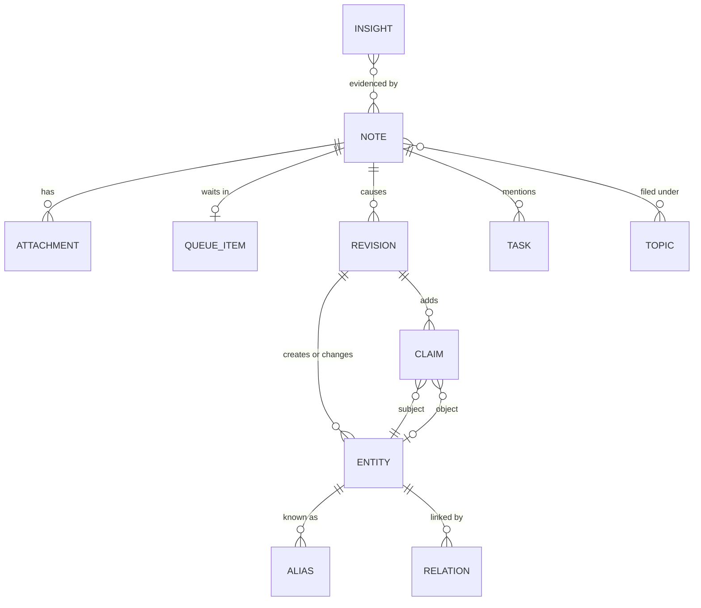

# Data model

This page defines the records AbstractNote keeps, how time works, how identities are assigned,
and how duplicates are handled. The Python types live in `abstractnote.model`; the SQLite schema
in `abstractnote.store.schema`; the AbstractMemory projection in `abstractnote.store.kg`.

## Overview

## Note

A note is anything you send: a sentence, a document, an image, a recording, a video, a log, a
chat turn imported from a transcript. It is the unit of provenance: every entity, claim and
revision points back to the note(s) that caused it.

| Field | Type | Meaning |
|---|---|---|
| `note_id` | `nt_<26 chars>` | Deterministic, base32 of a sha256. Imports: `sha256(importer, source_key)`. Live capture: `sha256(idempotency_key)` when the client sends one (clients always should; the runs API has no idempotency key of its own), otherwise `sha256(text_norm, attachment hashes, occurred_at to the minute, source.client)`. A retried request yields the same note; the same words said again on another day yield a new note that revisits the earlier one. |
| `kind` | enum | `idea`, `task`, `decision`, `fact`, `event`, `question`, `reflection`, `reference`, `log`, `conversation`, `personal`, `synthesis`, `insight`. Assigned by the quick filing step; `synthesis` and `insight` are system-authored. |
| `title` | text | Short title (model-written or taken from the source). |
| `text` | text | The note body as received (Markdown allowed). Never truncated. |
| `text_norm` | text | Whitespace-normalised, lower-cased copy used for hashing and full-text search. |
| `summary` | text | One to three sentences written by the processor. |
| `occurred_at` | ISO 8601 UTC | When the note was made or the event happened. From the client clock, the importer (message timestamp, file date, EXIF), or an explicit value. |
| `received_at` | ISO 8601 UTC | When AbstractNote stored it. |
| `processed_at` | ISO 8601 UTC or null | When the last successful revision was applied. |
| `source` | object | Provenance: `{client: web|watch|iphone|cli|agent|importer, importer?: claude-sessions|agora|markdown|files, origin: {...source-specific ids...}, author?: user id or agent name}`. |
| `location` | object or null | `{lat, lon, accuracy_m?, label?}` when the client provides one. |
| `language` | text or null | BCP-47 tag detected by the filing step. |
| `topics` | list | Categories assigned by filing and refined by processing (see Topics). |
| `priority` | int 0..3 | 3 urgent, 2 high, 1 normal, 0 bulk. |
| `status` | enum | `received`, `queued`, `processing`, `processed`, `failed`, `duplicate`, `archived`. |
| `duplicate_of` | note id or null | Set only when the same idempotency key or import source key arrives again (a retry), never for the same words on another occasion. |
| `session_id`, `run_id` | text | The gateway session and the run that captured it, when applicable. |
| `archived_at` | ISO or null | Notes are archived, never deleted. |

### Attachment

| Field | Meaning |
|---|---|
| `attachment_id` | `at_<...>` deterministic from `(note_id, sha256)` |
| `sha256`, `size`, `mime`, `filename` | the bytes' identity |
| `artifact_ref` | the gateway artifact that carried it, when uploaded through the gateway |
| `blob_path` | `blobs/<sha256[:2]>/<sha256>`; stored once per distinct content across the notebook |
| `extracted_text`, `extracted_by` | text derived from the bytes (document text, transcript, image description, log excerpt, media metadata) and which extractor produced it (`plain`, `markdown`, `pdf`, `vision:<model>`, `stt:<model>`, `media-metadata`, `none`). Audio and video with a speech track are transcribed when a speech model is configured; otherwise, and for music, the filing keeps the metadata (filename, duration, tags) and the capture answer says so plainly. |

Two notes that attach the same file share one blob; the second attachment records the
relation `same_bytes_as` so the graph shows that the file came back.

## Entity

An entity is a thing the notes talk about: a person, an organisation, a project, a concept, a
place, an event, an artifact (a document, a dataset, a repository), a piece of software, or a
generic thing.

| Field | Meaning |
|---|---|
| `entity_id` | `ex:<kind>-<slug>` following AbstractFramework ADR 0025. A collision with a different entity of the same kind appends `-2`, `-3`. Ids are never reused. |
| `kind` | `person`, `org`, `project`, `concept`, `place`, `event`, `artifact`, `software`, `thing` |
| `name` | preferred display name (case preserved) |
| `aliases` | other names seen in notes, case preserved; matching is case-folded |
| `summary` | one model-written sentence saying what the notebook knows about it, rewritten when a note tells something new (each revision kept) |
| `first_seen`, `last_seen` | `occurred_at` of the first and latest note mentioning it |
| `note_count` | number of notes that mention it |
| `merged_into` | set when the model decided this entity is the same as another; the record stays so old links still resolve |
| `embedding` | vector of `name + aliases + summary`, refreshed when the summary changes |

Entities are created only by revisions. The id is minted from the name chosen by the model at
creation time; later renames add aliases and may change `name`, never the id.

## Claim

A claim is one statement with time and provenance. Claims are the edges and attributes of the
graph.

| Field | Meaning |
|---|---|
| `claim_id` | `cl_<...>` deterministic from `(note_id, subject, predicate, object)`; predicate CURIEs keep their case in the index |
| `subject_id` | entity id |
| `predicate` | a CURIE from the AbstractSemantics registry when one fits (`schema:knowsAbout`, `schema:participant`, `skos:related`, `dcterms:references`, `cito:disagreesWith`, ...), otherwise `ex:<snake_case>` |
| `object_id` or `object_literal` | an entity, or a literal value (text, number, date) |
| `certainty` | `stated`, `probable`, `possible`, `reported`, `disputed` (tokens, not numbers) |
| `stance` | `assert`, `revise`, `retract`: what the note does to earlier knowledge |
| `observed_at` | the note's `occurred_at` |
| `valid_from`, `valid_until` | the validity window; `valid_from` defaults to `observed_at` for state claims and is null for timeless facts; `valid_until` is set when a later note supersedes or retracts the claim, and equals `valid_from` when you retract it ("never true") |
| `status` | `active`, `superseded`, `retracted` |
| `superseded_by` | the claim that replaced it |
| `evidence` | the verbatim excerpt of the note that supports the claim |
| `note_id`, `revision_id` | provenance |
| `assertion_id` | the id of the same claim in the AbstractMemory store (equals `claim_id`) |

### Relation

A relation is a derived, fast-to-read summary of all claims between two entities:
`(subject_id, object_id, predicate) -> first_seen, last_seen, count, active_claim_ids`. The graph
view reads relations. The **relation timeline** (`/note/relations/{a}/{b}`) is first-class: all
claims between two entities in history order, with supersessions and a then-versus-now of the
relationship, so the evolution of a link is as visible as the evolution of a node.

## Revision

A revision is the append-only record of what one processed note did to the graph. It is the
authoritative history: replaying revisions in order rebuilds entities, claims, relations, topics
and tasks.

| Field | Meaning |
|---|---|
| `revision_id` | `rv_<...>` deterministic from `(note_id, attempt)`; user actions use `(action, target, occurred_at)` |
| `note_id` | the cause (null for a user action; then `source` names the client and account) |
| `applied_index`, `applied_kg` | flags set after each projection commits; recovery replays revisions whose flags are not both set (idempotent thanks to deterministic ids) |
| `at` | the note's `occurred_at` (history time) |
| `recorded_at` | when the processor applied it (system time) |
| `run_id` | the processing run (ledger) |
| `ops` | ordered list of operations |
| `summary` | one sentence written by the processor ("Linked the LUT budget decision to Castor; superseded the earlier plan.") |

Operations:

| op | payload |
|---|---|
| `entity.create` | `{entity_id, kind, name, aliases, summary}` |
| `entity.alias` | `{entity_id, alias}` |
| `entity.rename` | `{entity_id, name, previous}` |
| `entity.summary` | `{entity_id, summary, previous}` |
| `entity.merge` | `{from_id, into_id, reason}` |
| `claim.add` | the claim |
| `claim.supersede` | `{claim_id, by_claim_id, reason, valid_until}` |
| `claim.retract` | `{claim_id, reason, valid_until?}` (without `valid_until`, the window closes at the revision's time) |
| `claim.reinforce` | `{claim_id, note_id}` (the same statement seen again) |
| `topic.assign` | `{note_id, topic}` |
| `task.open` / `task.close` / `task.drop` | `{task_id, text, due?, by_note_id?}` |
| `entity.unmerge` | `{entity_id, from_id, reason}` (a user action; re-points the claims that came from `from_id`) |
| `entity.mention` | `{entity_id, note_id}` (the note talks about the entity; drives `note_count`, `first_seen`, `last_seen`) |
| `note.summary` | `{note_id, summary, kind, language}` |

User actions (`close a task`, `retract a claim`, `undo a merge`) produce revisions with
`source = {client, account}` and no note; they are the human side of an actionable graph. Through
the gateway, `account` is the signed-in user and `client` is `web` (the Note web app) or `api`
(any other caller), decided by the server, never by the request body.

Reversibility: a merge keeps both records and can be undone by a later revision that re-points
claims; a supersession keeps the old claim with its window closed.

## Topic

A topic is a lightweight category (`#lut`, `#release`, `#family`). The filing step chooses from
existing topics first and proposes new ones sparingly; the processor may refine. Topics are
flat; entities carry the structure.

## Task

Open loops extracted from notes: `{task_id, note_id, text, status open|done|dropped, due?,
closed_by_note_id?}`; `task_id` is `tk_<...>` deterministic from `(note_id, normalised text)`. A later note that reports the task done closes it with a `task.close` op,
decided by the model during processing.

## Insight

System-authored notes with `kind = insight` or `synthesis`: dossiers from deep recall and the
findings of the reflect flow (open loops, contradictions, resurfaced material, connections).
They carry `evidence_note_ids`, `entity_ids`, `insight_kind` (`warning`, `reminder`,
`connection`, `contradiction`, `evolution`, `dossier`, `cue`) and `acked_at`. Cue cards are the
unacknowledged insights other than dossiers, newest first.

## Time

AbstractNote is bitemporal.

| Axis | Field | Question it answers |
|---|---|---|
| History time | `occurred_at`, `claim.observed_at`, `revision.at` | "What did I note in July?" "What did the graph look like on day X?" |
| Validity | `claim.valid_from`, `claim.valid_until` | "What did I believe about X at time T?" |
| System time | `received_at`, `processed_at`, `revision.recorded_at` | "What has the processor done since I last looked?" |

Rules:

- The graph **as of T** = entities first seen at or before T (their creating revision's `at`, or an
  earlier note that mentions them when notes are processed out of history order), not merged away
  by T; edges from claims with `observed_at <= T`.
- **Beliefs at T** = claims with `valid_from <= T` and (`valid_until` is null or `> T`).
- Supersession sets `valid_until` of the old claim to the `occurred_at` of the superseding note;
  so does a note whose stance is `retract`.
- A retraction you make (`POST /note/claims/{id}/retract`) says the claim was never true: its
  status becomes `retracted` and `valid_until = valid_from` (its `observed_at` when it has no
  start), an empty window, never the moment you said so. Retracted claims are never beliefs.
- Importers set `occurred_at` from the source (message timestamp, commit date, file date);
  `received_at` is always the ingest time, so an import is visible as a system-time event while
  history stays truthful.
- Explicit time references inside a note ("last Tuesday", "in 2024") are extracted as claims with
  literal dates when the model can resolve them from the note's own `occurred_at`; they never
  move the note itself.

## Identity and de-duplication

| Level | Mechanism | Outcome |
|---|---|---|
| Bytes | `sha256` of attachment content | one blob per content; later attachments link to it |
| Retry | same idempotency key (live) or source key (import) | same `note_id`, status `duplicate`, nothing else written |
| Same words again | exact `text_norm` hash equal to an earlier note | a new note; the earlier one is the strongest `ex:revisits` candidate; the answer says "you noted this on <date>" |
| Near-duplicate note | vector cosine over note embeddings, threshold 0.92 | kept as a distinct note, linked with `ex:revisits` to the earlier one: a revisit is a signal, not noise |
| Entity | candidates from alias match (case-folded), full-text on name and aliases, vector k-nearest on entity embeddings; the model decides `same`, `different`, `unsure` per mention and may propose a merge of two existing entities | `entity.create`, `entity.alias`, `entity.merge` ops |
| Claim | same `(subject, predicate, object)` after resolution | `claim.reinforce` instead of a new claim |
| Conflicting claim | same `(subject, predicate)` with a different object and the model marks the predicate single-valued, or the note's stance is `revise` or `retract` | `claim.supersede` or `claim.retract` with reason; history kept |

No regular-expression or keyword heuristics decide identity. Deterministic steps only produce
candidates and exact-hash matches.

## AbstractMemory projection

Every claim is written to the AbstractMemory store as a `TripleAssertion`:

| TripleAssertion field | Value |
|---|---|
| `assertion_id` | `claim_id` |
| `subject`, `predicate`, `object` | entity ids and predicate CURIE; literal objects marked with `attributes.literal = true` so case is preserved |
| `scope`, `owner_id` | `global`, `abstractnote` |
| `observed_at` | the claim's `observed_at` (note time) |
| `valid_from`, `valid_until` | the claim's window |
| `confidence` | mapped from certainty: stated 0.9, probable 0.7, possible 0.5, reported 0.6, disputed 0.3 |
| `provenance` | `{source: "abstractnote", note_id, revision_id, run_id, evidence_quote, recorded_at}` |
| `attributes` | `{subject_type, object_type, certainty, stance, literal?, evidence_quote?, abstractnote_kind}` (`abstractnote_kind` is `claim`, `name`, `alias` or `same_as`) |

Entity names and aliases are written as `(entity_id, schema:name, "Name")` and
`(entity_id, skos:altLabel, "Alias")`; merges as `(from_id, schema:sameAs, into_id)`. Supersession
closes the old assertion in place with `close_assertion(assertion_id, valid_until)`, an additive
AbstractMemory store method introduced for this purpose (it updates `valid_until` only when it is
still open and leaves everything else untouched), and records a journal
`ClosureRecord(kind="supersede")` so both `TripleQuery(active_at=...)` and ranked retrieval agree
with the note index. AbstractMemory lowercases subjects, predicates and objects that are not
literals; the note index keeps the original case, and every AbstractMemory query from AbstractNote
passes `owner_id="abstractnote"`.

Write order for one revision: the revision row (intent) first, then the index projection (one
transaction that also sets `applied_index`), then the AbstractMemory projection, then `applied_kg`.
A revision whose index projection raises is set aside (nothing applied) instead of replayed. Embeddings are computed once in the
note index and handed to the triple store, so a rebuild never re-embeds over the network unless
`rebuild --reembed` is requested (for example after the embedding model changed; the pin is shown
by `GET /note/status`).

Store: `SQLiteTripleStore` at `<plane>/abstractnote/kg.sqlite3` with the notebook's embedder
(the gateway's embedding route inside a gateway; headless, the OpenAI-compatible model given on
the command line or the built-in hashing embedder; vectors are pinned to that embedding space and
handed over from the note index) and a `SQLiteJournal` in the same file (tables `memj_*`). A
notebook opened without the embedder it is pinned to opens read-only: reads and word-only search
work, and anything that would write or embed refuses with a plain sentence. A retraction (user
action or a note's `retract` stance) closes the assertion
the same way with `ClosureRecord(kind="retract")`; an undone merge closes its `schema:sameAs`.
