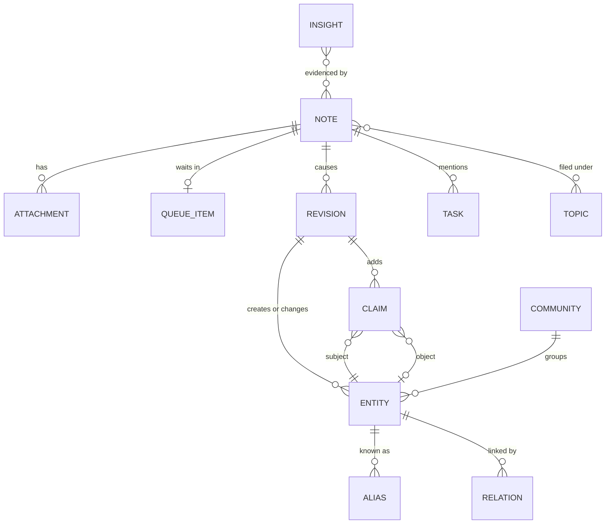

# Data model

This page defines the records AbstractNote keeps, how time works, how identities are assigned,
and how duplicates are handled. The Python types live in `abstractnote.model`; the SQLite schema
in `abstractnote.store.schema`; the AbstractMemory projection in `abstractnote.store.kg`.

## Overview

## Note

A note is anything you send: a sentence, a document, an image, a recording, a video, a log, a
chat turn imported from a transcript. It is the unit of provenance: every entity, claim and
revision points back to the note(s) that caused it.

| Field | Type | Meaning |
|---|---|---|
| `note_id` | `nt_<26 chars>` | Deterministic, base32 of a sha256. Imports: `sha256(importer, source_key)`. Live capture: `sha256(idempotency_key)` when the client sends one (clients always should; the runs API has no idempotency key of its own), otherwise `sha256(text_norm, attachment hashes, occurred_at to the minute, source.client)`. A retried request yields the same note; the same words said again on another day yield a new note that revisits the earlier one. |
| `kind` | enum | `idea`, `task`, `decision`, `fact`, `event`, `question`, `reflection`, `reference`, `log`, `conversation`, `personal`, `synthesis`, `insight`. Assigned by the quick filing step; `synthesis` and `insight` are system-authored. |
| `title` | text | Short title (model-written or taken from the source). |
| `text` | text | The note body as received (Markdown allowed). Never truncated. |
| `text_norm` | text | Whitespace-normalised, lower-cased copy used for hashing and full-text search. |
| `summary` | text | One to three sentences written by the processor. |
| `occurred_at` | ISO 8601 UTC | When the note was made or the event happened. From the client clock, the importer (message timestamp, file date, EXIF), the attachment's own metadata date or the file date the client sent for a capture that gives none, the moment of the capture, or an explicit value; moved only by a `note.redate` (see "Document dates"). |
| `date_basis`, `date_approximate` | read only | How `occurred_at` was found (`GET /note/notes/{id}`, and the capture answer): the latest redate's basis (`content`, `stated_month`, `stated_year`, `user`), else `source.origin.date_basis` (an importer's, docs/importers.md, or a live capture's `upload`, `pasted_text`, `capture_time`, `file_mtime`, `exif`, `pdf_created` ...), else `client` for a note typed now and `unrecorded` for an older import; `date_approximate` is true for a stand-in date (`upload`, `pasted_text`, `capture_time`, `stated_month`, `stated_year`, `file_mtime`, `git_added`, `bulk_commit`, `store_updated`, `last_record`, `origin_session`, `front_matter_modified`, `unrecorded`), the ones a client offers to "Set the date". |
| `received_at` | ISO 8601 UTC | When AbstractNote stored it. |
| `processed_at` | ISO 8601 UTC or null | When the last successful revision was applied. |
| `source` | object | Provenance: `{client: web|watch|iphone|cli|agent|importer, importer?: claude-sessions|agora|markdown|files, origin: {...source-specific ids...}, author?: user id or agent name}`. |
| `location` | object or null | `{lat, lon, accuracy_m?, label?}` when the client provides one. |
| `language` | text or null | BCP-47 tag detected by the filing step. |
| `topics` | list | Categories assigned by filing and refined by processing (see Topics). |
| `priority` | int 0..3 | 3 urgent, 2 high, 1 normal, 0 bulk. |
| `status` | enum | `received`, `queued`, `processing`, `processed`, `failed`, `duplicate`, `archived`. |
| `duplicate_of` | note id or null | Set only when the same idempotency key or import source key arrives again (a retry), never for the same words on another occasion. |
| `session_id`, `run_id` | text | The gateway session and the run that captured it, when applicable. |
| `archived_at` | ISO or null | Notes are archived, never deleted. |

### Attachment

| Field | Meaning |
|---|---|
| `attachment_id` | `at_<...>` deterministic from `(note_id, sha256)` |
| `sha256`, `size`, `mime`, `filename` | the bytes' identity |
| `artifact_ref` | the gateway artifact that carried it, when uploaded through the gateway |
| `blob_path` | `blobs/<sha256[:2]>/<sha256>`; stored once per distinct content across the notebook |
| `extracted_text`, `extracted_by` | text derived from the bytes (document text, transcript, image description, log excerpt, media metadata) and which extractor produced it (`plain`, `markdown`, `pdf`, `vision:<model>`, `stt:<model>`, `media-metadata`, `none`). Audio and video with a speech track are transcribed when a speech model is configured; otherwise, and for music, the filing keeps the metadata (filename, duration, tags) and the capture answer says so plainly. |

Two notes that attach the same file share one blob; the second attachment records the
relation `same_bytes_as` so the graph shows that the file came back.

## Entity

An entity is a thing the notes talk about: a person, an organisation, a project, a concept, a
place, an event, an artifact (a document, a dataset, a repository), a piece of software, or a
generic thing.

| Field | Meaning |
|---|---|
| `entity_id` | `ex:<kind>-<slug>` following AbstractFramework ADR 0025, the slug being the canonical name written in kebab-case ASCII (`ex:person-laurent-philippe-albou`). A collision with a different entity of the same kind appends `-2`, `-3`. Ids are never reused. |
| `kind` | `person`, `org`, `project`, `concept`, `place`, `event`, `artifact`, `software`, `thing` |
| `name` | the one canonical name, shown everywhere: Unicode NFKC, trimmed, case-folded, every run of whitespace, punctuation or underscores collapsed to one `_` (snake_case for several words), none at either end (`ids.canonical_name`: `Laurent-Philippe Albou` is `laurent_philippe_albou`; `Memory`, `memory` and `MEMORY.` are `memory`) |
| `name_key` | the lookup key of the name (`ids.name_key`, equal to the canonical name); unique among live entities, so a person never sees two entities that differ only by case, spacing or punctuation |
| `display_name` | the first surface form a note wrote (`Laurent-Philippe Albou`), kept for clients that want it; a rename replaces it |
| `aliases` | other names seen in notes, each stored with its surface form and its key (`alias_key`); shown once per canonical name and never the entity's own; exact matching is by key |
| `summary` | one model-written sentence saying what the notebook knows about it, rewritten when a note tells something new (each revision kept) |
| `first_seen`, `last_seen` | `occurred_at` of the first and latest note mentioning it |
| `note_count` | number of notes that mention it |
| `merged_into` | set when the model decided this entity is the same as another; the record stays so old links still resolve |
| `retired_revision_id`, `retired_at` | set when only a superseded interpretation created the entity and nothing references it any more (`entity.retire`, ADR 0008): it leaves lists, counts (stats, timeline, the day view, the overview, changes), communities, the graph, search, cues and the summary refresh; its own page says what retired it (`retired` on the card: the note, and `into`, the entries the new reading uses for the same words, from the op's `read_as`); the archive as received before shows it; a later mention brings it back |
| `embedding` | vector of `name + aliases + summary`, refreshed when the summary changes |

Entities are created only by revisions. The id is minted from the canonical name of the name chosen
by the model at creation time; later renames add aliases and may change `name`, never the id.

One canonical name per entity is a deterministic guarantee, applied when a revision is applied
(`Notebook.apply_revision`, `abstractnote.store.names`): an `entity.create` whose canonical name a
live entity already has becomes a reuse of that entity, whatever the model decided. The surface forms
become its aliases, later ops of the revision follow it (an identical statement reinforces the
existing one, and moves its start back when the note is older; a statement linking the entity to itself is left
out; the create's summary is kept as dated history when the entity's current summary describes a later day), the revision records a warning
(with `kind_conflict` when the kinds differ: the existing kind is kept, never a second entity), and
the stored revision is the rewritten one, so a replay agrees. A rename onto a canonical name another
live entity has is refused (that is a merge). Aliases never force a reuse: an alias is the model's
word for an entity, and only produces candidates. A mention name or alias that ends with one of the
entity kinds in parentheses (`memory (software)`) loses that suffix before its canonical name is
taken, with a warning (`names.strip_kind_suffix`): the linking packet once showed entities as
`name (kind)` and the model copied the form into names; it now shows `name — kind`. This is
structural (a known kind word in a fixed position), not a reading of the name.

Notebooks written before canonical names (schema 1) are upgraded on open: `name_key`, `display_name`
and `alias_key` are filled in, a later live entity whose canonical name an earlier one holds is marked
(`key_clash_with`), and the next processed note runs the repair, `Notebook.normalize_entities`
(`abstractnote normalize`, `POST /note/entities/normalize`): each group of live entities sharing a
canonical name is merged into its earliest entity, one `entity.merge` revision per merged entry with
source `{client, account}` (`migration` for the automatic run), the merged entry's names kept as
aliases. Reads follow merges, so its statements, relations, notes and tasks come with it; an unmerge
undoes it, and the separated entry takes the first free `<name>_2`, `<name>_3` so two live entities
never share a canonical name. A pair a person separated is never joined again by the repair. The
repair also joins the entries left by the `name (kind)` echo: a live entity whose surface form ends
with ` (<kind>)` and whose canonical name is `<name>_<kind>` is merged into the live entity named
`<name>` when there is one (the group lists it under `kind_suffix`; the echoed form is not kept as an
alias); an entry written as words (`contact person`) or whose plain name no entity has is left alone.

## Claim

A claim is one statement with time and provenance. Claims are the edges and attributes of the
graph.

| Field | Meaning |
|---|---|
| `claim_id` | `cl_<...>` deterministic from `(note_id, subject, predicate, object)`; predicate CURIEs keep their case in the index |
| `subject_id` | entity id |
| `predicate` | a CURIE from the AbstractSemantics registry when one fits (`schema:knowsAbout`, `schema:participant`, `skos:related`, `dcterms:references`, `cito:disagreesWith`, ...), otherwise `ex:<snake_case>` |
| `object_id` or `object_literal` | an entity, or a literal value (text, number, date) |
| `certainty` | `stated`, `probable`, `possible`, `reported`, `disputed` (tokens, not numbers) |
| `stance` | `assert`, `revise`, `retract`: what the note does to earlier knowledge |
| `observed_at` | the note's `occurred_at`; moved back to an earlier note's date when that note restates or refines the claim (`claim.start_earlier`, never later) |
| `valid_from`, `valid_until` | the validity window; `valid_from` defaults to `observed_at` for state claims and is null for timeless facts or for a statement that stopped before its note was written (`valid_until` earlier than the note); `valid_until` is set when a later note supersedes or retracts the claim, when the claim is an earlier belief placed before a later one (`claim.insert_before`: the later one's start; a Linking `earlier_state_of`), and equals `valid_from` when you retract it ("never true"); it is never earlier than `valid_from`. An earlier note that restates or refines the claim moves `valid_from` back to its date when it was later (`min`, never later; no start stays no start) |
| `status` | `active`, `superseded`, `retracted`, `reinterpreted` (the note was understood again and its new reading does not make this statement: an empty window, never a belief; see "Re-understanding") |
| `superseded_by` | the claim that replaced it |
| `evidence` | the verbatim excerpt of the note that supports the claim |
| `note_id`, `revision_id` | provenance |
| `assertion_id` | the id of the same claim in the AbstractMemory store (equals `claim_id`; a statement a re-understanding revised in place or re-opened has a new copy there, named here, whose `attributes.claim_id` is the claim) |

### Relation

A relation is a derived, fast-to-read summary of all claims between two entities:
`(subject_id, object_id, predicate) -> first_seen, last_seen, count, active_claim_ids`. The graph
view reads relations. The **relation timeline** (`/note/relations/{a}/{b}`) is first-class: all
claims between two entities in history order, with supersessions and a then-versus-now of the
relationship, so the evolution of a link is as visible as the evolution of a node.

## Revision

A revision is the append-only record of what one processed note did to the graph. It is the
authoritative history: replaying revisions in order rebuilds entities, claims, relations, topics
and tasks.

| Field | Meaning |
|---|---|
| `revision_id` | `rv_<...>` deterministic from `(note_id, attempt)`; user actions use `(action, target, occurred_at)` |
| `note_id` | the cause (null for a user action; then `source` names the client and account) |
| `applied_index`, `applied_kg` | flags set after each projection commits; recovery replays revisions whose flags are not both set (idempotent thanks to deterministic ids) |
| `at` | the note's `occurred_at` (history time) |
| `recorded_at` | when the processor applied it (system time) |
| `run_id` | the processing run (ledger) |
| `action` | null for a note's first understanding; `note.reinterpret` for a re-understanding (ADR 0008, id from `(note.reinterpret, note_id, the revision it supersedes)`); the user action otherwise |
| `context_json` | the dependency record (ADR 0008): what the reading saw, `{as_of, entities, claims, summaries: {entity_id: revision_id}, notes, mention_queries, looked_up}` (see "Re-understanding"); null on revisions written before schema 3 (`context_unknown`) and on user actions |
| `ops` | ordered list of operations |
| `summary` | one sentence written by the processor ("Linked the LUT budget decision to Castor; superseded the earlier plan.") |

Operations:

| op | payload |
|---|---|
| `entity.create` | `{entity_id, kind, name, aliases, summary}` |
| `entity.alias` | `{entity_id, alias}` |
| `entity.rename` | `{entity_id, name, previous}` |
| `entity.summary` | `{entity_id, summary, previous}` |
| `entity.merge` | `{from_id, into_id, reason}` |
| `claim.add` | the claim |
| `claim.supersede` | `{claim_id, by_claim_id, reason, valid_until}` |
| `claim.retract` | `{claim_id, reason, valid_until?}` (without `valid_until`, the window closes at the revision's time) |
| `claim.reinforce` | `{claim_id, note_id}` (the same statement seen again) |
| `claim.insert_before` | `{claim_id, before_claim_id, valid_until, reason, after_claim_id?, after_valid_until?}`: the claim just added by this revision comes from a note older than `before_claim_id`, the belief it gives way to; it is closed at `valid_until` (that belief's start) and superseded by it, which stays untouched; `after_claim_id`, the belief before it, now ends at `after_valid_until` (this claim's start) and is superseded by it (see Time) |
| `claim.start_earlier` | `{claim_id, note_id, observed_at, valid_from, previous_observed_at, previous_valid_from, subject_id, predicate, object_id, object_literal, certainty, stance, evidence, reason, after_claim_id?, after_valid_until?}`: an earlier note shows the belief already held on its date: `observed_at` and `valid_from` move back to it (`min`, never later; a claim without a start keeps none), the relation's `first_seen` follows; `after_claim_id`, the belief before it whose window covered that date, now ends there; the statement's content rides along for AbstractMemory (see "AbstractMemory projection"); emitted after the `claim.reinforce` |
| `topic.assign` | `{note_id, topic}` (stored under the topic's canonical name; processing keeps the first 3 per note) |
| `topic.unassign` | `{note_id, topic}`: the note leaves the topic as stored (`abstractnote normalize-topics`) |
| `task.open` / `task.close` / `task.drop` | `{task_id, text, due?, by_note_id?}` |
| `entity.unmerge` | `{entity_id, from_id, reason}` (a user action; re-points the claims that came from `from_id`) |
| `entity.mention` | `{entity_id, note_id}` (the note talks about the entity; drives `note_count`, `first_seen`, `last_seen`) |
| `note.summary` | `{note_id, summary, kind, language}` |
| `note.archive` | `{note_id, duplicate_of?, reason?}`: the note is archived (it leaves lists, search and the queue, keeps its links) and names the copy it duplicates (`abstractnote dedupe-sources`) |
| `note.reinterpret` | `{note_id, supersedes, reason, by_note_ids}`: the first op of a re-understanding (see "Re-understanding"): the interpretation `supersedes` is superseded, its mentions and topics are soft-removed (`entity_notes_removed`, `note_topics_removed`) for the new reading's ops to add them again |
| `claim.reinterpret` | `{claim_id, valid_until, assertion_id, reason}`: a statement of the superseded reading the new one does not make: status `reinterpreted`, window emptied at its own start; AbstractMemory closes its copy with the closure kind `reinterpreted` |
| `claim.revise` | `{claim_id, certainty, stance, valid_from, valid_until, evidence, assertion_id, previous, previous_assertion_id, empty_at, assertion}`: the same statement (subject, predicate, object) read again with another certainty, stance, window or evidence: updated in place (`previous` keeps the earlier values; a window another revision closed stays closed); AbstractMemory gets the new copy `assertion` and closes the previous one empty (kind `reinterpreted`) |
| `claim.reopen` | `{claim_id, status, valid_until, superseded_by, closed_reason, closed_revision_id, closed_by_revision, assertion_id, previous_assertion_id, empty_at, assertion}`: a statement of another note that the superseded reading had closed (superseded, retracted, narrowed) and the new reading leaves alone: restored to the state the other revisions give it; AbstractMemory gets a re-opened copy (a window cannot widen there) |
| `claim.repoint` | `{claim_id, superseded_by, previous}`: a statement the superseded reading closed and the new reading closes on the same slot: it stays closed, superseded by the new reading's statement |
| `reinforcement.drop` | `{claim_id, revision_id}`: a reinforcement the superseded reading made that the new one does not repeat |
| `claim.start_restore` | `{claim_id, observed_at, valid_from, earlier_assertions: [{assertion_id, empty_at}], reason}`: the inverse of `claim.start_earlier`: the superseded reading's earlier evidence moved the belief's start back and the new reading no longer restates it: `observed_at` and `valid_from` return to the start replayed from the claim's own add and the moves that remain; AbstractMemory closes each additive earlier-evidence assertion empty with the kind `reinterpreted`; as received before the re-understanding the moved start is still shown |
| `task.reopen` | `{task_id, closed_revision_id}`: a task the superseded reading closed that the new one does not close |
| `task.retire` | `{task_id, reason}`: a task of the superseded reading the new one does not have: status `retired` |
| `entity.retire` | `{entity_id, reason, read_as}`: an entity only the superseded reading created and that nothing references any more (see Entity); `read_as`: the entries the new reading uses for a mention whose name or alias has the retired entry's name or alias as its lookup key (empty when it no longer names it) |
| `note.redate` | `{note_id, from, to, basis, quote?, reason?}`: the note moves in history time (`basis` `content` when its text states its date, `user` when a person sets it); its mentions, its topics' ranges, its queue place, and the statements and tasks it wrote with the old date move with it; `source.redated` keeps `{basis, from, to, revision_id}` |

User actions (`close a task`, `retract a claim`, `undo a merge`, `confirm a match`) produce revisions with
`source = {client, account}` and no note; they are the human side of an actionable graph. Through
the gateway, `account` is the signed-in user and `client` is `web` (the Note web app) or `api`
(any other caller), decided by the server, never by the request body.

Confirming a match from the review list (`POST /note/review/{id}/confirm`) is a revision with `action =
match.confirm` and `target` = the review id: for a close match (an `unsure` decision, recorded as a `skos:closeMatch`
claim from the new entry to the candidate) its ops are `entity.merge` (the new entry into the candidate) and
`claim.supersede` of the close-match claim; for a merge the processor made it has no ops and only records that you
keep it. Revisions are the truth, so a rebuild keeps what you confirmed.

Reversibility: a merge keeps both records and can be undone by a later revision that re-points
claims; a supersession keeps the old claim with its window closed.

## Topic

A topic is a lightweight category (`#lut`, `#release`, `#family`). The filing step chooses from
existing topics first and proposes new ones sparingly; the processor may refine. Topics are
flat; entities carry the structure.

A topic is stored under its canonical name (the entity rule: `Bug-Fix`, `bug fix` and `bug_fix` are
`bug_fix`), and processing keeps the first 3 topics the model lists for a note (`TOPICS_PER_NOTE`; a
user revision is not capped); the others are named, never dropped silently (ADR 0007): the revision's result
lists them under `topics_not_assigned`, its warnings and its summary say which were not kept. Quick filing keeps
4 (`MAX_FILING_TOPICS`) and names the rest in `note_file`'s `topics_not_assigned`. The extraction packet lists the 50 most used topics. Topics stored before
that keep their spelling until `abstractnote normalize-topics --notebook DIR [--dry-run]` gives each
group one name in ONE revision (`topic.unassign` + `topic.assign`): the same canonical name (case,
`-`, `_` and whitespace). That is spelling, not meaning: no word rule decides that two topics are one
(ADR 0004), so `bug_fixes` and `bug_fix`, or `gateway` and `abstractgateway`, stay two topics. Search and
note lists filter by a topic's given and canonical spelling.

## Task

Open loops extracted from notes: `{task_id, note_id, text, status open|done|dropped|retired, due?,
closed_by_note_id?}`; `task_id` is `tk_<...>` deterministic from `(note_id, normalised text)`. A later note that reports the task done closes it with a `task.close` op,
decided by the model during processing, applied only when the linking quotes the note's own words that say it is
done (`evidence`, a whole-word sequence of the note) and the note is not older than the task; otherwise the open task
stays open and the note's task is its own (opened, and closed when reported done), with a warning. So no task closes
before it opened.

## Insight

System-authored notes with `kind = insight` or `synthesis`: dossiers from deep recall and the
findings of the reflect flow (open loops, contradictions, resurfaced material, connections).
They carry `evidence_note_ids`, `entity_ids`, `insight_kind` (`warning`, `reminder`,
`connection`, `contradiction`, `evolution`, `dossier`, `cue`) and `acked_at`. Cue cards are the
unacknowledged insights other than dossiers, newest first.

## Community

A community is a group of entities the notes keep bringing together (a project and its people, a set
of tools, a theme), found by `abstractnote.recall.communities` without a model and named by one. They
make a large graph readable: the explorer colours nodes by community, and the statistics count them.

| Field | Meaning |
|---|---|
| `community_id` | `cm_<20 chars>`, a hash of the sorted member entity ids when the community first appeared; kept while its membership changes little (below) |
| `label`, `summary`, `kind` | the model's name (at most 4 words), one sentence on what holds the group together, and `project`, `theme`, `people`, `tooling`, `process` or `other`; null until the reflect flow labels it |
| `size`, `top_entities` | member count and the 5 members with the most notes |
| `created_at`, `labelled_at` | when it first appeared, when it was last labelled |
| `stale_label` | the label is kept but more than 20 % of the membership changed since it was labelled: the next reflect run names it again |
| `revision_count_at_compute` | applied revisions when detection last ran; `GET /note/communities` reports `revisions_since` |

Detection is Louvain (`networkx`, fixed seed, resolution 1.0 by default) over the live entities,
deterministic for a given networkx version: the same graph under the same networkx release gives the
same communities, but another release may split it differently, so `meta.communities` records the
`networkx` version of each computation (`GET /note/communities` reports it) and the dependency is
capped below the first release that changes the partition (`networkx>=3.2,<3.7`; 3.4 and 3.6 were tested, 3.7 differs);
the weight of a pair is the number of its statements that were not retracted (merged entries count
for their survivor) plus a co-mention weight: each note that mentions `k >= 2` live entities adds
`1/((k-1)·log2 k)` to every pair among them, so a long note weighs `k/(2·log2 k)` in all rather than
`k/2` (docs/cognition.md, note-reflect). Groups of fewer than 3 entities are the **loose ends**
and belong to no community. A recomputation matches each new group to the previous community it
overlaps most (Jaccard of the member sets, best overlaps first, each previous community used once):
an overlap of at least 0.6 keeps the id, label, summary and kind; anything else is a new community
with a new id and no label. Once after the networkx version changed (or after a computation that
recorded none), the floor is 0.5, and a labelled previous community that still matches nothing hands
its label, marked stale, to the unmatched new group it overlaps most (a new id); the recompute
response lists those labels under `carry_over` (`kept`, `stale`, and `dropped` for a label no new
group overlaps), so a library upgrade never loses a label silently. Tables `communities` and `entity_communities` (one row per member) are
derived, but because the labels are model work, `rebuild` keeps them (`schema.KEPT_TABLES`). A
notebook opened without its embedding model reads communities and refuses to recompute or label.

A community's label longer than 4 words is kept whole with an `over_length` warning (ADR 0007).

## Consolidation run

Table `consolidation_runs` (kept by `rebuild`) holds one row per memory consolidation (docs/cognition.md,
note-consolidate); the open row has no `finished_at`. `status` is `running`, `completed` (nothing was left out),
`completed_with_gaps` (the run finished its stages but left items for the next one), `failed` (`error` is the
step's sentence) or `interrupted` (it stopped before closing). `stages_json` holds per stage `{done, total,
seconds_per_item, started_at, skipped?, reason?, reasons?, skipped_ids?: [{id, reason}]}`: `skipped_ids` are the
entries or groups the stage skipped for this run after the model left them unanswered twice. `results_json`
holds the counts and, for a finished run, `left_out: {summaries, labels, reasons}` (skipped items still pending
at the close plus what the time budget did not reach, never more than pending) and `budget_spent`.
`offered_json` lists the entries the run already offered (never offered twice in a run), `touched_json` the
entries it merged into or summarised. A summary longer than 600 characters is kept whole with an `over_length`
warning in its revision (ADR 0007).

## Time

AbstractNote is bitemporal, and every note carries three dates that answer three different questions:

| Date | Field | Question it answers |
|---|---|---|
| Authored (history time) | `occurred_at`, `claim.observed_at`, `revision.at` | "When was this written or did it happen?" "What did the graph look like on day X?" |
| Valid | `claim.valid_from`, `claim.valid_until` | "What did I believe about X at time T?" |
| Archive-accepted (system time) | `received_at` (and `processed_at`, `revision.recorded_at`) | "What did my archive hold on date R?" "What has the processor done since I last looked?" |

The axes are independent: an import received today can hold notes authored years ago, and a note
written in January can say something stopped being true in March.

Rules:

- The archive **as received at R** (`as_received=R` on `GET /note/graph`, `GET /note/entities/{id}`,
  `GET /note/changes` and `GET /note/day/{date}`) = only the notes with `received_at <= R`, so material
  imported later is left out even when it was authored earlier. What derives from notes follows them: a
  revision belongs when the note that caused it was received by R (a user action without a note: when it was
  recorded by R); entities exist when such a revision created them or such a note mentions them; merges,
  names, aliases, summaries and the closing of claims count only when their revision belongs, so a claim a
  later note superseded reads as it stood before. `at` and `as_received` compose: "the graph as of T, from
  what the archive held on R".
- The graph **as of T** = entities first seen at or before T (their creating revision's `at`, or an
  earlier note that mentions them when notes are processed out of history order), not merged away
  by T; edges from claims with `observed_at <= T`.
- **Beliefs at T** = claims with `valid_from <= T` and (`valid_until` is null or `> T`).
- Supersession sets `valid_until` of the old claim to the `occurred_at` of the superseding note;
  so does a note whose stance is `retract`.
- A retraction you make (`POST /note/claims/{id}/retract`) says the claim was never true: its
  status becomes `retracted` and `valid_until = valid_from` (its `observed_at` when it has no
  start), an empty window, never the moment you said so. Retracted claims are never beliefs.
- Importers set `occurred_at` from the source (message timestamp, commit date, file date);
  `received_at` is always the ingest time, so an import is visible as a system-time event while
  history stays truthful.
- Explicit time references inside a note ("last Tuesday", "in 2024") are extracted as claims with
  literal dates when the model can resolve them from the note's own `occurred_at`; they never
  move the note itself. Only the date the text gives ITSELF can (below).

### Retrospective insertion

Notes and archives from earlier dates (and other projects that name known entities) keep arriving into a graph
built from later ones, while live notes arrive too. History adapts; nothing is rewritten in place except windows:

- **Beliefs in history order.** Supersession and contradiction are applied with regard to time. For a statement
  `C_new` (its note's `occurred_at` = `t_new`) that the linking says supersedes an existing `C_old` (`observed_at`
  = `t_old`), on the same resolved subject and predicate:
  - `t_new >= t_old`: as always, `C_old` closes at `t_new` (`claim.supersede`, or `claim.retract` for a
    `retract` stance).
  - `t_new < t_old`: an older note never closes a later belief. `C_new` is inserted as the EARLIER belief
    (`claim.add` + `claim.insert_before`): placed in its interval of the supersession lineage of `C_old` (the
    claims linked to it by `superseded_by`, same subject and predicate, retracted ones left out), it ends at the
    start of the next later belief and is superseded by it; the belief before it, if its window covered `t_new`,
    now ends at `t_new` and is superseded by `C_new`. Out of order 2026, then 2022, then 2024: 2022 holds
    [2022, 2024), 2024 holds [2024, 2026), 2026 is the active belief.
  - `contradicts` with `t_new < t_old` is the earlier belief the same way, unless the model marked the statement
    `disputed` and the two dates are at most 30 days apart: then it is a dispute (both kept, marked disputed).
  - `earlier_state_of` (ADR 0008 §2): the linking packet shows each candidate as known on the note's date and,
    apart and labelled LATER, every statement recorded after it; the model names a LATER statement by index
    when the note's statement is the same kind of fact with the value it had before (an intern in 2022, a head
    of research in 2024, a director in 2026). It is placed like an older `supersedes` (`claim.insert_before`,
    never closing the later belief). The named statement must be about the same resolved subject and LATER
    than the note (first seen on a later day, and not said to hold already on the note's date); otherwise a
    warning and the statement is `new`. A `supersedes` that names a statement whose history (its supersession
    lineage) holds a statement after the note's date is placed the same way, so a note dated between two
    beliefs lands between them whichever of the two it names.
  - One predicate per fact: a statement linked by index (`supersedes`, `contradicts`, `earlier_state_of`) to a
    statement of the same subject whose predicate is spelled differently ADOPTS the existing predicate, with a
    `predicate_adopted: <new> -> <existing>` warning (the model's index decides, never the strings; ADR 0004),
    when both values are of the same kind (two texts, or two entities); a text linked to an entity relation
    (`role "intern"` before `leads zorn_labs`) keeps its own predicate, with a warning, and the link holds the
    history: a lineage follows supersession links on the same subject across predicates.
    A `new` statement on a subject and predicate whose LATER statements the packet showed is kept (a relation
    that adds up has many values) and said: `parallel_belief: ...` in the warnings, counted in the result.
  - **Earlier evidence moves a belief back.** `restates` (or `refines`, or an identical statement found by
    resolution) from a note OLDER than the belief: `claim.reinforce` plus `claim.start_earlier`: the belief's
    `observed_at` and `valid_from` move back to the note's date, never later (a claim said to hold since 2020
    restated by a 2022 note keeps 2020), the belief before it in its lineage is narrowed to end there, and the
    relation's `first_seen` follows. When another state of that belief began between the note's date and the
    belief's (2022 restates a 2026 value after a 2024 one), the start does not move over it: the note's
    statement is its own earlier belief, placed before that state. A move of minutes (live notes out of order,
    within a day) is applied but not a retrospective mark. The archive as received before the earlier note
    shows the belief's previous start.
  - A `supersedes` naming a statement no longer believed on the note's date (it ended, or was retracted, since
    the note was read) closes nothing: the statement is kept as new with a warning. A supersession at the very
    time the replaced statement began leaves it an empty window and says so ("same day").
  - "Known then" (the packet): a statement first seen on or before the note's day, or recorded later but said to
    hold already then (`valid_from` on or before the note's date: "stated later, said to hold since ..."),
    whose window covers the note's date.
  - A window never ends before it starts: a closing date earlier than the closed claim's `valid_from` closes it
    empty (at `valid_from`), in the builder (so the note index and AbstractMemory agree) and again in the
    projection (for replays of earlier revisions); an extracted end before an extracted start is ignored.
- **Tasks**: an older note cannot close a task opened later; a later note can (see Task).
- **Entities**: `first_seen` moves back to the older note (it is the earliest mention); the graph as of T shows
  the entity from then.
- **Summaries are dated knowledge**: a summary an older note writes describes the entity as of that note's date
  (the linking packet shows the summary as known then and later ones only in the LATER block) and is stored at the
  note's date in the summary history; the current summary stays the latest dated one. A create that the canonical
  name turns into a reuse keeps its summary that way when the entity's current summary describes a later day.
- **Retrospective marks** (`meta.retro`, written in the projection transaction): a note that mentions an entity
  already seen more than a day later (live notes a few minutes out of order are not), a `claim.insert_before` (its subject, object and neighbours) or a `note.redate`
  marks the entities: their summaries are stale (until a summary recorded after the mark is the current one, the
  consolidation's refresh), their then-versus-now cards are dropped, `graph_version` is bumped and the event is
  logged. `Notebook.retro_state()` reports `{graph_version, insertions, stale_summaries, retro_notes_since_communities,
  communities_due}` (due after 20 retrospective notes since the communities were last computed);
  `Notebook.after_retro_insert(entity_ids)` records one by hand. The revision result lists `retrospective` (the
  marked entities) and `claims_inserted_before`.
- **History order everywhere history is shown**: timelines, then-versus-now and relation timelines order by
  `occurred_at`/`observed_at` and end a superseded belief at its `valid_until` (not when the closing revision was
  applied); new entities are counted where they were first seen. `GET /note/changes` stays in system time.

### Re-understanding (ADR 0008)

A note is understood against what the notebook knew; when an earlier note (its foundation) arrives later, the
note is understood again. Interpretation is a derived view: each reading is a revision, the revision log keeps
them all, and the as-received axis shows what the notebook believed before.

- **Dependency record** (`revisions.context_json`, every processing and re-understanding revision): what the
  reading SAW, from the stored context packet as the apply finds it: `as_of` (the note's date), `entities` (the
  candidates `note_context` showed and those `note_resolve_candidates` offered per mention), `claims` (every
  statement the packet indexed), `summaries` (`{entity_id: revision_id}` of the summary known at the note's date),
  `notes` (the similar notes shown), `mention_queries` (the mention names resolve was asked, for the no-call check)
  and `looked_up` (false when the note was applied without a context: nothing was seen). R1's digest
  (`packet.context`) is merged in when present. A stored packet that has lost its keys fails the apply loudly.
- **What a reading USED** (`note_dependencies`, a projection of the current interpretation): the subjects and
  objects of its statements, the statements it related to (reinforced, closed), its tasks and the tasks it closed;
  its mentions are `entity_notes`. This, not what the packet merely showed, is the invalidation key (a hub entity
  shown in every packet marks only the notes that used it).
- **Marks** (`reinterpret_marks`, truth: kept by a rebuild, never written by a replay): when a revision is
  applied, the notes whose current interpretation used an entity it touched (created, mentioned, the subject or
  object of a statement it added or closed, an alias or summary it wrote, an entity it retired), or an entity whose
  canonical name or alias has the same key as one of those (exact keys, ADR 0004), or an entity whose name or alias
  the note's own words write (whole words), or that closed a task whose words contain or are contained in a task
  this note opened, are marked `{note_id, reason, by_note_id, by_revision_id, entities, from_at, marked_at}`. The
  reason is a sentence ("An earlier note (2026-03-05) says more about LUT."). Forward only: a note understood for
  the first time marks only notes on or after its date (the same date included); a re-understanding marks only
  notes after it in history order (date, then received time, then id), so marks never go back in history and a
  pass terminates. A person's re-date marks forward from the earlier of the two dates over the moved note's used
  entities, and the moved note itself; an archive (not of a duplicate) from the note's date; a retraction from the
  statement's date; a join or separation a person confirmed from the earlier first mention. The canonical-name
  repair and duplicate archiving mark nothing (they join copies, not meanings). A note has at most one untaken mark
  (idempotent); once a pass took it the note is in flight, and a new mark is a new row for the next pass. The apply
  result says how many notes it marked and why (`marked`, `reinterpret_marked`).
- **`note.reinterpret`**: the consolidation's reinterpret stage (cognition.md) or `note_apply_revision(...,
  reinterpret=true)` reads a marked note again with `note-process` (its context leaves out its own previous
  reading and shows again what that reading had closed). The new reading supersedes the previous one's effects;
  the inverse of every op of the superseded interpretation:

| op of the superseded reading | in the re-understanding |
|---|---|
| `claim.add` (its own statements) | same subject, predicate and object in the new reading: kept as is, or `claim.revise` in place when certainty, stance, window or evidence differ; otherwise `claim.reinterpret` |
| `claim.supersede`, `claim.retract`, `claim.insert_before` (`after_claim_id`) on another note's statement | the new reading writes on the same slot (subject and predicate): stays closed (`claim.repoint` to the new statement); otherwise `claim.reopen` to the state the other revisions give it |
| `claim.reinforce` | repeated: kept; otherwise `reinforcement.drop` |
| `claim.start_earlier` (earlier evidence moved another note's belief back) | restated again by the new reading: kept; otherwise `claim.start_restore` (the start the other revisions give it; its earlier-evidence assertions close empty in AbstractMemory) and the belief it had narrowed is re-opened (`claim.reopen` above) |
| `entity.mention` | soft-removed (`entity_notes_removed`); the new reading's mentions are added |
| `topic.assign` | soft-removed (`note_topics_removed`); the new reading's topics are added (the first 3) |
| `task.open` (its own tasks) | the same task (same words) in the new reading: kept (re-opened when the new reading no longer says it is done); otherwise `task.retire` |
| `task.close` of another note's task | closed again by the new reading: kept; otherwise `task.reopen` |
| `entity.create` | referenced by the new reading or by anything else: kept; otherwise `entity.retire` |
| `entity.alias`, `entity.rename`, `entity.summary`, `entity.merge`, `note.redate`, `note.summary` | kept (names seen in the note's words, dated summaries in the history, merges a person can undo; the note summary is rewritten) |

  When the new reading's statements (subject, predicate, object, certainty, stance, window), mentions, tasks and
  topics equal the old ones, nothing is written: the mark is consumed `unchanged` (a summary rewrite alone is
  `summary_only`, still unchanged), and the current reading's dependency record becomes what that re-reading was
  read against (its packet's record, `related` included), so a later wave from the same unchanged idea, or a note
  that arrived before it, is settled without a call. Before any model call, the stage's no-call check compares the note's context
  looked up again with the dependency record (what was known at the note's date only, without the reading's own
  entities, statements and summaries): equal means the foundation did not change, `unchanged` with zero calls.
  The revision's id is deterministic from the revision it supersedes, so a replay is a no-op.
- **AbstractMemory**: a closed reading is the additive closure kind `reinterpreted` (never a retraction; an
  AbstractMemory without it makes the re-understanding fail before anything is written). A revised or re-opened
  statement is a new assertion copy (content is append-only, a window cannot widen), its `attributes.claim_id`
  naming the claim; the copy it replaces is closed empty with the kind `reinterpreted`. `ClaimStore.active_claim_ids`
  answers claim ids, so the two stores agree.
- **As received**: a re-understanding belongs to the archive at R when it was RECORDED by R (it is what the
  processor did then): before it, the archive shows the previous reading's statements (their status, window and
  revised values), mentions, topics and the entities it alone created.
- **Supersede of a statement no longer believed** (a context read before a re-understanding or a person closed
  it): nothing is closed, the note's statement is kept as new, the revision warns `stale_context` and the result
  lists the statements.
- **Upgrade** (schema 3): `meta.dependency_record = {schema: 3, since_seq, upgraded_at}`; revisions up to `since_seq`
  have no record (`context_unknown`): they are reached through their mentions and the name match, and a mark on such
  a note is always read again with the model.

#### Deep changes reach the ideas that relied on them (ADR 0008 §4a)

A re-understanding is the one place where two readings of the same note can be compared, so it is where a change of
meaning is measured and from where it spreads (`recall/propagation.py`).

- **Change records** (`idea_changes`, truth: written once when the re-understanding is applied, copied by a
  rebuild, never recomputed by a replay; key `(revision_id, entity_id)`): for every entity the old or the new
  reading touched (canonical; the entities of its ops, the subjects and objects of the statements it changed, the
  mentions it soft-removed), four signals in [0, 1] comparing the note's OLD reading with its NEW one:
  - `kind_change` (K): 1 when the re-understanding retired, created, joined or separated the entity (a change of
    kind shows as a retire plus a create);
  - `summary_distance` (d): the cosine distance between the summary of the entity the old reading wrote and the one
    the new reading wrote, both embedded now with the notebook's pinned embedder (`embedder_model`); null with
    `summary_basis` `none` when either reading wrote none (the signal is 0); normalised `s = (d - SUMMARY_NOISE) /
    (SUMMARY_DIFFERENT - SUMMARY_NOISE)` clamped to [0, 1];
  - `claim_share` (C): the statements on the entity (as subject or object, merged members included) the
    re-understanding added, closed, re-opened, repointed, restored or changed in certainty or stance (the key
    `(subject, predicate, object, certainty, stance)`; a change of evidence or window alone does not count), over
    `support_claims` = its active statements known at the note's date before plus those added;
  - `relation_share` (R): the Jaccard distance between its relations `(predicate, other entity, direction)` over
    active statements known at the note's date, before and after (`support_relations` = their union).

  `magnitude = max(K, s, C, R)`; `deep` when K = 1, d >= `DEEP_SUMMARY_DISTANCE`, C >= `DEEP_CLAIM_SHARE` or R >=
  `DEEP_RELATION_SHARE`; `summary_only` when only d crossed its threshold. Every record is kept, deep or not, so the
  thresholds can be tuned offline from real records without a model call. `carried`, `hops`, `pass_id`: the mark
  that took the note (below); `spread`, `spread_json` `{m0, capped_by, reached: [{entity_id, impact, reliance,
  notes}], below_floor, hop_cut, invisible}` or `{skipped}`: where it spread.
- **The relation graph**: live entities (not merged away, not retired), tied by statements between two entities;
  an open statement weighs 1, an ended or superseded one `ENDED_CLAIM_WEIGHT`, a retracted or `reinterpreted` one
  nothing (`store.notes.claim_live_sql`). A co-mention is no reliance (a note that mentions both used both, so §4
  marks it directly).
- **Reliance**: `r(E -> F) = a(E, F) * recency / A(F)`, where `a(E, F)` is the weight of the statements between
  them and `A(F)` F's whole relation weight: normalised by the TARGET, so a leaf that is only about E relies on it
  fully and a hub with hundreds of relations barely relies on one neighbour. `recency` = 1 when the relation was
  stated (or reinforced) on or after the change date, else `1 / (1 + days / RECENCY_DAYS)`.
- **The hop** (one per re-understanding, in the same transaction as its change records): for each deep record of
  entity E not yet spread in this pass, `m0 = min(magnitude, carried)` (`carried` = the impact of the mark that
  took the note: 1 for a direct mark or a person's request, the impact for a propagated one: a re-reading never
  passes on more than it was given); for every neighbour F the re-reading did not touch itself (its users have
  direct marks), `impact = m0 * PROPAGATION_DECAY * r(E -> F)`; under `PROPAGATION_FLOOR` nothing is marked
  (`below_floor`), beyond `MAX_PROPAGATION_HOPS` neither (`hop_cut`, a guard: the floor binds first); otherwise the
  notes after the re-read note in history order whose current reading used F (the §4 rule: `note_dependencies`,
  mentions, the exact name and alias keys) are marked when the change is visible at their date.
- **Visibility**: a change of statements, relations or identity is dated at the re-read note's date, so every later
  note sees it; a summary-only change is seen only by the notes whose known-then summary of E (the latest at or
  before their date) is the one this re-understanding wrote: the notes between it and the next note that described
  E (`invisible` counts the others).
- **Propagated marks** (`reinterpret_marks` columns since schema 4): `reason_code` `direct` (the default: §4) or
  `propagated`, `source_entity_id` (E), `source_revision_id` (the re-understanding), `impact`, `hops` (from the
  first change). The reason names no number: "Zorn is understood differently since a note of 2026-03-20 was read
  again, and the budget board relies on it.". An untaken mark gives way to a direct one and to a stronger
  propagated one (max, never a sum); a direct mark is never replaced.
- **Order**: the waiting notes are read in two tiers, each one forward sweep in history order: tier A = notes with
  a direct mark or a propagated one of impact >= `TIER_A_IMPACT`, tier B = the rest (a single queue by impact would
  read a note before its own earlier foundation was read again).
- **What the model sees and decides**: a note taken through a propagated mark gets, in its linking packet, the block
  "Understood differently since this note was read": per source idea (at most 3, the rest counted) its name and
  kind, what it is now as known on the note's date, what it was taken to be before, and the statements the
  re-understanding no longer reads and now reads (at most 6, the rest counted); never an impact. Its dependency
  record keeps `related: {entity_id: {summary, claims}}` (the known-then summary revision and a hash of the live
  statements known then); the no-call check settles a later propagated mark from the same idea without a call
  when that state did not change, and reads the note when the reading never recorded it. A re-reading the model
  answers the same writes no revision: nothing is measured, the spread stops there.
- **Termination**: each entity spreads at most once per pass (a later deep change of it in the same pass records
  `skipped`), every propagated mark is strictly after the note that raised it, and the carried impact shrinks by at
  least `PROPAGATION_DECAY` per hop, so a wave dies within `floor(log(FLOOR) / log(DECAY))` = 3 hops whatever the
  cycles and the number of passes; a second pass without new earlier notes finds no mark and makes no call.
- **Before the run**: `reinterpret.propagated.may_follow` is an upper bound of the notes propagated marks may add
  (a numeric dry run: every idea a waiting note uses changes with magnitude 1, recency taken as 1, strongest path
  to the fixed point; the later users of a reached idea after that note, not waiting already), with the ideas it
  comes from: a bound over the ideas the waiting notes use now, never a promise.
- **Constants** (`recall.propagation.PropagationTuning`, one frozen object; a value outside its band is refused):

| Constant | Value | What it decides (measured basis: untracked/reports/R6.md) |
|---|---|---|
| `DEEP_SUMMARY_DISTANCE` | 0.56 | d at or above is deep: the H0 rule (noise p95 + 0.05) on the closest noise proxy, summary rewrites that came with no new statement about the entity (p95 0.511 on notebook-1000); the design's first value was 0.40 |
| `SUMMARY_NOISE` / `SUMMARY_DIFFERENT` | 0.10 / 0.61 | the paraphrase end (noise-proxy p25 0.111) and where another idea begins (different entities of one kind: median 0.609) |
| `DEEP_CLAIM_SHARE` / `DEEP_RELATION_SHARE` | 0.5 / 0.5 | half of the entity's statements or relations replaced |
| `PROPAGATION_DECAY` | 0.5 | impact kept per hop |
| `PROPAGATION_FLOOR` | 0.1 | under it nothing is marked (without it two hops reach the whole notebook) |
| `TIER_A_IMPACT` | 0.25 | propagated marks read with the direct ones |
| `MAX_PROPAGATION_HOPS` | 3 | a guard (0.5^3 = 0.125, 0.5^4 < 0.1) |
| `RECENCY_DAYS` | 180 | the hyperbolic recency scale of a relation |
| `ENDED_CLAIM_WEIGHT` | 0.5 | an ended statement's weight in the reliance |

- **Upgrade** (schema 4): `meta.propagation_record = {schema: 4, since_seq, upgraded_at}`; re-understandings up to
  `since_seq` have no change record and spread nothing; marks written before are `direct` with impact 1.

### Document dates

Dates come with their basis (ADR 0008 §7). A live capture is dated by `ingest.dates.capture_date`:

| The capture | `occurred_at` | `date_basis` |
|---|---|---|
| a note typed now (the client's time, no attachment, no paste) | the client's time | `client` (never moved by its text) |
| an upload with the client's time (the watch's recordings excepted: made now, they keep `client`) | the moment of the upload | `upload` |
| a pasted text (`source.origin.pasted`, the web app sets it on a paste) | the moment of the paste | `pasted_text` |
| no client time, an attachment with its own metadata date | that date | `exif`, `xmp`, `pdf_created`, `office_created` |
| no client time, a file whose `last_modified` the client sent (web: `File.lastModified`; the watch has none) | that time | `file_mtime` |
| no client time, nothing else (an upload, or a call that sent no date) | the moment of the capture | `upload` or `capture_time` |

A note with no words, no title and no readable text in any of its files is refused at capture (nothing written,
nothing queued): it could never be understood.

A note's date can be a stand-in: the moment of an upload, a paste or a capture, a file's modification time, a
commit, a session start, a store update. When the date basis is approximate (`date_approximate`), the extraction
header says so ("this date is approximate, from the upload") and the model may give `document_date`
`{iso, basis: "stated in the text", quote}`: the date the text gives itself (a dated letter, a report's date line,
a meeting's minutes); `iso` is `YYYY-MM` or `YYYY` when the text states only a month or a year. At apply time it is
used only when the quote is the note's own words (a whole-word sequence), the date is not in the future and it
differs from `occurred_at` by more than a day: the revision's first op is `note.redate {from, to, basis, quote}`
with basis `content` (`stated_month` / `stated_year`, on the first day, still approximate, for a month or a year
alone), and the revision, its statements (`observed_at`, `valid_from`) and its mentions carry the stated date; the
processed capture answer says "Dated 14 March 2019 from the document.". A note typed now (basis `client`) or a note
with an exact basis (`record`, `message`, `front_matter`, `exif`, `pdf_created` ...) is never redated from its text.

A person can set the date: `POST /note/notes/{id}/redate {occurred_at, reason}` is a user revision (`action
note.redate`, source `{client, account}`) with one `note.redate` op, basis `user`
(`ingest.dates.redate_note`):

- A note not understood yet moves with its mentions, tasks, topics' ranges and queue place; it is understood later
  at its new date.
- An understood note's statements are where its understanding placed them, in the note index and in AbstractMemory
  (whose windows can be closed but never reopened or moved earlier at their start). Moving them in the note index
  alone would leave the two stores disagreeing and, when the move crosses another belief of the same slot,
  overlapping beliefs (retro-B P7b: 2022 believed 18k and 40k at once). So the op carries `keep_statements`: the
  note, its mentions, tasks and topics move, its statements and their reinforcements stay, and the note is marked
  for re-understanding together with the notes that depend on it, forward from the earlier of the old and the new
  date (a note moved earlier is a new foundation for the notes between; a note moved later was known to them):
  `Notebook.mark_reinterpret(note_id, since, reason="redated", by_note_id)`. Its re-understanding re-places the
  statements at the new date in both stores. While the notebook cannot understand notes again, that re-date is
  refused ("This note was already understood, and its date can only change once the notebook can understand it
  again."), nothing written.

## Identity and de-duplication

| Level | Mechanism | Outcome |
|---|---|---|
| Bytes | `sha256` of attachment content | one blob per content; later attachments link to it |
| Retry | same idempotency key (live) or source key (import) | same `note_id`, status `duplicate`, nothing else written |
| Same words again | exact `text_norm` hash equal to an earlier note | a new note; the earlier one is the strongest `ex:revisits` candidate; the answer says "you noted this on <date>" |
| Near-duplicate note | vector cosine over note embeddings, threshold 0.92 | kept as a distinct note, linked with `ex:revisits` to the earlier one: a revisit is a signal, not noise |
| Same canonical name | `name_key` of the mention's name equal to a live entity's: deterministic normalisation (case, spacing, punctuation, NFKC), not an identity judgement | always the first candidate; a create of that name is filed under the existing entity at apply time (warning, `kind_conflict` when the kinds differ); older notebooks repaired by `normalize_entities` |
| Entity | candidates from exact key match on names and aliases (`name_key`, `alias_key`; always a candidate, `match: alias`, past the per-mention count), full-text on name and aliases, vector k-nearest on entity embeddings; the model decides `same`, `different`, `unsure` per mention and may propose a merge of two existing entities (`Gateway` versus `abstractgateway` is this level) | `entity.create`, `entity.alias`, `entity.merge` ops; a mention created apart from an alias-key candidate (or reused as another entity), and a created entity whose alias is a live entity's canonical name, get a `skos:closeMatch` review item to it (ADR 0008 §6) |
| Model merge (guard) | a proposed merge is applied only when the two entities have the same kind, share a name or alias key, the merged entry has fewer than 5 notes and neither was merged earlier in the same note (no chains); structural checks, never a reading of the names | otherwise a `skos:closeMatch` claim from the entry to merge to the other: a review item ("kept for review"), confirmed by a person |
| Values are not entities | a mention whose whole name is a bare number, a version (`0.9.0`, `v15`), a message or thread id (`c1234`, `dm#7`, `dm:a--b`), a link, an invite or hash token, or one word of the editable list `abstractnote/process/generic_words.txt` (`time`, `model`, `provider`, `triggers` ...): shape checks and an explicit list (operator ruling 2026-10-20), never a reading of meaning | never an entity: its statements keep it as a literal object (a statement whose subject it is is left out), with a warning |
| Claim | same `(subject, predicate, object)` after resolution | `claim.reinforce` instead of a new claim |
| Conflicting claim | same `(subject, predicate)` with a different object and the model marks the predicate single-valued, or the note's stance is `revise` or `retract`; a `supersedes` or `contradicts` naming a statement on another resolved subject or predicate is refused (a new statement, with a warning) | `claim.supersede` or `claim.retract` with reason, or `claim.insert_before` when the note is older (Time); history kept |

No regular-expression or keyword heuristics decide identity. Deterministic steps only produce
candidates, exact-hash matches and the canonical name key (ADR 0004, amended).

## AbstractMemory projection

Every claim is written to the AbstractMemory store as a `TripleAssertion`:

| TripleAssertion field | Value |
|---|---|
| `assertion_id` | `claim_id` |
| `subject`, `predicate`, `object` | entity ids and predicate CURIE; literal objects marked with `attributes.literal = true` so case is preserved |
| `scope`, `owner_id` | `global`, `abstractnote` |
| `observed_at` | the claim's `observed_at` (note time) |
| `valid_from`, `valid_until` | the claim's window |
| `confidence` | mapped from certainty: stated 0.9, probable 0.7, possible 0.5, reported 0.6, disputed 0.3 |
| `provenance` | `{source: "abstractnote", note_id, revision_id, run_id, evidence_quote, recorded_at}` |
| `attributes` | `{subject_type, object_type, certainty, stance, literal?, evidence_quote?, abstractnote_kind}` (`abstractnote_kind` is `claim`, `name`, `alias` or `same_as`) |

Entity names and aliases are written as `(entity_id, schema:name, "Name")` and
`(entity_id, skos:altLabel, "Alias")`; merges as `(from_id, schema:sameAs, into_id)`. Supersession
closes the old assertion in place with `close_assertion(assertion_id, valid_until)`, an additive
AbstractMemory store method introduced for this purpose (it updates `valid_until` only when it is
still open and leaves everything else untouched), and records a journal
`ClosureRecord(kind="supersede")` so both `TripleQuery(active_at=...)` and ranked retrieval agree
with the note index. A `claim.insert_before` closes the OLDER copy the same way (never the later belief), and moves
the window of the belief before it back with `ClaimStore.narrow_assertion` (`valid_until` only, earlier only, with
its own closure record): AbstractMemory has no public method for an already-closed window yet, so AbstractNote
writes that one column of its own triple store's table (a seam: an additive AbstractMemory method should replace it).
A `claim.start_earlier` cannot widen the assertion either (its content, `observed_at` and `valid_from`, is
append-only): the earlier evidence is an ADDITIVE assertion of the same statement for the moved part of the
window, `[new start, previous start)`, observed at the earlier note's date, with provenance naming the earlier
note's revision and `attributes.earlier_evidence_of` = the claim; its id is deterministic from the claim, the
earlier note and the new start. `ClaimStore.active_claim_ids(at)` reads such an assertion as the claim it moved
back, so `TripleQuery(active_at=...)` agrees with the note index on the whole window. A claim without a known
start moves only its `observed_at` in the note index and adds nothing. The belief before it is narrowed like an
insert_before's. Accepted limit: a moved-back claim later closed BEFORE its previous start keeps the additive
assertion's end (the closure applies to the claim's own assertion only). AbstractMemory lowercases subjects, predicates and objects that are not
literals; the note index keeps the original case, and every AbstractMemory query from AbstractNote
passes `owner_id="abstractnote"`.

Write order for one revision: the revision row (intent) first, then the index projection (one
transaction that also sets `applied_index`), then the AbstractMemory projection, then `applied_kg`.
A revision whose index projection raises is set aside (nothing applied) instead of replayed. Embeddings are computed once in the
note index and handed to the triple store, so a rebuild never re-embeds over the network unless
`rebuild --reembed` is requested (for example after the embedding model changed; the pin is shown
by `GET /note/status`).

Store: `SQLiteTripleStore` at `<plane>/abstractnote/kg.sqlite3` with the notebook's embedder
(the gateway's embedding route inside a gateway; headless, the OpenAI-compatible model given on
the command line or the built-in hashing embedder; vectors are pinned to that embedding space and
handed over from the note index) and a `SQLiteJournal` in the same file (tables `memj_*`). A
notebook opened without the embedder it is pinned to opens read-only: reads and word-only search
work, and anything that would write or embed refuses with a plain sentence. A retraction (user
action or a note's `retract` stance) closes the assertion
the same way with `ClosureRecord(kind="retract")`; an undone merge closes its `schema:sameAs`.
