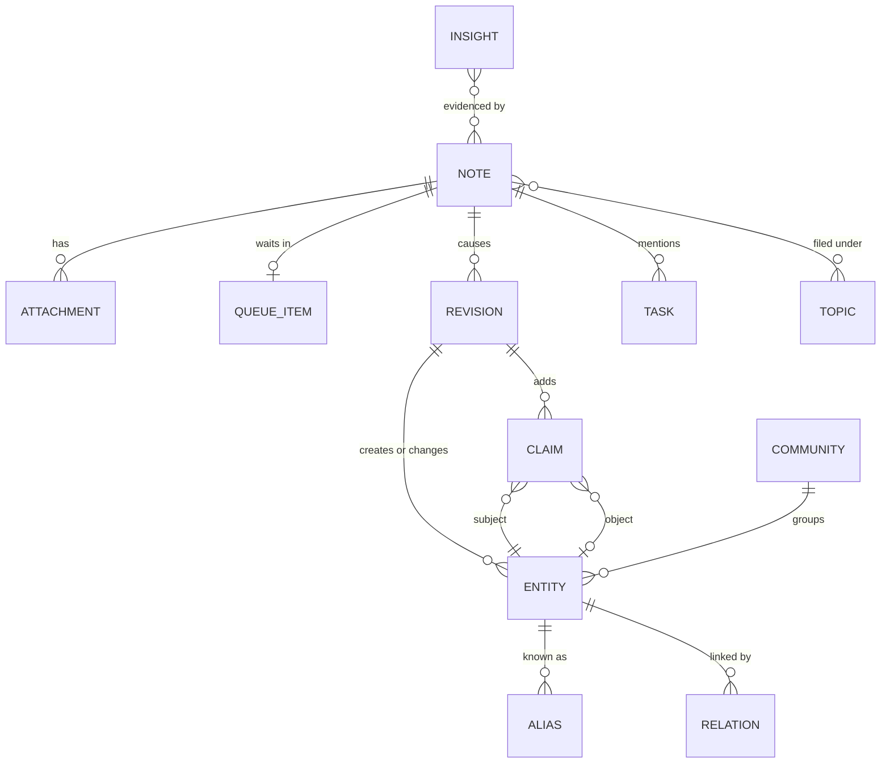

# Data model

This page defines the records AbstractNote keeps, how time works, how identities are assigned,
and how duplicates are handled. The Python types live in `abstractnote.model`; the SQLite schema
in `abstractnote.store.schema`; the AbstractMemory projection in `abstractnote.store.kg`.

## Overview



## Note

A note is anything you send: a sentence, a document, an image, a recording, a video, a log, a
chat turn imported from a transcript. It is the unit of provenance: every entity, claim and
revision points back to the note(s) that caused it.

| Field | Type | Meaning |
|---|---|---|
| `note_id` | `nt_<26 chars>` | Deterministic, base32 of a sha256. Imports: `sha256(importer, source_key)`. Live capture: `sha256(idempotency_key)` when the client sends one (clients always should; the runs API has no idempotency key of its own), otherwise `sha256(text_norm, attachment hashes, occurred_at to the minute, source.client)`. A retried request yields the same note; the same words said again on another day yield a new note that revisits the earlier one. |
| `kind` | enum | `idea`, `task`, `decision`, `fact`, `event`, `question`, `reflection`, `reference`, `log`, `conversation`, `personal`, `synthesis`, `insight`. Assigned by the quick filing step; `synthesis` and `insight` are system-authored. |
| `title` | text | Short title (model-written or taken from the source). |
| `text` | text | The note body as received (Markdown allowed). Never truncated. |
| `text_norm` | text | Whitespace-normalised, lower-cased copy used for hashing and full-text search. |
| `summary` | text | One to three sentences written by the processor. |
| `occurred_at` | ISO 8601 UTC | When the note was made or the event happened. From the client clock, the importer (message timestamp, file date, EXIF), the attachment's own metadata date for a capture that gives none, or an explicit value; moved only by a `note.redate` (see Time). |
| `date_basis`, `date_approximate` | read only | How `occurred_at` was found (`GET /note/notes/{id}`): the latest redate's basis (`content`, `user`), else the importer's `source.origin.date_basis` (docs/importers.md), else `client` for a live note and `unrecorded` for an older import; `date_approximate` is true for a stand-in date (`file_mtime`, `git_added`, `bulk_commit`, `store_updated`, `last_record`, `origin_session`, `front_matter_modified`, `unrecorded`), the ones a client offers to "Set the date". |
| `received_at` | ISO 8601 UTC | When AbstractNote stored it. |
| `processed_at` | ISO 8601 UTC or null | When the last successful revision was applied. |
| `source` | object | Provenance: `{client: web|watch|iphone|cli|agent|importer, importer?: claude-sessions|agora|markdown|files, origin: {...source-specific ids...}, author?: user id or agent name}`. |
| `location` | object or null | `{lat, lon, accuracy_m?, label?}` when the client provides one. |
| `language` | text or null | BCP-47 tag detected by the filing step. |
| `topics` | list | Categories assigned by filing and refined by processing (see Topics). |
| `priority` | int 0..3 | 3 urgent, 2 high, 1 normal, 0 bulk. |
| `status` | enum | `received`, `queued`, `processing`, `processed`, `failed`, `duplicate`, `archived`. |
| `duplicate_of` | note id or null | Set only when the same idempotency key or import source key arrives again (a retry), never for the same words on another occasion. |
| `session_id`, `run_id` | text | The gateway session and the AbstractRuntime run that captured it, when applicable (a capture inside a runtime step: the run of that step, read from the runtime, never passed by a flow or a model). A run id given by a caller with no step behind it (`capture(run_id=...)`, the optional `run_id` of `note_insight_write`, notes written before backlog 0037) is kept as a label only: it is never a source of what the note teaches (`ledger_seq` and `ledger_step_id` are null for it). Inside a runtime step a given run id must be the step's own run, or the write is refused. |
| `ledger_seq`, `ledger_step_id` | int, text, or null | The ledger row (`seq` of the step's STARTED record) and the step id of the `note_capture` tool step that captured it, when the runtime reported them; never invented (backlog 0037). Null for notes captured outside a run and for notes written before. |
| `body_artifact` | `{artifact_id, run_id?}` or null | The note body stored as an AbstractRuntime artifact of the capture run (tags `kind=note_body`, `note_id`), when the capture had an artifact store (inside the gateway, or `NoteRunner.local(..., artifact_store=...)`). Null for the CLI and importers, and for notes captured before (writing their bodies is the operator's one-time projection decision). Column `body_artifact_json`. |
| `archived_at` | ISO or null | Notes are archived, never deleted. |

### Attachment

| Field | Meaning |
|---|---|
| `attachment_id` | `at_<...>` deterministic from `(note_id, sha256)` |
| `sha256`, `size`, `mime`, `filename` | the bytes' identity |
| `artifact_ref` | the gateway artifact that carried it, when uploaded through the gateway |
| `blob_path` | `blobs/<sha256[:2]>/<sha256>`; stored once per distinct content across the notebook |
| `extracted_text`, `extracted_by` | text derived from the bytes (document text, transcript, image description, log excerpt, media metadata) and which extractor produced it (`plain`, `markdown`, `pdf`, `vision:<model>`, `stt:<model>`, `media-metadata`, `none`). Audio and video with a speech track are transcribed when a speech model is configured; otherwise, and for music, the filing keeps the metadata (filename, duration, tags) and the capture answer says so plainly. |

Two notes that attach the same file share one blob; the second attachment records the
relation `same_bytes_as` so the graph shows that the file came back.

## Entity

An entity is a thing the notes talk about: a person, an organisation, a project, a concept, a
place, an event, an artifact (a document, a dataset, a repository), a piece of software, or a
generic thing.

| Field | Meaning |
|---|---|
| `entity_id` | `ex:<kind>-<slug>` following AbstractFramework ADR 0025, the slug being the canonical name written in kebab-case ASCII (`ex:person-laurent-philippe-albou`). A collision with a different entity of the same kind appends `-2`, `-3`. Ids are never reused. |
| `kind` | `person`, `org`, `project`, `concept`, `place`, `event`, `artifact`, `software`, `thing` |
| `name` | the one canonical name, shown everywhere: Unicode NFKC, trimmed, case-folded, every run of whitespace, punctuation or underscores collapsed to one `_` (snake_case for several words), none at either end (`ids.canonical_name`: `Laurent-Philippe Albou` is `laurent_philippe_albou`; `Memory`, `memory` and `MEMORY.` are `memory`) |
| `name_key` | the lookup key of the name (`ids.name_key`, equal to the canonical name); unique among live entities, so a person never sees two entities that differ only by case, spacing or punctuation |
| `display_name` | the first surface form a note wrote (`Laurent-Philippe Albou`), kept for clients that want it; a rename replaces it |
| `aliases` | other names seen in notes, each stored with its surface form and its key (`alias_key`); shown once per canonical name and never the entity's own; exact matching is by key |
| `summary` | one model-written sentence saying what the notebook knows about it, rewritten when a note tells something new (each revision kept) |
| `first_seen`, `last_seen` | `occurred_at` of the first and latest note mentioning it |
| `note_count` | number of notes that mention it |
| `merged_into` | set when the model decided this entity is the same as another; the record stays so old links still resolve |
| `embedding` | vector of `name + aliases + summary`, refreshed when the summary changes |

Entities are created only by revisions. The id is minted from the canonical name of the name chosen
by the model at creation time; later renames add aliases and may change `name`, never the id.

One canonical name per entity is a deterministic guarantee, applied when a revision is applied
(`Notebook.apply_revision`, `abstractnote.store.names`): an `entity.create` whose canonical name a
live entity already has becomes a reuse of that entity, whatever the model decided. The surface forms
become its aliases, later ops of the revision follow it (an identical statement reinforces the
existing one, a statement linking the entity to itself is left out), the revision records a warning
(with `kind_conflict` when the kinds differ: the existing kind is kept, never a second entity), and
the stored revision is the rewritten one, so a replay agrees. A rename onto a canonical name another
live entity has is refused (that is a merge). Aliases never force a reuse: an alias is the model's
word for an entity, and only produces candidates. A mention name or alias that ends with one of the
entity kinds in parentheses (`memory (software)`) loses that suffix before its canonical name is
taken, with a warning (`names.strip_kind_suffix`): the linking packet once showed entities as
`name (kind)` and the model copied the form into names; it now shows `name — kind`. This is
structural (a known kind word in a fixed position), not a reading of the name.

Notebooks written before canonical names (schema 1) are upgraded on open: `name_key`, `display_name`
and `alias_key` are filled in, a later live entity whose canonical name an earlier one holds is marked
(`key_clash_with`), and the next processed note runs the repair, `Notebook.normalize_entities`
(`abstractnote normalize`, `POST /note/entities/normalize`): each group of live entities sharing a
canonical name is merged into its earliest entity, one `entity.merge` revision per merged entry with
source `{client, account}` (`migration` for the automatic run), the merged entry's names kept as
aliases. Reads follow merges, so its statements, relations, notes and tasks come with it; an unmerge
undoes it, and the separated entry takes the first free `<name>_2`, `<name>_3` so two live entities
never share a canonical name. A pair a person separated is never joined again by the repair. The
repair also joins the entries left by the `name (kind)` echo: a live entity whose surface form ends
with ` (<kind>)` and whose canonical name is `<name>_<kind>` is merged into the live entity named
`<name>` when there is one (the group lists it under `kind_suffix`; the echoed form is not kept as an
alias); an entry written as words (`contact person`) or whose plain name no entity has is left alone.

## Claim

A claim is one statement with time and provenance. Claims are the edges and attributes of the
graph.

| Field | Meaning |
|---|---|
| `claim_id` | `cl_<...>` deterministic from `(note_id, subject, predicate, object)`; predicate CURIEs keep their case in the index |
| `subject_id` | entity id |
| `predicate` | a CURIE from the AbstractSemantics registry when one fits (`schema:knowsAbout`, `schema:participant`, `skos:related`, `dcterms:references`, `cito:disagreesWith`, ...), otherwise `ex:<snake_case>` |
| `object_id` or `object_literal` | an entity, or a literal value (text, number, date) |
| `certainty` | `stated`, `probable`, `possible`, `reported`, `disputed` (tokens, not numbers) |
| `stance` | `assert`, `revise`, `retract`: what the note does to earlier knowledge |
| `observed_at` | the note's `occurred_at` |
| `valid_from`, `valid_until` | the validity window; `valid_from` defaults to `observed_at` for state claims and is null for timeless facts or for a statement that stopped before its note was written (`valid_until` earlier than the note); `valid_until` is set when a later note supersedes or retracts the claim, when the claim is an earlier belief placed before a later one (`claim.insert_before`: the later one's start), and equals `valid_from` when you retract it ("never true"); it is never earlier than `valid_from` |
| `status` | `active`, `superseded`, `retracted` |
| `superseded_by` | the claim that replaced it |
| `evidence` | the verbatim excerpt of the note that supports the claim |
| `note_id`, `revision_id` | provenance |
| `assertion_id` | the id of the same claim in the AbstractMemory store (equals `claim_id`) |

### Relation

A relation is a derived, fast-to-read summary of all claims between two entities:
`(subject_id, object_id, predicate) -> first_seen, last_seen, count, active_claim_ids`. The graph
view reads relations. The **relation timeline** (`/note/relations/{a}/{b}`) is first-class: all
claims between two entities in history order, with supersessions and a then-versus-now of the
relationship, so the evolution of a link is as visible as the evolution of a node.

## Revision

A revision is the append-only record of what one processed note did to the graph. It is the
authoritative history: replaying revisions in order rebuilds entities, claims, relations, topics
and tasks.

| Field | Meaning |
|---|---|
| `revision_id` | `rv_<...>` deterministic from `(note_id, attempt)`; user actions use `(action, target, occurred_at)` |
| `note_id` | the cause (null for a user action; then `source` names the client and account) |
| `applied_index`, `applied_kg` | flags set after each projection commits; recovery replays revisions whose flags are not both set (idempotent thanks to deterministic ids) |
| `at` | the note's `occurred_at` (history time) |
| `recorded_at` | when the processor applied it (system time) |
| `run_id` | an AbstractNote-local run id when one applies (a consolidation's `cs_<...>`); not the ledger address |
| `ledger` | `{run_id, seq?, step_id?}` or null: the AbstractRuntime tool step that applied it (for a processed note, the `note_apply_revision` step of the `note-process` run, whose STARTED ledger row holds the extraction and linking verbatim as the tool's arguments). Read from the runtime's step context when the caller passes none; `seq` only when the runtime reported it. Columns `ledger_run_id`, `ledger_seq`, `ledger_step_id` (backlog 0037). |
| `sources` | the note's own ledger sources when the revision was written (AbstractMemory `SourceRef` dicts: the capture `step` or `run`, the body `artifact`, each attachment's `artifact`), fixed on the row so a replay or a rebuild projects the same provenance. Column `sources_json`. |
| `ops` | ordered list of operations |
| `summary` | one sentence written by the processor ("Linked the LUT budget decision to Castor; superseded the earlier plan.") |

Operations:

| op | payload |
|---|---|
| `entity.create` | `{entity_id, kind, name, aliases, summary}` |
| `entity.alias` | `{entity_id, alias}` |
| `entity.rename` | `{entity_id, name, previous}` |
| `entity.summary` | `{entity_id, summary, previous}` |
| `entity.merge` | `{from_id, into_id, reason}` |
| `claim.add` | the claim |
| `claim.supersede` | `{claim_id, by_claim_id, reason, valid_until}` |
| `claim.retract` | `{claim_id, reason, valid_until?}` (without `valid_until`, the window closes at the revision's time) |
| `claim.reinforce` | `{claim_id, note_id}` (the same statement seen again) |
| `claim.insert_before` | `{claim_id, before_claim_id, valid_until, reason, after_claim_id?, after_valid_until?}`: the claim just added by this revision comes from a note older than `before_claim_id`, the belief it gives way to; it is closed at `valid_until` (that belief's start) and superseded by it, which stays untouched; `after_claim_id`, the belief before it, now ends at `after_valid_until` (this claim's start) and is superseded by it (see Time) |
| `topic.assign` | `{note_id, topic}` (stored under the topic's canonical name; processing keeps the first 3 per note) |
| `topic.unassign` | `{note_id, topic}`: the note leaves the topic as stored (`abstractnote normalize-topics`) |
| `task.open` / `task.close` / `task.drop` | `{task_id, text, due?, by_note_id?}` |
| `entity.unmerge` | `{entity_id, from_id, reason}` (a user action; re-points the claims that came from `from_id`) |
| `entity.mention` | `{entity_id, note_id}` (the note talks about the entity; drives `note_count`, `first_seen`, `last_seen`) |
| `note.summary` | `{note_id, summary, kind, language}` |
| `note.archive` | `{note_id, duplicate_of?, reason?}`: the note is archived (it leaves lists, search and the queue, keeps its links) and names the copy it duplicates (`abstractnote dedupe-sources`) |
| `note.redate` | `{note_id, from, to, basis, quote?, reason?}`: the note moves in history time (`basis` `content` when its text states its date, `user` when a person sets it); its mentions, its topics' ranges, its queue place, and the statements and tasks it wrote with the old date move with it; `source.redated` keeps `{basis, from, to, revision_id}` |

User actions (`close a task`, `retract a claim`, `undo a merge`, `confirm a match`) produce revisions with
`source = {client, account}` and no note; they are the human side of an actionable graph. Through
the gateway, `account` is the signed-in user and `client` is `web` (the Note web app) or `api`
(any other caller), decided by the server, never by the request body.

Confirming a match from the review list (`POST /note/review/{id}/confirm`) is a revision with `action =
match.confirm` and `target` = the review id: for a close match (an `unsure` decision, recorded as a `skos:closeMatch`
claim from the new entry to the candidate) its ops are `entity.merge` (the new entry into the candidate) and
`claim.supersede` of the close-match claim; for a merge the processor made it has no ops and only records that you
keep it. Revisions are the truth, so a rebuild keeps what you confirmed.

Reversibility: a merge keeps both records and can be undone by a later revision that re-points
claims; a supersession keeps the old claim with its window closed.

## Topic

A topic is a lightweight category (`#lut`, `#release`, `#family`). The filing step chooses from
existing topics first and proposes new ones sparingly; the processor may refine. Topics are
flat; entities carry the structure.

A topic is stored under its canonical name (the entity rule: `Bug-Fix`, `bug fix` and `bug_fix` are
`bug_fix`), and processing keeps the first 3 topics the model lists for a note (`TOPICS_PER_NOTE`; a
user revision is not capped); the others are named, never dropped silently (ADR 0007): the revision's result
lists them under `topics_not_assigned`, its warnings and its summary say which were not kept. Quick filing keeps
4 (`MAX_FILING_TOPICS`) and names the rest in `note_file`'s `topics_not_assigned`. The extraction packet lists the 50 most used topics. Topics stored before
that keep their spelling until `abstractnote normalize-topics --notebook DIR [--dry-run]` gives each
group one name in ONE revision (`topic.unassign` + `topic.assign`): the same canonical name (case,
`-`, `_` and whitespace). That is spelling, not meaning: no word rule decides that two topics are one
(ADR 0004), so `bug_fixes` and `bug_fix`, or `gateway` and `abstractgateway`, stay two topics. Search and
note lists filter by a topic's given and canonical spelling.

## Task

Open loops extracted from notes: `{task_id, note_id, text, status open|done|dropped, due?,
closed_by_note_id?}`; `task_id` is `tk_<...>` deterministic from `(note_id, normalised text)`. A later note that reports the task done closes it with a `task.close` op,
decided by the model during processing, applied only when the linking quotes the note's own words that say it is
done (`evidence`, a whole-word sequence of the note) and the note is not older than the task; otherwise the open task
stays open and the note's task is its own (opened, and closed when reported done), with a warning. So no task closes
before it opened.

## Insight

System-authored notes with `kind = insight` or `synthesis`: dossiers from deep recall and the
findings of the reflect flow (open loops, contradictions, resurfaced material, connections).
They carry `evidence_note_ids`, `entity_ids`, `insight_kind` (`warning`, `reminder`,
`connection`, `contradiction`, `evolution`, `dossier`, `cue`) and `acked_at`. Cue cards are the
unacknowledged insights other than dossiers, newest first.

## Community

A community is a group of entities the notes keep bringing together (a project and its people, a set
of tools, a theme), found by `abstractnote.recall.communities` without a model and named by one. They
make a large graph readable: the explorer colours nodes by community, and the statistics count them.

| Field | Meaning |
|---|---|
| `community_id` | `cm_<20 chars>`, a hash of the sorted member entity ids when the community first appeared; kept while its membership changes little (below) |
| `label`, `summary`, `kind` | the model's name (at most 4 words), one sentence on what holds the group together, and `project`, `theme`, `people`, `tooling`, `process` or `other`; null until the reflect flow labels it |
| `size`, `top_entities` | member count and the 5 members with the most notes |
| `created_at`, `labelled_at` | when it first appeared, when it was last labelled |
| `stale_label` | the label is kept but more than 20 % of the membership changed since it was labelled: the next reflect run names it again |
| `revision_count_at_compute` | applied revisions when detection last ran; `GET /note/communities` reports `revisions_since` |

Detection is Louvain (`networkx`, fixed seed, resolution 1.0 by default) over the live entities,
deterministic for a given networkx version: the same graph under the same networkx release gives the
same communities, but another release may split it differently, so `meta.communities` records the
`networkx` version of each computation (`GET /note/communities` reports it) and the dependency is
capped below the first release that changes the partition (`networkx>=3.2,<3.7`; 3.4 and 3.6 were tested, 3.7 differs);
the weight of a pair is the number of its statements that were not retracted (merged entries count
for their survivor) plus a co-mention weight: each note that mentions `k >= 2` live entities adds
`1/((k-1)·log2 k)` to every pair among them, so a long note weighs `k/(2·log2 k)` in all rather than
`k/2` (docs/cognition.md, note-reflect). Groups of fewer than 3 entities are the **loose ends**
and belong to no community. A recomputation matches each new group to the previous community it
overlaps most (Jaccard of the member sets, best overlaps first, each previous community used once):
an overlap of at least 0.6 keeps the id, label, summary and kind; anything else is a new community
with a new id and no label. Once after the networkx version changed (or after a computation that
recorded none), the floor is 0.5, and a labelled previous community that still matches nothing hands
its label, marked stale, to the unmatched new group it overlaps most (a new id); the recompute
response lists those labels under `carry_over` (`kept`, `stale`, and `dropped` for a label no new
group overlaps), so a library upgrade never loses a label silently. Tables `communities` and `entity_communities` (one row per member) are
derived, but because the labels are model work, `rebuild` keeps them (`schema.KEPT_TABLES`). A
notebook opened without its embedding model reads communities and refuses to recompute or label.

A community's label longer than 4 words is kept whole with an `over_length` warning (ADR 0007).

## Consolidation run

Table `consolidation_runs` (kept by `rebuild`) holds one row per memory consolidation (docs/cognition.md,
note-consolidate); the open row has no `finished_at`. `status` is `running`, `completed` (nothing was left out),
`completed_with_gaps` (the run finished its stages but left items for the next one), `failed` (`error` is the
step's sentence) or `interrupted` (it stopped before closing). `stages_json` holds per stage `{done, total,
seconds_per_item, started_at, skipped?, reason?, reasons?, skipped_ids?: [{id, reason}]}`: `skipped_ids` are the
entries or groups the stage skipped for this run after the model left them unanswered twice. `results_json`
holds the counts and, for a finished run, `left_out: {summaries, labels, reasons}` (skipped items still pending
at the close plus what the time budget did not reach, never more than pending) and `budget_spent`.
`offered_json` lists the entries the run already offered (never offered twice in a run), `touched_json` the
entries it merged into or summarised. A summary longer than 600 characters is kept whole with an `over_length`
warning in its revision (ADR 0007).

## Time

AbstractNote is bitemporal, and every note carries three dates that answer three different questions. In
AbstractMemory's vocabulary (its ADR 0003 decision 5) the three axes are **event time** (the validity window,
read with `active_at`), **observation time** (`observed_at`, the note's date, read with `as_of`) and **record
time** (`recorded_at`, when the mind learned it, read with `as_recorded`, the as-received view); the table names
the AbstractNote fields of each:

| Date | Field | Question it answers |
|---|---|---|
| Authored (history time; AbstractMemory: observation time) | `occurred_at`, `claim.observed_at`, `revision.at` | "When was this written or did it happen?" "What did the graph look like on day X?" |
| Valid (AbstractMemory: event time) | `claim.valid_from`, `claim.valid_until` | "What did I believe about X at time T?" |
| Archive-accepted (system time; AbstractMemory: record time) | `received_at` (and `processed_at`, `revision.recorded_at`) | "What did my archive hold on date R?" "What has the processor done since I last looked?" |

The axes are independent: an import received today can hold notes authored years ago, and a note
written in January can say something stopped being true in March.

Rules:

- The archive **as received at R** (`as_received=R` on `GET /note/graph`, `GET /note/entities/{id}`,
  `GET /note/changes` and `GET /note/day/{date}`) = only the notes with `received_at <= R`, so material
  imported later is left out even when it was authored earlier. What derives from notes follows them: a
  revision belongs when the note that caused it was received by R (a user action without a note: when it was
  recorded by R); entities exist when such a revision created them or such a note mentions them; merges,
  names, aliases, summaries and the closing of claims count only when their revision belongs, so a claim a
  later note superseded reads as it stood before. `at` and `as_received` compose: "the graph as of T, from
  what the archive held on R".
- The graph **as of T** = entities first seen at or before T (their creating revision's `at`, or an
  earlier note that mentions them when notes are processed out of history order), not merged away
  by T; edges from claims with `observed_at <= T`.
- **Beliefs at T** = claims with `valid_from <= T` and (`valid_until` is null or `> T`).
- Supersession sets `valid_until` of the old claim to the `occurred_at` of the superseding note;
  so does a note whose stance is `retract`.
- A retraction you make (`POST /note/claims/{id}/retract`) says the claim was never true: its
  status becomes `retracted` and `valid_until = valid_from` (its `observed_at` when it has no
  start), an empty window, never the moment you said so. Retracted claims are never beliefs.
- Importers set `occurred_at` from the source (message timestamp, commit date, file date);
  `received_at` is always the ingest time, so an import is visible as a system-time event while
  history stays truthful.
- Explicit time references inside a note ("last Tuesday", "in 2024") are extracted as claims with
  literal dates when the model can resolve them from the note's own `occurred_at`; they never
  move the note itself. Only the date the text gives ITSELF can (below).

### Retrospective insertion

Notes and archives from earlier dates (and other projects that name known entities) keep arriving into a graph
built from later ones, while live notes arrive too. History adapts; nothing is rewritten in place except windows:

- **Beliefs in history order.** Supersession and contradiction are applied with regard to time. For a statement
  `C_new` (its note's `occurred_at` = `t_new`) that the linking says supersedes an existing `C_old` (`observed_at`
  = `t_old`), on the same resolved subject and predicate:
  - `t_new >= t_old`: as always, `C_old` closes at `t_new` (`claim.supersede`, or `claim.retract` for a
    `retract` stance).
  - `t_new < t_old`: an older note never closes a later belief. `C_new` is inserted as the EARLIER belief
    (`claim.add` + `claim.insert_before`): placed in its interval of the supersession lineage of `C_old` (the
    claims linked to it by `superseded_by`, same subject and predicate, retracted ones left out), it ends at the
    start of the next later belief and is superseded by it; the belief before it, if its window covered `t_new`,
    now ends at `t_new` and is superseded by `C_new`. Out of order 2026, then 2022, then 2024: 2022 holds
    [2022, 2024), 2024 holds [2024, 2026), 2026 is the active belief.
  - `contradicts` with `t_new < t_old` is the earlier belief the same way, unless the model marked the statement
    `disputed` and the two dates are at most 30 days apart: then it is a dispute (both kept, marked disputed).
  - A window never ends before it starts: a closing date earlier than the closed claim's `valid_from` closes it
    empty (at `valid_from`), in the builder (so the note index and AbstractMemory agree) and again in the
    projection (for replays of earlier revisions); an extracted end before an extracted start is ignored.
- **Tasks**: an older note cannot close a task opened later; a later note can (see Task).
- **Entities**: `first_seen` moves back to the older note (it is the earliest mention); the graph as of T shows
  the entity from then.
- **Retrospective marks** (`meta.retro`, written in the projection transaction): a note that mentions an entity
  already seen more than a day later (live notes a few minutes out of order are not), a `claim.insert_before` (its subject, object and neighbours) or a `note.redate`
  marks the entities: their summaries are stale (until a summary recorded after the mark is the current one, the
  consolidation's refresh), their then-versus-now cards are dropped, `graph_version` is bumped and the event is
  logged. `Notebook.retro_state()` reports `{graph_version, insertions, stale_summaries, retro_notes_since_communities,
  communities_due}` (due after 20 retrospective notes since the communities were last computed);
  `Notebook.after_retro_insert(entity_ids)` records one by hand. The revision result lists `retrospective` (the
  marked entities) and `claims_inserted_before`.
- **History order everywhere history is shown**: timelines, then-versus-now and relation timelines order by
  `occurred_at`/`observed_at` and end a superseded belief at its `valid_until` (not when the closing revision was
  applied); new entities are counted where they were first seen. `GET /note/changes` stays in system time.

### Document dates

A note's date can be a stand-in: a file's modification time, a commit, a session start, a store update. When the
date basis is approximate (`date_approximate`), the extraction header says so and the model may give
`document_date` `{iso, basis: "stated in the text", quote}`: the date the text gives itself (a dated letter, a
report's date line). At apply time it is used only when the quote is the note's own words (a whole-word sequence),
the date is not in the future and it differs from `occurred_at` by more than a day: the revision's first op is
`note.redate {from, to, basis: "content", quote}`, and the revision, its statements (`observed_at`, `valid_from`)
and its mentions carry the stated date; the basis becomes `content`. A live note (basis `client`) or a note with an
exact basis (`record`, `message`, `front_matter`, `exif`, `pdf_created` ...) is never redated from its text.

A person can set the date: `POST /note/notes/{id}/redate {occurred_at, reason}` is a user revision (`action
note.redate`, source `{client, account}`) with one `note.redate` op, basis `user`. Its mentions, statements and
tasks that carried the old date move in the note index; AbstractMemory keeps the statements' original
`observed_at` and `valid_from` (its content is append-only), so a person's redate of an already-understood note is
reflected in the note index and the graph views, and in the triple store only through later revisions.

## Identity and de-duplication

| Level | Mechanism | Outcome |
|---|---|---|
| Bytes | `sha256` of attachment content | one blob per content; later attachments link to it |
| Retry | same idempotency key (live) or source key (import) | same `note_id`, status `duplicate`, nothing else written |
| Same words again | exact `text_norm` hash equal to an earlier note | a new note; the earlier one is the strongest `ex:revisits` candidate; the answer says "you noted this on <date>" |
| Near-duplicate note | vector cosine over note embeddings, threshold 0.92 | kept as a distinct note, linked with `ex:revisits` to the earlier one: a revisit is a signal, not noise |
| Same canonical name | `name_key` of the mention's name equal to a live entity's: deterministic normalisation (case, spacing, punctuation, NFKC), not an identity judgement | always the first candidate; a create of that name is filed under the existing entity at apply time (warning, `kind_conflict` when the kinds differ); older notebooks repaired by `normalize_entities` |
| Entity | candidates from exact key match on names and aliases (`name_key`, `alias_key`), full-text on name and aliases, vector k-nearest on entity embeddings; the model decides `same`, `different`, `unsure` per mention and may propose a merge of two existing entities (`Gateway` versus `abstractgateway` is this level) | `entity.create`, `entity.alias`, `entity.merge` ops |
| Model merge (guard) | a proposed merge is applied only when the two entities have the same kind, share a name or alias key, the merged entry has fewer than 5 notes and neither was merged earlier in the same note (no chains); structural checks, never a reading of the names | otherwise a `skos:closeMatch` claim from the entry to merge to the other: a review item ("kept for review"), confirmed by a person |
| Values are not entities | a mention whose whole name is a bare number, a version (`0.9.0`, `v15`), a message or thread id (`c1234`, `dm#7`, `dm:a--b`), a link, an invite or hash token, or one word of the editable list `abstractnote/process/generic_words.txt` (`time`, `model`, `provider`, `triggers` ...): shape checks and an explicit list (operator ruling 2026-10-20), never a reading of meaning | never an entity: its statements keep it as a literal object (a statement whose subject it is is left out), with a warning |
| Claim | same `(subject, predicate, object)` after resolution | `claim.reinforce` instead of a new claim |
| Conflicting claim | same `(subject, predicate)` with a different object and the model marks the predicate single-valued, or the note's stance is `revise` or `retract`; a `supersedes` or `contradicts` naming a statement on another resolved subject or predicate is refused (a new statement, with a warning) | `claim.supersede` or `claim.retract` with reason, or `claim.insert_before` when the note is older (Time); history kept |

No regular-expression or keyword heuristics decide identity. Deterministic steps only produce
candidates, exact-hash matches and the canonical name key (ADR 0004, amended).

## AbstractMemory projection

Every claim is written to the AbstractMemory store as a `TripleAssertion`:

| TripleAssertion field | Value |
|---|---|
| `assertion_id` | `claim_id` |
| `subject`, `predicate`, `object` | entity ids and predicate CURIE; literal objects marked with `attributes.literal = true` so case is preserved |
| `scope`, `owner_id` | `global`, `abstractnote` |
| `observed_at` | the claim's `observed_at` (note time) |
| `valid_from`, `valid_until` | the claim's window |
| `confidence` | mapped from certainty: stated 0.9, probable 0.7, possible 0.5, reported 0.6, disputed 0.3 |
| `provenance` | AbstractMemory's provenance shape (its ADR 0003, `abstractmemory.graph.Provenance`; see "Ledger provenance" below) |
| `attributes` | `{subject_type, object_type, certainty, stance, literal?, evidence_quote?, abstractnote_kind}` (`abstractnote_kind` is `claim`, `name`, `alias` or `same_as`) |

Entity names and aliases are written as `(entity_id, schema:name, "Name")` and
`(entity_id, skos:altLabel, "Alias")`; merges as `(from_id, schema:sameAs, into_id)`. Supersession
closes the old assertion in place with `close_assertion(assertion_id, valid_until)`, an additive
AbstractMemory store method introduced for this purpose (it updates `valid_until` only when it is
still open and leaves everything else untouched), and records a journal
`ClosureRecord(kind="supersede")` so both `TripleQuery(active_at=...)` and ranked retrieval agree
with the note index. A `claim.insert_before` closes the OLDER copy the same way (never the later belief), and moves
the window of the belief before it back with AbstractMemory's public `narrow_assertion(assertion_id, valid_until)`
(`valid_until` only, earlier only, refusing an open window or a widening; with its own closure record;
AbstractMemory 0.4.0, backlog 0034). AbstractMemory lowercases subjects, predicates and objects that are not
literals; the note index keeps the original case, and every AbstractMemory query from AbstractNote
passes `owner_id="abstractnote"`.

Write order for one revision: the revision row (intent) first, then the index projection (one
transaction that also sets `applied_index`), then the AbstractMemory projection, then `applied_kg`.
A revision whose index projection raises is set aside (nothing applied) instead of replayed. Embeddings are computed once in the
note index and handed to the triple store, so a rebuild never re-embeds over the network unless
`rebuild --reembed` is requested (for example after the embedding model changed; the pin is shown
by `GET /note/status`).

Store: `SQLiteTripleStore` at `<plane>/abstractnote/kg.sqlite3` with the notebook's embedder
(the gateway's embedding route inside a gateway; headless, the OpenAI-compatible model given on
the command line or the built-in hashing embedder; vectors are pinned to that embedding space and
handed over from the note index) and a `SQLiteJournal` in the same file (tables `memj_*`). A
notebook opened without the embedder it is pinned to opens read-only: reads and word-only search
work, and anything that would write or embed refuses with a plain sentence. A retraction (user
action or a note's `retract` stance) closes the assertion
the same way with `ClosureRecord(kind="retract")`; an undone merge closes its `schema:sameAs`.

### Ledger provenance

Every projected assertion (claims, names, aliases, merges) and every journal closure carries the provenance shape
of AbstractMemory ADR 0003 (decisions 8-11), so `abstractmemory.graph.Provenance.from_dict` reads it unchanged:

```
{"sources": [SourceRef, ...],      # the revision's ledger step, then the note's sources (below)
 "derived_from": [],
 "actor": "abstractnote",
 "reader": "<provider/model>" | null,   # when the revision's source names the model; no flow passes it yet
 "reason": null,
 "extra": {"revision_id", "recorded_at", "note_id"?, "evidence_quote"?, "step_id"?, "valid_until"?,
           "run_id"?, "note_run_id"?}}       # the last two: bare run ids, labels only
```

`sources` lists, without repeats: the step that applied the revision (`{"kind": "step", run_id, seq, step_id}`
when the runtime reported the ledger row, else `{"kind": "run", run_id}` with the step id in `extra.step_id`),
the step that captured the note, the note body's artifact and each attachment's artifact (`{"kind":
"artifact", artifact_id, run_id?}`). A closure's `extra` names the closing revision and the window's new end
(`valid_until`). Only an address that names its step (a `seq` or a `step_id`, as the
runtime's step context always does) is a source: a bare run id, given by a caller or written before, is a label,
carried in `extra.run_id` (the revision's) or `extra.note_run_id` (its note's) and never in `sources`. A
revision written outside any run, about a note captured outside any run without an artifact store (the CLI, an
importer, a test), names no source; nothing is invented for it. Neither does a person's correction from the web
(retract, redate, unmerge, confirm, task close: `POST /note/...` routes that write the notebook directly, outside
any runtime step): its assertions and closures carry `actor: "abstractnote"` and `extra.revision_id`, whose
revision row names the action and `source = {client, account}`, and no source (backlog 0033 phase 2). Revisions and notes written
before this change carry none either (their grounding is the operator's one-time projection, backlog 0033).
In AbstractMemory's terms `sources[*].key()` is `step:<run_id>#<seq>`, `run:<run_id>` or `artifact:<id>`; the
runtime's `LedgerStore.get_record(run_id, seq)` returns the row a `step` ref names.

An existing `kg.sqlite3` keeps the earlier flat provenance (`{source: "abstractnote", note_id, revision_id, ...}`)
on the assertions it already holds until `rebuild()`, which rewrites them in this shape with empty `sources`
(their revisions named no step); phase 2 adopts them with an `import`/`migration` revision (backlog 0033).

Transitional (backlog 0033): AbstractNote still writes this projection to its own `kg.sqlite3`. Phase 2 moves it
onto AbstractMemory's `MemoryGraph.apply_revision` through the gateway, into the plane's one mind (AbstractMemory
ADR 0003 decisions 1-3), where this shape is required (`ProvenanceRequired` for a write that names neither a
source nor a memory it was derived from).
